# Salesforce Sales Extension - Architecture Documentation

**Version:** 2.0.15
**Java Version:** Java 21
**Salesforce API:** REST API v58.0+
**Last Updated:** 2025-11-27

---

## Table of Contents

1. [Architecture Overview](#architecture-overview)
2. [5-Layer Architecture](#5-layer-architecture)
3. [Component Diagrams](#component-diagrams)
4. [Data Flow](#data-flow)
5. [Authentication Flow](#authentication-flow)
6. [Error Handling Architecture](#error-handling-architecture)
7. [Performance Characteristics](#performance-characteristics)
8. [Scalability and Limitations](#scalability-and-limitations)
9. [Security Architecture](#security-architecture)
10. [Deployment Architecture](#deployment-architecture)

---

## Architecture Overview

The Salesforce Sales Extension follows a **5-layer architecture** pattern that provides clear separation of concerns, testability, and maintainability. The extension integrates Krista with Salesforce Sales Cloud using OAuth 2.0 authentication and REST API v58.0+.

### Key Architectural Principles

- **Separation of Concerns**: Each layer has a distinct responsibility
- **Dependency Injection**: All components use constructor injection for testability
- **Interface-Based Design**: Service layer uses interfaces for abstraction
- **Immutability**: Preference for immutable data structures
- **Fail-Safe**: Graceful error handling with user-friendly messages
- **Stateless**: No session state maintained in extension components

### Technology Stack

| Component | Technology |
|-----------|-----------|
| Language | Java 21 |
| Framework | Krista Extension SDK |
| Dependency Injection | JSR-330 (javax.inject) |
| HTTP Client | Apache HttpClient |
| JSON Processing | Jackson |
| OAuth 2.0 | ScribeJava |
| Logging | SLF4J + Logback |
| Build Tool | Gradle |

---

## 5-Layer Architecture

The extension is organized into 5 distinct layers, each with specific responsibilities:

```
┌─────────────────────────────────────────────────────────────┐
│                    Layer 1: Extension Entry Point            │
│  SalesforceSalesExtension, SalesforceSalesAttributes        │
└─────────────────────────────────────────────────────────────┘
                              ↓
┌─────────────────────────────────────────────────────────────┐
│              Layer 2: Catalog Request Areas                  │
│  OpportunityManagementArea, LeadsManagementArea, etc.       │
└─────────────────────────────────────────────────────────────┘
                              ↓
┌─────────────────────────────────────────────────────────────┐
│           Layer 3: Service Interfaces (DAO Layer)            │
│  OpportunityDao, LeadDao, QuoteDao, SOQLDao, etc.           │
└─────────────────────────────────────────────────────────────┘
                              ↓
┌─────────────────────────────────────────────────────────────┐
│    Layer 4: Implementation & Integration                     │
│  SalesforceManager, SalesforceTokenProvider, *DaoImpl       │
└─────────────────────────────────────────────────────────────┘
                              ↓
┌─────────────────────────────────────────────────────────────┐
│              Layer 5: Model & Entity Layer                   │
│  SF* Models, Catalog Entities, Converters                   │
└─────────────────────────────────────────────────────────────┘
```

### Layer 1: Extension Entry Point

**Package:** `app.krista.extensions.crm.sales.salesforce_sales`

**Components:**
- `SalesforceSalesExtension` - Main extension class
- `SalesforceSalesAttributes` - Configuration holder
- `SalesforceSalesRequestAuthenticator` - Request authentication handler

**Responsibilities:**
- Extension lifecycle management (initialization, validation, updates)
- Configuration attribute management and validation
- Request authenticator provisioning
- Custom tabs registration
- Connection testing

**Key Annotations:**
- `@Extension` - Marks the extension entry point
- `@Field.*` - Defines configuration attributes
- `@InvokerRequest` - Handles extension lifecycle events

**Configuration Attributes:**
| Attribute | Type | Required | Description |
|-----------|------|----------|-------------|
| clientId | Text | Yes | OAuth 2.0 Client ID |
| clientSecret | Text (Secured) | Yes | OAuth 2.0 Client Secret |
| Instance URL | Text | No | Salesforce instance URL |
| username | Text | No | Service account username |
| password | Text (Secured) | No | Service account password |
| securityToken | Text (Secured) | No | Security token |
| sandbox | Boolean | No | Use sandbox environment |
| timezone | Text | No | Timezone for operations |

### Layer 2: Catalog Request Areas

**Package:** `app.krista.extensions.crm.sales.salesforce_sales.catalog`

**Functional Areas (11 total):**

1. **OpportunityManagementArea** - 7 catalog requests
   - Get Opportunities, Update Opportunity Status, Update An Opportunity
   - Get My Details, Opportunity Change Alert, Get Latest Posts

2. **LeadsManagementArea** - 2 catalog requests
   - Get Leads, Lead Change Alert

3. **QuoteManagementArea** - 6 catalog requests
   - Get All Quote Status, Update Quote, Add Product To Quote
   - Get Quote Details, Get Quote Line Items

4. **AssetsManagementArea** - 2 catalog requests
   - Delete An Asset, Update An Asset

5. **TaskManagementArea** - 2 catalog requests
   - Get Task Statuses, Task Change Alert

6. **AccountsManagementArea** - 1 catalog request
   - Account Change Alert

7. **ActionsArea** - 2 catalog requests
   - Send A Mail, Send Verification Mail

8. **ReportingArea** - 5 catalog requests
   - Process Query Request, Process Query Request Async
   - Get Results, YTD Sales Revenue Closed, Sales Quota

9. **ForecastingArea** - 1 catalog request
   - Get Sales Forecast For A Specific Quarter

10. **WeeklySummaryArea** - 2 catalog requests
    - Get Revenue Closed, Get Revenue Expected To Close

11. **ContentArea** - 1 catalog request
    - Retrieve Custom Fields For Given Object

**Responsibilities:**
- Expose catalog requests to Krista
- Input parameter validation
- Business logic orchestration
- Error handling and user-friendly messages
- Coordinate between multiple DAOs

**Key Annotations:**
- `@Domain` - Defines the functional domain
- `@CatalogRequest` - Marks catalog request methods
- `@Field.*` - Defines input/output parameters

### Layer 3: Service Interfaces (DAO Layer)

**Package:** `app.krista.extensions.crm.sales.salesforce_sales.service`

**Service Interfaces:**
- `OpportunityDao` - Opportunity operations
- `LeadDao` - Lead operations
- `QuoteDao` - Quote operations
- `AssetDao` - Asset operations
- `TaskDao` - Task operations
- `AccountDao` - Account operations
- `UserDao` - User operations
- `EventDao` - Event operations
- `PriceBookDao` - Pricebook operations
- `PriceBookEntryDao` - Pricebook entry operations
- `SOQLDao` - Generic SOQL query execution
- `SalesPipelineSummaryDao` - Pipeline summary operations

**Responsibilities:**
- Define contracts for data access operations
- Provide abstraction over Salesforce API
- Enable testability through interface-based design
- Support dependency injection

**Design Pattern:** Repository Pattern

### Layer 4: Implementation & Integration

**Package:** `app.krista.extensions.crm.sales.salesforce_sales.impl`

**Core Components:**

#### SalesforceManager
Central component for Salesforce API interactions.

**Responsibilities:**
- HTTP request execution to Salesforce REST API
- Request signing with OAuth tokens
- Response parsing and error handling
- CRUD operations (create, read, update, delete)
- SOQL query execution
- Email sending

**Key Methods:**
- `executeRequest(HttpRequest, SalesforceTokenProvider)` - Execute HTTP request
- `create(String objectType, Map<String, Object> fields)` - Create record
- `update(String objectType, String recordId, Map<String, Object> fields)` - Update record
- `delete(String objectType, String recordId)` - Delete record
- `query(String soqlQuery)` - Execute SOQL query
- `sendEmail(String[] toAddresses, String subject, String body)` - Send email

#### SalesforceTokenProvider
Manages OAuth 2.0 token lifecycle.

**Responsibilities:**
- OAuth 2.0 token acquisition (Authorization Code and Username-Password flows)
- Token refresh mechanism
- Refresh token storage and retrieval
- User vs admin authentication handling
- MustAuthorizeException triggering for re-authentication

**Key Methods:**
- `getSalesforceTokenForUser()` - Get token for user
- `getSalesforceTokenForAdmin()` - Get token for admin
- `refreshToken(String refreshToken)` - Refresh expired token
- `storeRefreshToken(String userId, String refreshToken)` - Store refresh token

#### DAO Implementations
Concrete implementations of service interfaces.

**Pattern:** Each DAO implementation:
1. Injects SalesforceManager
2. Constructs SOQL queries
3. Executes queries via SalesforceManager
4. Transforms SF models to catalog entities
5. Handles errors gracefully

**Examples:**
- `OpportunityDaoImpl` - Opportunity CRUD, revenue calculations
- `LeadDaoImpl` - Lead retrieval and filtering
- `QuoteDaoImpl` - Quote management, line items
- `SOQLDaoImpl` - Generic query execution

### Layer 5: Model & Entity Layer

**Package:** `app.krista.extensions.crm.sales.salesforce_sales.model`
**Package:** `app.krista.extensions.crm.sales.salesforce_sales.catalog.entities`

**Components:**

#### SF* Models (Salesforce API Response Models)
- `SFOpportunity`, `SFLead`, `SFQuote`, `SFAsset`, `SFTask`, `SFAccount`, `SFUser`, `SFEvent`, `SFPricebookEntry`
- Direct mapping to Salesforce API JSON responses
- Used for deserialization

#### Catalog Entities
- `Opportunity`, `Lead`, `Quote`, `Asset`, `Task`, `Account`, `User`, `Event`, `PricebookEntry`, `LatestPosts`, `SalesPipelineSummary`
- Krista catalog type definitions
- Annotated with `@Entity`
- Primary key: "Id"
- supportStore: false

#### Catalog Type Converters
- `OpportunityCatalogType`, `LeadCatalogType`, `QuoteCatalogType`, etc.
- Transform SF models to catalog entities
- Handle data type conversions (dates, numbers, booleans)

#### Service Implementations
- `OpportunityImpl`, `LeadImpl`, `QuoteImpl`, etc.
- Wrap SF models with business logic
- Implement service interfaces

**Transformation Flow:**
```
Salesforce API JSON → SF* Model → Service Implementation → Catalog Entity
```

---

## Component Diagrams

### High-Level Component Diagram

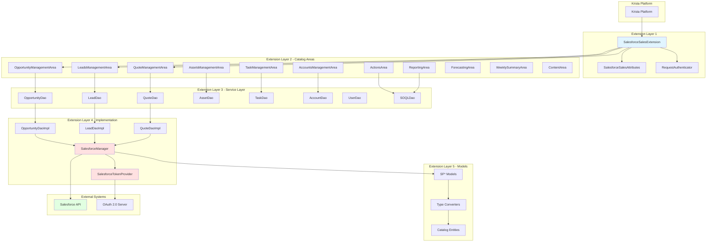

---

## Data Flow

### Request Processing Flow

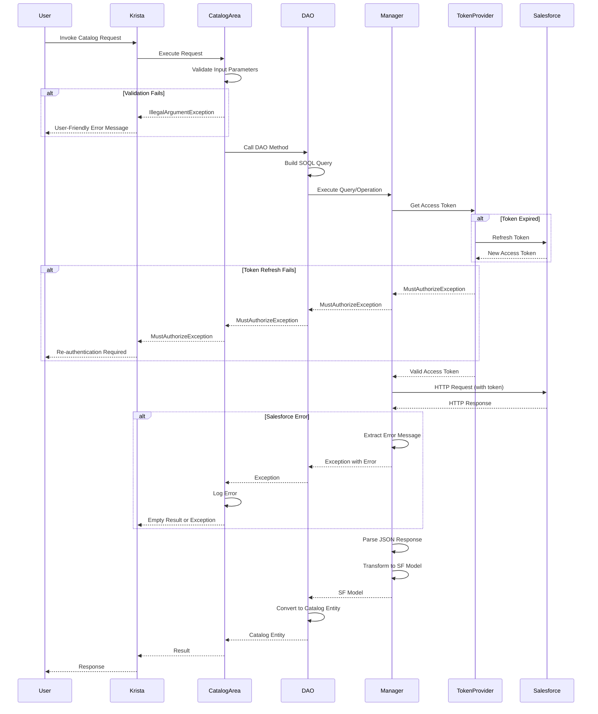

### Query Execution Flow

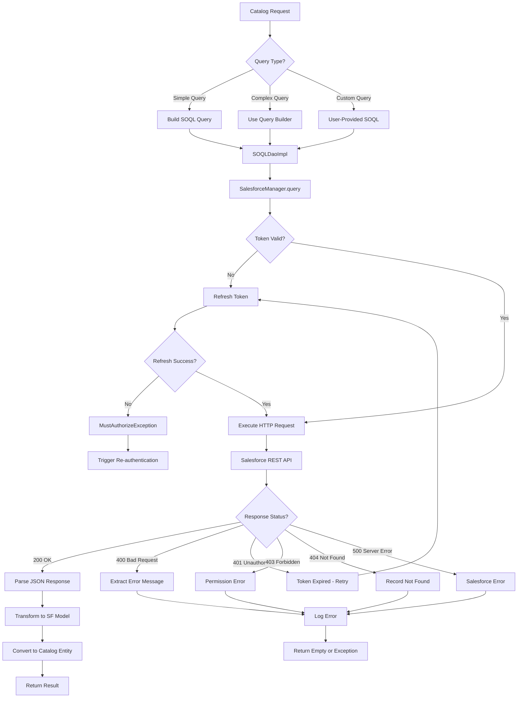

### CRUD Operation Flow

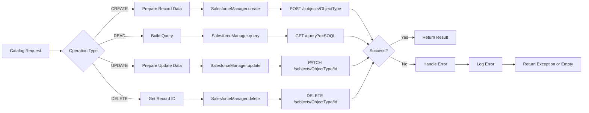

---


## Authentication Flow

### OAuth 2.0 Authorization Code Flow (User Authentication)

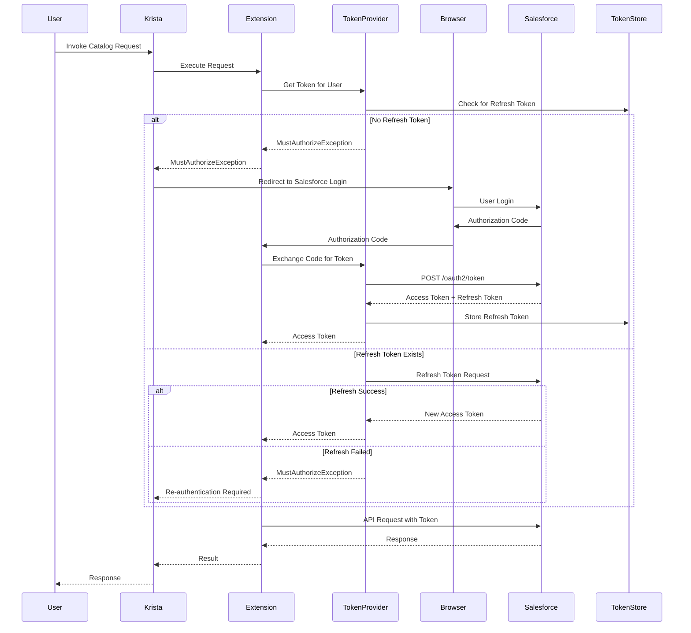

### Username-Password Flow (Service Account Authentication)

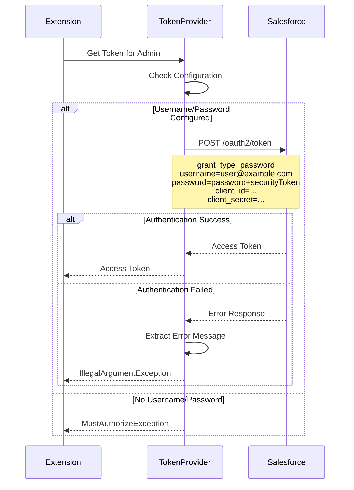

### Token Refresh Flow

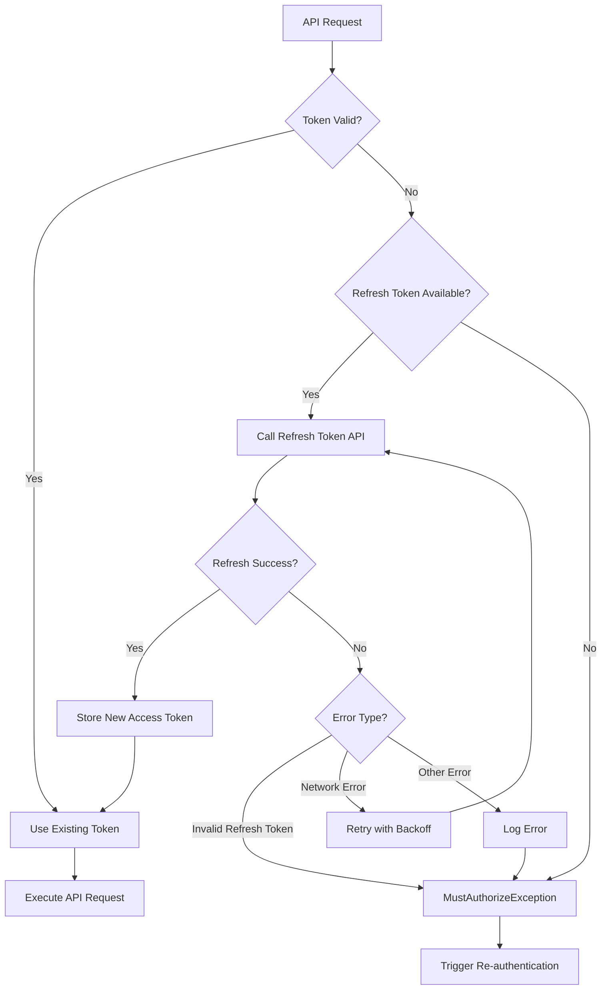

### Authentication State Diagram

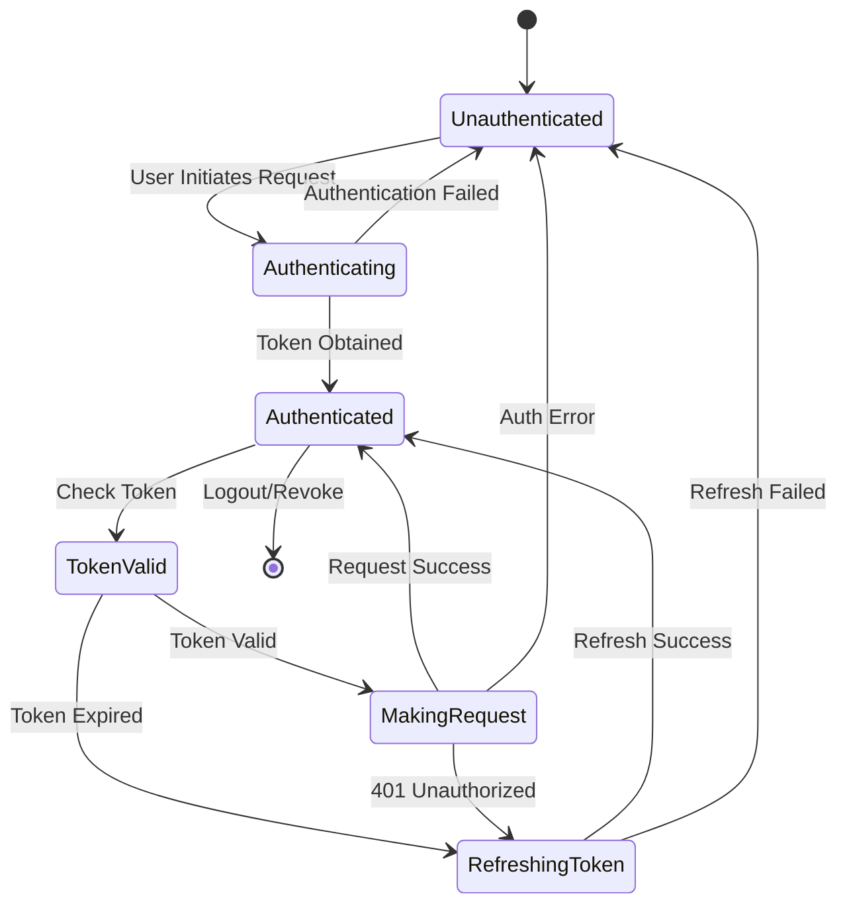

---

## Error Handling Architecture

### Error Categories and Handling Strategy

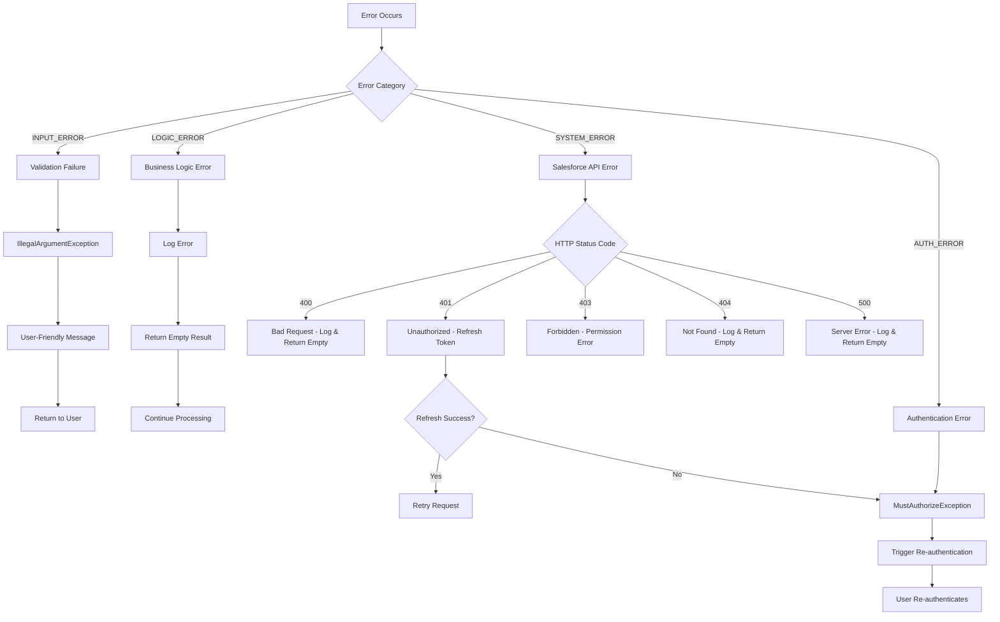

### Error Propagation Flow

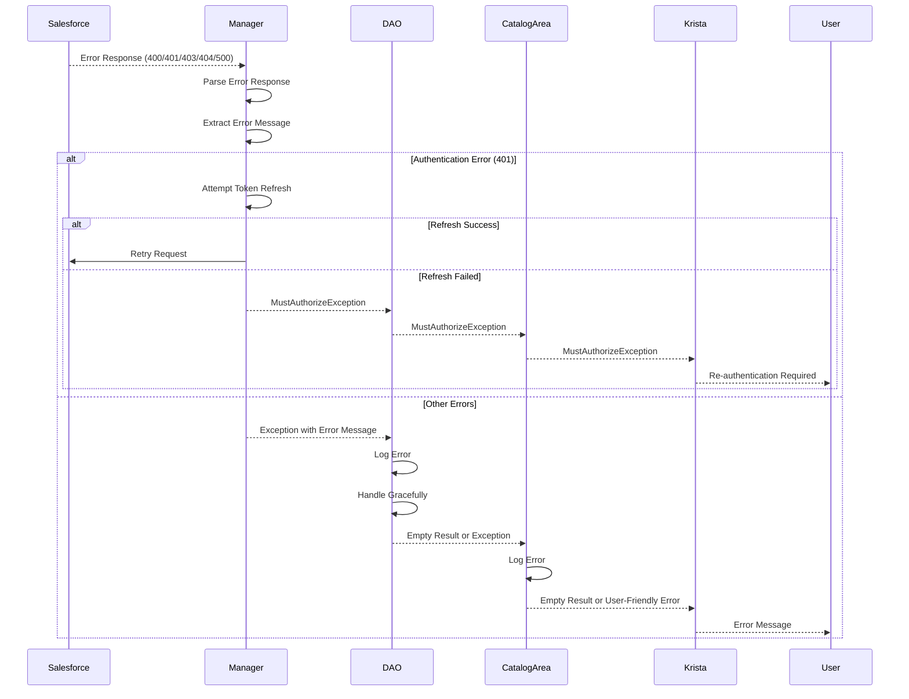

### Common Error Scenarios

| Error Type | HTTP Status | Cause | Handling Strategy | User Impact |
|------------|-------------|-------|-------------------|-------------|
| Invalid Token | 401 | Access token expired | Automatic token refresh | Transparent (retry) |
| Refresh Token Expired | 401 | Refresh token expired | MustAuthorizeException | Re-authentication required |
| Insufficient Permissions | 403 | User lacks permissions | Log error, return empty | Error message displayed |
| Record Not Found | 404 | Invalid record ID | Log error, return empty | Empty result |
| Invalid Request | 400 | Malformed request/query | Log error, return empty | Error message displayed |
| Salesforce Server Error | 500 | Salesforce internal error | Log error, return empty | Error message displayed |
| Rate Limit Exceeded | 429 | Too many API requests | Log error, return empty | Error message displayed |
| Network Timeout | Timeout | Network connectivity | Log error, return empty | Error message displayed |
| Validation Error | N/A | Invalid input parameters | IllegalArgumentException | User-friendly validation message |
| SOQL Error | 400 | Invalid SOQL syntax | Log error, return empty | Error message displayed |

### Error Handling Best Practices

1. **Graceful Degradation**: Return empty results instead of crashing
2. **User-Friendly Messages**: Convert technical errors to actionable messages
3. **Comprehensive Logging**: Log all errors with context for debugging
4. **Automatic Retry**: Retry transient errors (token refresh, network)
5. **Fail-Fast Validation**: Validate inputs before making API calls
6. **Error Context**: Include relevant context (request ID, user ID, operation)

---
## Performance Characteristics

### API Request Performance

| Operation Type | Typical Latency | Max Latency | Throughput | Notes |
|----------------|-----------------|-------------|------------|-------|
| Simple Query (< 100 records) | 200-500ms | 2s | 100 req/min | Depends on network and Salesforce load |
| Complex Query (> 1000 records) | 1-5s | 120s | 20 req/min | Use pagination or async queries |
| CRUD Operations | 300-800ms | 3s | 80 req/min | Single record operations |
| Bulk Operations (200 records) | 2-10s | 30s | 10 req/min | Use Salesforce Bulk API for > 200 |
| Token Refresh | 500-1000ms | 5s | N/A | Cached for 1-2 hours |
| Email Sending | 500-1500ms | 10s | 50 req/min | Depends on email size |

### Performance Optimization Strategies

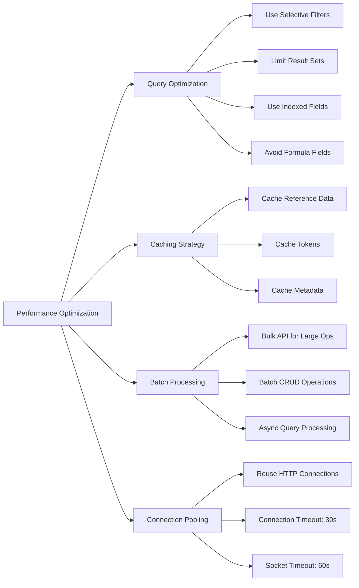

### Query Performance Guidelines

**Indexed Fields (Fast):**
- Id
- Name
- OwnerId
- CreatedDate
- LastModifiedDate
- SystemModstamp
- RecordTypeId
- Custom fields marked as External ID

**Non-Indexed Fields (Slow):**
- Formula fields
- Long text fields
- Rich text fields
- Non-indexed custom fields

**Query Optimization Examples:**

```sql
-- ❌ Slow: Non-selective query
SELECT Id, Name FROM Opportunity

-- ✅ Fast: Selective query with indexed field
SELECT Id, Name FROM Opportunity WHERE OwnerId = '005...' AND CloseDate = THIS_QUARTER

-- ❌ Slow: Query on formula field
SELECT Id, Name FROM Opportunity WHERE Formula_Field__c = 'Value'

-- ✅ Fast: Query on indexed custom field
SELECT Id, Name FROM Opportunity WHERE External_ID__c = 'EXT-12345'

-- ❌ Slow: Large result set
SELECT Id, Name, Description FROM Opportunity WHERE Amount > 0

-- ✅ Fast: Limited result set with pagination
SELECT Id, Name FROM Opportunity WHERE Amount > 10000 LIMIT 100 OFFSET 0
```

### Memory Consumption

| Component | Typical Memory | Peak Memory | Notes |
|-----------|----------------|-------------|-------|
| Extension Instance | 50-100 MB | 200 MB | Per extension instance |
| Query Result (100 records) | 1-5 MB | 10 MB | Depends on field count |
| Query Result (1000 records) | 10-50 MB | 100 MB | Consider pagination |
| Token Cache | < 1 MB | 5 MB | Per user token |
| HTTP Connection Pool | 5-10 MB | 20 MB | Reused connections |

### Concurrency Characteristics

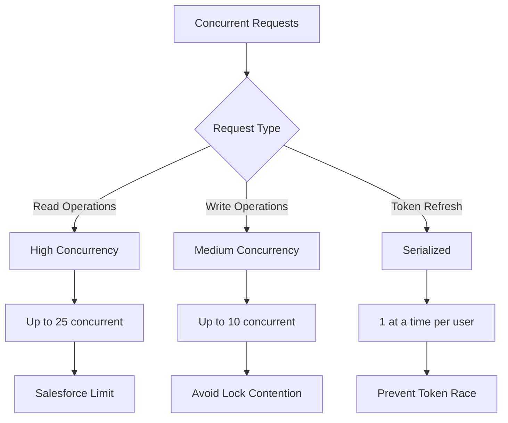

**Concurrency Limits:**
- **Salesforce API**: 25 concurrent requests per org (default)
- **Extension**: No artificial limits, respects Salesforce limits
- **Token Refresh**: Serialized per user to prevent race conditions
- **HTTP Connections**: Connection pool size: 20 (configurable)

---

## Scalability and Limitations

### Salesforce API Limits

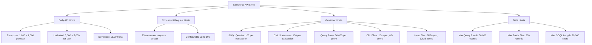

### Extension Limitations

| Limitation Type | Limit | Mitigation Strategy |
|-----------------|-------|---------------------|
| **API Rate Limits** | Varies by Salesforce edition | Monitor usage, implement caching, use bulk operations |
| **Query Result Size** | 50,000 records per query | Use pagination, async queries, or Bulk API |
| **Query Timeout** | 120 seconds | Optimize queries, use selective filters |
| **Concurrent Requests** | 25 (Salesforce default) | Serialize requests if needed, request limit increase |
| **Token Expiration** | 1-2 hours (access token) | Automatic refresh, transparent to users |
| **Refresh Token Expiration** | 90 days (unverified apps) | Re-authentication required |
| **SOQL Query Length** | 20,000 characters | Simplify queries, use dynamic SOQL |
| **Batch Size** | 200 records per batch | Use Bulk API for larger operations |
| **File Upload Size** | 37.5 MB per file | Split large files |
| **Email Recipients** | 5,000 per day | Batch email operations |

### Scalability Patterns

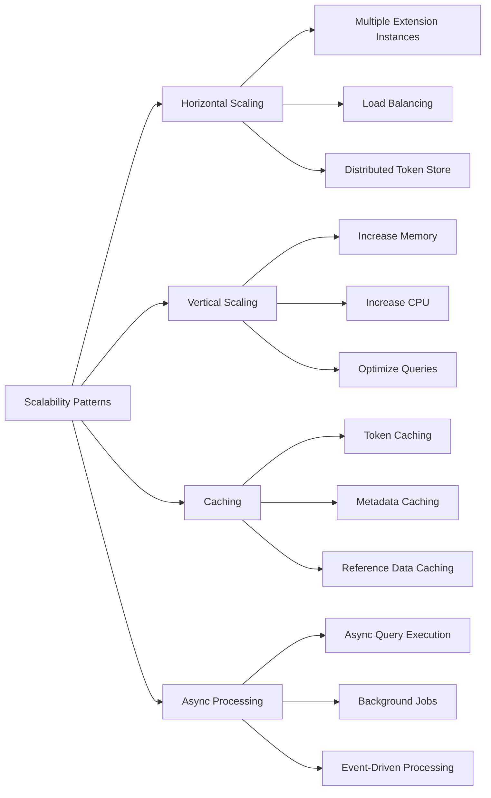

### Performance Monitoring

**Key Metrics to Monitor:**

1. **API Usage**
   - Daily API calls consumed
   - API calls remaining
   - Peak usage times
   - Rate limit violations

2. **Response Times**
   - Average query latency
   - P95/P99 latency
   - Timeout occurrences
   - Slow query identification

3. **Error Rates**
   - Authentication failures
   - Permission errors
   - Salesforce errors (500)
   - Network timeouts

4. **Token Management**
   - Token refresh frequency
   - Token refresh failures
   - Re-authentication events

5. **Resource Utilization**
   - Memory consumption
   - CPU usage
   - HTTP connection pool usage
   - Thread pool utilization

### Capacity Planning

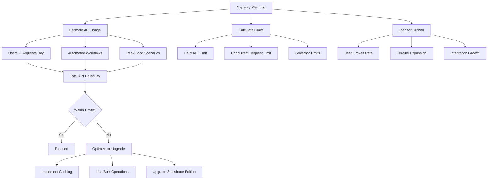

**Capacity Planning Formula:**

```
Daily API Calls = (Users × Avg Requests/User/Day) + (Automated Workflows × Frequency)

Required API Limit = Daily API Calls × 1.5 (safety margin)

Concurrent Requests Needed = Peak Requests/Minute ÷ 60 × Avg Response Time (seconds)
```

**Example:**
- 100 users × 50 requests/day = 5,000 calls
- 10 automated workflows × 100 calls/day = 1,000 calls
- Total: 6,000 calls/day
- With 1.5x safety margin: 9,000 calls/day required
- Salesforce Enterprise (1,000 + 1,000 × 100 users = 101,000) ✅ Sufficient

---

## Security Architecture

### Security Layers

```mermaid
graph TB
    A[Security Architecture] --> B[Authentication Layer]
    A --> C[Authorization Layer]
    A --> D[Transport Security]
    A --> E[Data Protection]
    A --> F[Audit & Logging]

    B --> B1[OAuth 2.0]
    B --> B2[Token Management]
    B --> B3[Session Management]

    C --> C1[Salesforce Permissions]
    C --> C2[Field-Level Security]
    C --> C3[Object-Level Security]
    C --> C4[Sharing Rules]

    D --> D1[HTTPS/TLS 1.2+]
    D --> D2[Certificate Validation]
    D --> D3[Secure Headers]

    E --> E1[Encrypted Credentials]
    E --> E2[Secure Token Storage]
    E --> E3[No Sensitive Data Logging]

    F --> F1[Request Logging]
    F --> F2[Error Logging]
    F --> F3[Audit Trail]
```

### OAuth 2.0 Security

**Security Features:**
1. **Authorization Code Flow**: Most secure flow for user authentication
2. **Client Credentials**: Secure service account authentication
3. **Token Expiration**: Access tokens expire after 1-2 hours
4. **Refresh Token Rotation**: New refresh tokens issued on refresh
5. **Scope Limitation**: Tokens limited to requested scopes
6. **PKCE Support**: Proof Key for Code Exchange (optional)

**Token Storage Security:**
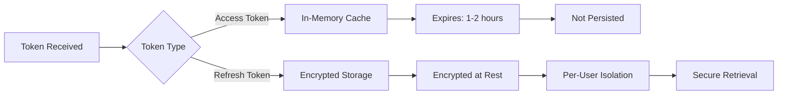

### Data Protection

| Data Type | Protection Method | Storage Location | Access Control |
|-----------|-------------------|------------------|----------------|
| Client Secret | Encrypted | Extension Configuration | Admin only |
| Password | Encrypted | Extension Configuration | Admin only |
| Security Token | Encrypted | Extension Configuration | Admin only |
| Access Token | In-Memory | Runtime Cache | Per-user isolation |
| Refresh Token | Encrypted | Secure Store | Per-user isolation |
| API Responses | Not Stored | Transient | Request scope |
| Logs | Sanitized | Log Files | Admin only |

### Secure Communication

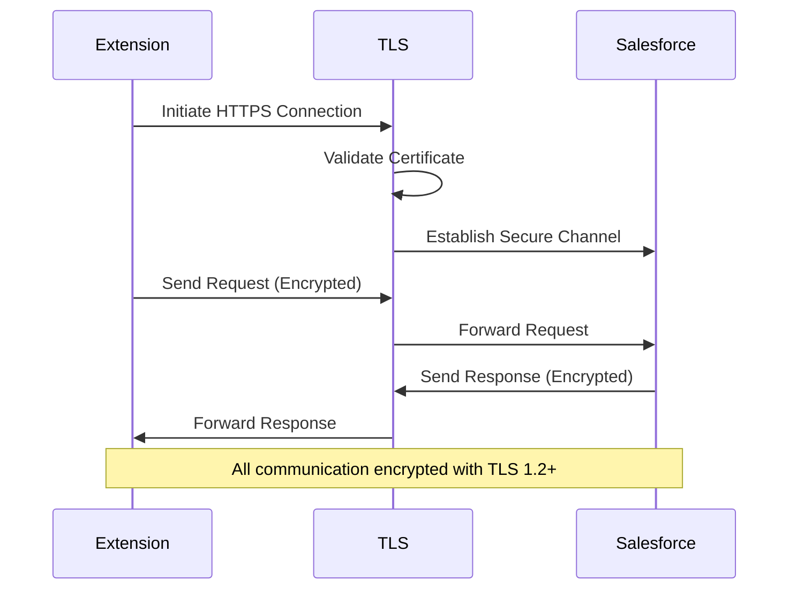

**Security Headers:**
- `Authorization: Bearer {token}` - OAuth token
- `Content-Type: application/json` - JSON content
- `Accept: application/json` - JSON response
- `User-Agent: Krista-Salesforce-Extension/2.0.15` - Client identification

### Permission Model

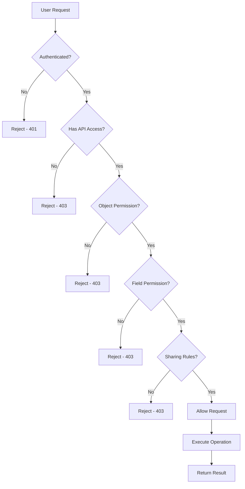

**Required Salesforce Permissions:**
- API Enabled
- Read/Write access to objects (Opportunity, Lead, Account, etc.)
- Field-level security for all accessed fields
- Sharing rules allowing record access
- Custom field access (if using custom fields)
- Send Email permission (for email operations)

### Security Best Practices

1. **Credential Management**
   - Never log sensitive credentials
   - Use encrypted storage for secrets
   - Rotate credentials regularly
   - Use separate credentials for dev/prod

2. **Token Management**
   - Store refresh tokens securely
   - Implement token expiration
   - Clear tokens on logout
   - Monitor for token theft

3. **API Security**
   - Validate all inputs
   - Sanitize SOQL queries
   - Use parameterized queries
   - Implement rate limiting

4. **Audit & Compliance**
   - Log all API requests
   - Track authentication events
   - Monitor for suspicious activity
   - Maintain audit trail

5. **Network Security**
   - Use HTTPS only
   - Validate SSL certificates
   - Implement connection timeouts
   - Use secure cipher suites

---

## Deployment Architecture

### Deployment Topology

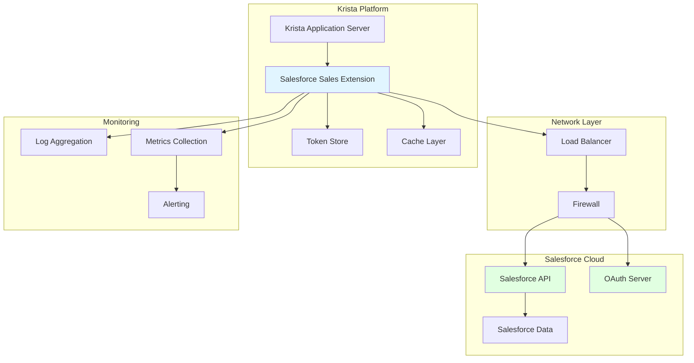

### Deployment Models

#### Single Instance Deployment

```mermaid
graph LR
    A[Users] --> B[Krista Server]
    B --> C[Extension Instance]
    C --> D[Salesforce]

    style C fill:#e1f5ff
```

**Characteristics:**
- Simple deployment
- Single point of failure
- Limited scalability
- Suitable for: Small teams, development, testing

#### High Availability Deployment

```mermaid
graph TB
    A[Users] --> B[Load Balancer]

    B --> C1[Krista Server 1]
    B --> C2[Krista Server 2]
    B --> C3[Krista Server N]

    C1 --> D1[Extension Instance 1]
    C2 --> D2[Extension Instance 2]
    C3 --> D3[Extension Instance N]

    D1 --> E[Shared Token Store]
    D2 --> E
    D3 --> E

    D1 --> F[Salesforce]
    D2 --> F
    D3 --> F

    style D1 fill:#e1f5ff
    style D2 fill:#e1f5ff
    style D3 fill:#e1f5ff
```

**Characteristics:**
- High availability
- Horizontal scalability
- Shared token store required
- Suitable for: Production, large teams, enterprise

### Environment Configuration

| Environment | Purpose | Configuration | Salesforce Org |
|-------------|---------|---------------|----------------|
| **Development** | Development and testing | sandbox=true, debug logging | Developer Sandbox |
| **Staging** | Pre-production testing | sandbox=true, info logging | Full Sandbox |
| **Production** | Live operations | sandbox=false, warn logging | Production Org |

### Deployment Checklist

**Pre-Deployment:**
- [ ] Salesforce Connected App created and configured
- [ ] OAuth scopes configured (api, refresh_token)
- [ ] Redirect URI configured
- [ ] Client ID and Client Secret obtained
- [ ] Service account credentials configured (if using)
- [ ] Firewall rules configured for Salesforce IPs
- [ ] SSL certificates validated
- [ ] Extension version tested in staging

**Deployment:**
- [ ] Deploy extension to Krista platform
- [ ] Configure extension attributes
- [ ] Test connection to Salesforce
- [ ] Verify authentication flow
- [ ] Test catalog requests
- [ ] Monitor logs for errors
- [ ] Verify token refresh mechanism

**Post-Deployment:**
- [ ] Monitor API usage
- [ ] Monitor error rates
- [ ] Monitor performance metrics
- [ ] Set up alerting
- [ ] Document configuration
- [ ] Train users
- [ ] Establish support process

### Disaster Recovery

```mermaid
flowchart TD
    A[Disaster Scenario] --> B{Type?}

    B -->|Extension Failure| C[Restart Extension]
    B -->|Salesforce Outage| D[Wait for Recovery]
    B -->|Token Store Failure| E[Re-authenticate Users]
    B -->|Network Failure| F[Check Connectivity]

    C --> G{Success?}
    G -->|Yes| H[Resume Operations]
    G -->|No| I[Escalate to Support]

    D --> J[Monitor Salesforce Status]
    J --> K{Recovered?}
    K -->|Yes| H
    K -->|No| L[Notify Users]

    E --> M[Clear Token Cache]
    M --> N[Trigger Re-auth]
    N --> H

    F --> O[Check Firewall]
    O --> P[Check DNS]
    P --> Q[Check SSL]
    Q --> H
```

**Recovery Time Objectives (RTO):**
- Extension restart: < 5 minutes
- Token store recovery: < 15 minutes
- Full disaster recovery: < 1 hour

**Recovery Point Objectives (RPO):**
- No data loss (stateless extension)
- Token refresh required after recovery

### Monitoring and Observability

**Logging Strategy:**
```mermaid
graph LR
    A[Extension] --> B[Log Events]

    B --> C[DEBUG]
    B --> D[INFO]
    B --> E[WARN]
    B --> F[ERROR]

    C --> G[Development Only]
    D --> H[All Environments]
    E --> H
    F --> H

    H --> I[Log Aggregation]
    I --> J[Analysis & Alerting]
```

**Key Log Events:**
- Authentication attempts (success/failure)
- Token refresh events
- API requests (method, endpoint, duration)
- Errors (with stack traces)
- Performance metrics (latency, throughput)
- Configuration changes

**Alerting Rules:**
- Authentication failure rate > 10%
- API error rate > 5%
- Average latency > 5 seconds
- Token refresh failure rate > 5%
- Daily API limit > 80% consumed

---

## Summary

The Salesforce Sales Extension implements a robust, scalable, and secure architecture that provides seamless integration between Krista and Salesforce Sales Cloud. Key architectural highlights:

### Architectural Strengths

1. **5-Layer Architecture**: Clear separation of concerns with well-defined responsibilities
2. **OAuth 2.0 Security**: Industry-standard authentication with automatic token refresh
3. **Graceful Error Handling**: User-friendly error messages with comprehensive logging
4. **Performance Optimized**: Query optimization, caching, and connection pooling
5. **Scalable Design**: Horizontal scaling support with shared token store
6. **Comprehensive Monitoring**: Detailed logging and metrics for observability

### Design Patterns Used

- **Repository Pattern**: DAO layer abstracts data access
- **Factory Pattern**: Token provider factory for different auth modes
- **Dependency Injection**: Constructor injection throughout
- **Strategy Pattern**: Different authentication strategies (user vs admin)
- **Singleton Pattern**: Extension instance and managers
- **Builder Pattern**: Query builders for complex SOQL

### Technology Decisions

| Decision | Rationale |
|----------|-----------|
| Java 21 | Latest LTS version with modern features |
| OAuth 2.0 | Industry standard, secure, widely supported |
| REST API v58.0+ | Latest Salesforce API with full feature support |
| Stateless Design | Enables horizontal scaling and high availability |
| Interface-Based DAOs | Testability and flexibility |
| Graceful Degradation | Better user experience on errors |

### Future Enhancements

- Bulk API support for large data operations
- Streaming API for real-time events
- Metadata API for schema introspection
- Enhanced caching with Redis/Memcached
- Circuit breaker pattern for resilience
- GraphQL support for flexible queries

---

**Document Version:** 1.0
**Last Updated:** 2025-11-27
**Maintained By:** Krista Extension Team
