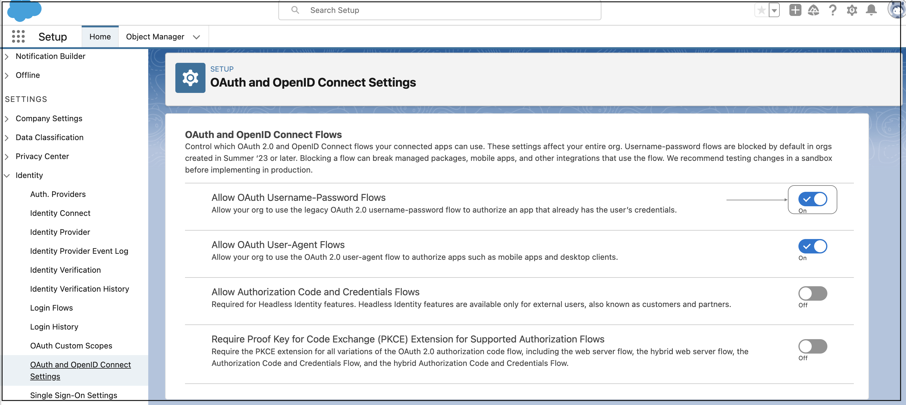
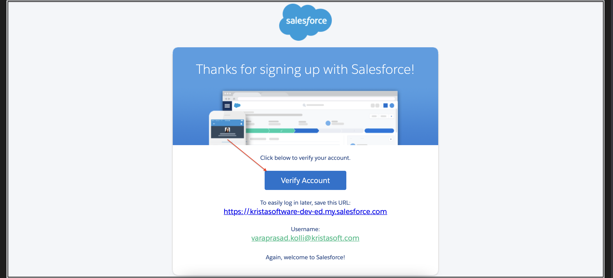
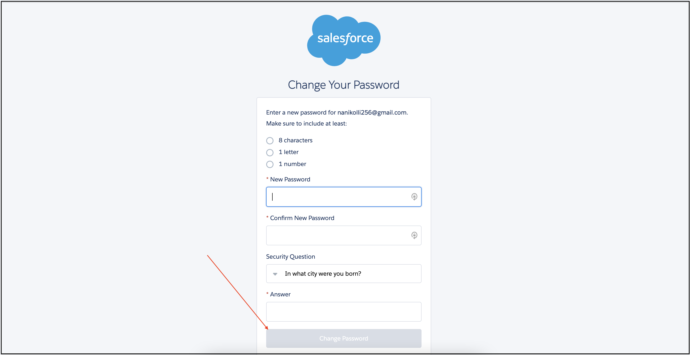

# Authentication

## Overview

The Krista Salesforce Sales Extension uses OAuth 2.0 for secure authentication with Salesforce. The extension supports multiple authentication modes to accommodate different use cases, from interactive user authentication to automated service account workflows.

## Authentication Modes

The extension automatically selects the appropriate authentication mode based on the configuration parameters you provide.

### User Account Authentication (Authorization Code Flow)

**When to Use:**
- Interactive conversations where actions should be performed as the authenticated user
- When you need user-specific permissions and audit trails
- When different users need different levels of access
- For conversations that require user consent

**How It Works:**
1. User initiates a conversation that requires Salesforce access
2. Extension redirects user to Salesforce login page
3. User authenticates with their Salesforce credentials
4. Salesforce redirects back to Krista with an authorization code
5. Extension exchanges the code for access and refresh tokens
6. Tokens are stored securely for the user's session

**Configuration Required:**
- Client ID
- Client Secret
- Redirect URI (automatically configured)

**In Krista Conversations:**
- Check the **"Have people authenticate with their account"** checkbox in the **Ask a System** step
- Users will be prompted to authenticate on first use
- Subsequent requests use the stored tokens automatically

### Service Account Authentication (Username-Password Flow)

**When to Use:**
- Automated workflows that run without user interaction
- Scheduled tasks and background processes
- System-to-system integration
- When all actions should be performed as a single service account

**How It Works:**
1. Extension authenticates using the configured username, password, and security token
2. Salesforce returns access and refresh tokens
3. Extension uses these tokens for all API calls
4. Tokens are refreshed automatically when they expire

**Configuration Required:**
- Client ID
- Client Secret
- Username (service account)
- Password (service account)
- Security Token (service account)

**In Krista Conversations:**
- Leave the **"Have people authenticate with their account"** checkbox **unchecked** in the **Ask a System** step
- All requests execute automatically using the service account
- No user interaction required

## OAuth 2.0 Scopes and Permissions

### Required Scopes

The extension requests the following OAuth scopes from Salesforce:

| Scope | Full URL | Description | Permission Level |
|-------|----------|-------------|------------------|
| `api` | `https://[instance].salesforce.com/services/oauth2/scope/api` | Access to Salesforce APIs | Full API access to all objects and data the user has permissions for |
| `refresh_token` | `https://[instance].salesforce.com/services/oauth2/scope/refresh_token` | Ability to refresh access tokens | Allows the extension to obtain new access tokens without re-authentication |

**Why These Scopes:**
- **`api`**: Required for all catalog requests and entity operations. Provides access to REST API endpoints for Opportunity, Lead, Account, Asset, Quote, Task, and other sales objects.
- **`refresh_token`**: Essential for long-running sessions. Allows automatic token refresh without requiring users to re-authenticate frequently.

**Alternative Scopes:**
- **`full`**: Provides full access to all data and APIs. Not used by default as it's broader than necessary and may raise security concerns.
- **`web`**: Limited to web-based access. Not sufficient for API operations required by this extension.

### Salesforce Permissions

In addition to OAuth scopes, the authenticated user (or service account) must have the following Salesforce permissions:

**Object-Level Permissions:**
- Read, Create, Edit, Delete on: Opportunity, Lead, Account, Asset, Quote, Task, Event
- Read access to: User, PricebookEntry (for sales operations)
- Send Email permission (for email-related catalog requests)

**Field-Level Security:**
- Read/Write access to all standard and custom fields used in catalog requests
- Custom fields must be visible to the user's profile

**System Permissions:**
- API Enabled
- View All Data (for service accounts performing broad queries)
- Modify All Data (for service accounts performing updates)

## OAuth 2.0 Grant Types

### Authorization Code Grant

**Grant Type**: `authorization_code`

**Used For**: Initial user authentication in the Authorization Code flow

**Flow**:
1. User is redirected to Salesforce authorization URL
2. User logs in and grants permissions
3. Salesforce redirects to callback URL with authorization code
4. Extension exchanges code for tokens

**Request Example**:
```http
POST /services/oauth2/token HTTP/1.1
Host: login.salesforce.com
Content-Type: application/x-www-form-urlencoded

grant_type=authorization_code
&code=aPrxhgZ1wG_Lh...
&client_id=3MVG9fTLmJ60pJ5...
&client_secret=1234567890ABCDEF...
&redirect_uri=https://krista.mycompany.com/rest/salesforcesales/callback
```

**Response Example**:
```json
{
  "access_token": "00D5w000000abcd!AR8AQP0jITN80ESEsj5EbaZTFG0RNBaT1cyWk7TrqoDjoNIWQ2ME_sTZzBjfmOE6zMHq6y8PIW4eWze9JksNEkWUl.Cju7m4",
  "refresh_token": "REDACTED_SECRET",
  "instance_url": "https://mycompany.my.salesforce.com",
  "id": "https://login.salesforce.com/id/00D5w000000abcdEAA/0055w000000abcdAAA",
  "token_type": "Bearer",
  "issued_at": "1638360000000",
  "signature": "xyz123..."
}
```

### Refresh Token Grant

**Grant Type**: `refresh_token`

**Used For**: Obtaining new access tokens when the current token expires

**Flow**:
1. Access token expires (after 1-2 hours)
2. Extension automatically uses refresh token to request new access token
3. Salesforce returns new access token
4. Extension continues operations seamlessly

**Request Example**:
```http
POST /services/oauth2/token HTTP/1.1
Host: login.salesforce.com
Content-Type: application/x-www-form-urlencoded

grant_type=refresh_token
&refresh_token=5Aep861TSESvWeug_xvFHRBTTbf_YrTWgEyjBJo7Xr34...
&client_id=3MVG9fTLmJ60pJ5...
&client_secret=1234567890ABCDEF...
```

**Response Example**:
```json
{
  "access_token": "00D5w000000abcd!AR8AQNewAccessTokenHere...",
  "instance_url": "https://mycompany.my.salesforce.com",
  "id": "https://login.salesforce.com/id/00D5w000000abcdEAA/0055w000000abcdAAA",
  "token_type": "Bearer",
  "issued_at": "1638363600000",
  "signature": "abc456..."
}
```

### Username-Password Grant (Resource Owner Password Credentials)

**Grant Type**: `password`

**Used For**: Service account authentication with username and password



**Flow**:
1. Extension sends username, password, and security token to Salesforce
2. Salesforce validates credentials and returns tokens
3. Extension stores and uses tokens for API calls

**Request Example**:
```http
POST /services/oauth2/token HTTP/1.1
Host: login.salesforce.com
Content-Type: application/x-www-form-urlencoded

grant_type=password
&client_id=3MVG9fTLmJ60pJ5...
&client_secret=1234567890ABCDEF...
&username=serviceaccount@company.com
&password=MyP@ssw0rdAbCdEfGhIjKlMnOp
```

> **📝 Note**: The password parameter should be the user's password concatenated with their security token (password + security token).

**Response Example**:
```json
{
  "access_token": "00D5w000000abcd!AR8AQServiceAccountToken...",
  "instance_url": "https://mycompany.my.salesforce.com",
  "id": "https://login.salesforce.com/id/00D5w000000abcdEAA/0055w000000serviceAAA",
  "token_type": "Bearer",
  "issued_at": "1638360000000",
  "signature": "def789..."
}
```

## Authentication Flow

### User Authentication Flow (Step-by-Step)

1. **User Initiates Request**
   - User starts a conversation that requires Salesforce access
   - Extension detects that user is not authenticated

2. **Authorization Request**
   - Extension generates authorization URL with state parameter
   - User is redirected to Salesforce login page
   - URL format: `https://login.salesforce.com/services/oauth2/authorize?response_type=code&client_id=...&redirect_uri=...&state=...`

3. **User Authentication**
   - User enters Salesforce credentials
   - User reviews and approves requested permissions
   - Salesforce validates credentials



4. **Authorization Code Exchange**
   - Salesforce redirects to callback URL with authorization code
   - Extension receives callback at `/rest/salesforcesales/callback`
   - Extension extracts authorization code from query parameters

5. **Token Request**
   - Extension sends authorization code to Salesforce token endpoint
   - Salesforce validates code and returns access token and refresh token

6. **Token Storage**
   - Extension stores tokens securely for the user's session
   - Tokens are associated with the user's Krista account

7. **API Access**
   - Extension uses access token for all Salesforce API calls
   - User's conversation continues seamlessly

### Service Account Flow (Step-by-Step)

1. **Extension Initialization**
   - Extension loads service account credentials from configuration
   - Credentials include username, password, and security token

2. **Token Request**
   - Extension sends credentials to Salesforce token endpoint using password grant
   - Request includes client ID, client secret, username, and password+token

3. **Token Response**
   - Salesforce validates credentials
   - Returns access token and refresh token

4. **Token Storage**
   - Extension stores tokens for service account
   - Tokens are reused for all service account requests

5. **Automatic Refresh**
   - When access token expires, extension automatically uses refresh token
   - New access token is obtained without re-authentication

## Token Management

### Access Token

**Lifetime**: 1-2 hours (configurable in Salesforce session settings)

**Usage**: Included in the Authorization header of every API request

**Format**: `Authorization: Bearer <access_token>`

**Expiration Handling**:
- Extension automatically detects expired tokens
- Uses refresh token to obtain new access token
- Retries failed request with new token
- Process is transparent to users

### Refresh Token

**Lifetime**:
- **Verified Apps**: Refresh tokens do not expire (unless revoked)
- **Unverified Apps**: Refresh tokens expire after 90 days of inactivity

**Usage**: Used to obtain new access tokens without re-authentication

**Storage**: Stored securely in Krista's token store, encrypted at rest

**Revocation**: Tokens are revoked when:
- User explicitly revokes access in Salesforce
- User password is changed
- Administrator revokes access
- Security policy triggers revocation
- Token limit is reached (Salesforce has a limit on active tokens per user)

## Token Expiration Scenarios

### Scenario 1: Access Token Expiration

**When**: After 1-2 hours of token issuance

**What Happens**:
1. API request fails with 401 Unauthorized
2. Extension detects expired access token
3. Extension automatically uses refresh token to get new access token
4. Extension retries the original request
5. User experiences no interruption

**User Action Required**: None (automatic)

### Scenario 2: Refresh Token Expiration (Unverified Apps)

**When**: After 90 days of inactivity (for unverified Connected Apps)

**What Happens**:
1. Extension attempts to refresh access token
2. Refresh request fails (invalid refresh token)
3. Extension throws MustAuthorizeException
4. User is prompted to re-authenticate

**User Action Required**: Re-authenticate with Salesforce

**Prevention**: Use a verified Connected App or ensure regular usage

### Scenario 3: Token Revocation by User

**When**: User revokes access in Salesforce Settings → Connected Apps

**What Happens**:
1. All tokens for that user are immediately invalidated
2. Next API request fails with 401 Unauthorized
3. Extension prompts user to re-authenticate

**User Action Required**: Re-authenticate with Salesforce

### Scenario 4: Password Change

**When**: User changes their Salesforce password



**What Happens**:
1. All existing tokens are revoked by Salesforce
2. Next API request fails
3. Extension prompts user to re-authenticate

**User Action Required**: Re-authenticate with new password

### Scenario 5: Token Limit Reached

**When**: User has too many active tokens (Salesforce limit varies by edition)

**What Happens**:
1. Oldest tokens are automatically revoked
2. If extension's token is revoked, next request fails
3. Extension prompts user to re-authenticate

**User Action Required**: Re-authenticate (consider revoking unused app tokens in Salesforce)

## Security Best Practices

### 1. Credential Management
- Store Client Secret securely; never expose in client-side code
- Use strong passwords for service accounts
- Rotate service account passwords regularly (every 90 days recommended)
- Use dedicated service accounts; don't share with human users

### 2. Token Security
- Tokens are stored encrypted in Krista's secure token store
- Never log or display tokens in conversations or logs
- Revoke tokens immediately if compromised
- Monitor token usage in Salesforce Setup → Identity → OAuth and OpenID Connect

### 3. Permission Minimization
- Grant only the minimum required Salesforce permissions
- Use permission sets for granular control
- Regularly audit service account permissions
- Avoid using "View All Data" and "Modify All Data" unless necessary

### 4. Network Security
- Always use HTTPS for all communications
- Whitelist Krista appliance IP addresses in Salesforce if using IP restrictions
- Use Salesforce Login IP Ranges to restrict service account access
- Enable Multi-Factor Authentication (MFA) for human users (not service accounts)

### 5. Monitoring and Auditing
- Review Salesforce Login History regularly
- Monitor API usage in Salesforce Setup → System Overview
- Set up alerts for unusual authentication patterns
- Use Salesforce Event Monitoring for detailed audit trails

## Troubleshooting Authentication

### Issue: "Client ID is required for OAuth authentication"

**Error Message**: "Client ID is required for OAuth authentication. Please provide your Salesforce Connected App Client ID in the extension configuration."

**Cause**: Client ID is missing from extension configuration

**Resolution**:
1. Navigate to extension configuration in Krista
2. Enter the Consumer Key from your Salesforce Connected App as the Client ID
3. Save the configuration

### Issue: "Client Secret is required for OAuth authentication"

**Error Message**: "Client Secret is required for OAuth authentication. Please provide your Salesforce Connected App Client Secret in the extension configuration."

**Cause**: Client Secret is missing from extension configuration

**Resolution**:
1. Navigate to extension configuration in Krista
2. Enter the Consumer Secret from your Salesforce Connected App as the Client Secret
3. Save the configuration

### Issue: "Invalid Client ID"

**Cause**: Client ID is incorrect or Connected App is not active

**Resolution**:
1. Verify Client ID matches the Consumer Key in Salesforce Connected App
2. Ensure Connected App is saved and active
3. Wait a few minutes after creating Connected App for changes to propagate

### Issue: "Redirect URI Mismatch"

**Cause**: Callback URL in Salesforce doesn't match Krista's redirect URI

**Resolution**:
1. Copy exact redirect URI from Krista extension configuration
2. Add to Callback URL in Salesforce Connected App
3. Ensure exact match including protocol (https://) and path

### Issue: "Authentication failed due to invalid credentials"

**Error Message**: "Authentication failed due to invalid credentials. Please verify your Salesforce username, password, and security token. If you recently changed your password, you may need to reset your security token."

**Cause**: Service account credentials are incorrect

**Resolution**:
1. Verify username is correct (usually email format)
2. Confirm password is current
3. Reset security token in Salesforce (Settings → Reset My Security Token)
4. Ensure password and token are entered correctly (password+token concatenated)
5. If password was recently changed, generate a new security token

### Issue: "Authentication failed due to invalid client credentials"

**Error Message**: "Authentication failed due to invalid client credentials. Please verify that your Client ID and Client Secret match those in your Salesforce Connected App settings."

**Cause**: Client ID or Client Secret is incorrect

**Resolution**:
1. Log in to Salesforce and navigate to Setup → App Manager
2. Find your Connected App and click "View"
3. Click "Manage Consumer Details" to view Client ID and Secret
4. Verify these match exactly with your extension configuration
5. If they don't match, update the extension configuration

### Issue: "Unable to establish OAuth connection with Salesforce"

**Error Message**: "Unable to establish OAuth connection with Salesforce. Please verify that your Client ID, Client Secret, and callback URL are correctly configured in your Salesforce Connected App settings."

**Cause**: OAuth service creation failed due to configuration issues

**Resolution**:
1. Verify all OAuth configuration parameters are correct
2. Check that the callback URL is properly configured in Salesforce
3. Ensure the Connected App is active and saved
4. Verify network connectivity to Salesforce
5. Check Salesforce service status

### Issue: "User Not Authorized"

**Cause**: User or service account lacks required permissions

**Resolution**:
1. Verify API Enabled permission
2. Check object and field-level permissions
3. Ensure user profile has necessary access
4. Review Connected App policies and IP restrictions

## See Also

- [Extension Configuration](pages/ExtensionConfiguration.md)
- [Creating Salesforce Connected App](pages/CreatingSalesforceApp.md)
- [Troubleshooting Guide](pages/Troubleshooting.md)

