# Creating Salesforce Connected App

## Overview

To integrate Krista with Salesforce, you must create a Connected App in Salesforce. A Connected App provides the OAuth 2.0 credentials (Client ID and Client Secret) required for secure authentication between Krista and Salesforce.

This guide provides step-by-step instructions for creating and configuring a Salesforce Connected App for use with the Krista Salesforce Sales Extension.

## Prerequisites

Before you begin, ensure you have:

- **Salesforce Account**: Developer, Enterprise, or Unlimited edition with admin access
- **Admin Permissions**: Ability to create and manage Connected Apps in Salesforce
- **Krista Appliance URL**: Your Krista instance URL for configuring the callback URL
- **API Access**: Ensure API access is enabled for your Salesforce organization

## Step-by-Step Instructions

### Step 1: Access Salesforce Setup

1. Log in to your Salesforce account
2. Click the **gear icon** (⚙️) in the top-right corner
3. Select **Setup** from the dropdown menu


> **📝 Note**: If you're using Salesforce Classic, click your name in the top-right corner and select **Setup**.

### Step 2: Navigate to App Manager

1. In the Setup menu, use the **Quick Find** box on the left sidebar
2. Type **"App Manager"** in the search box
3. Click **App Manager** under **Apps** section

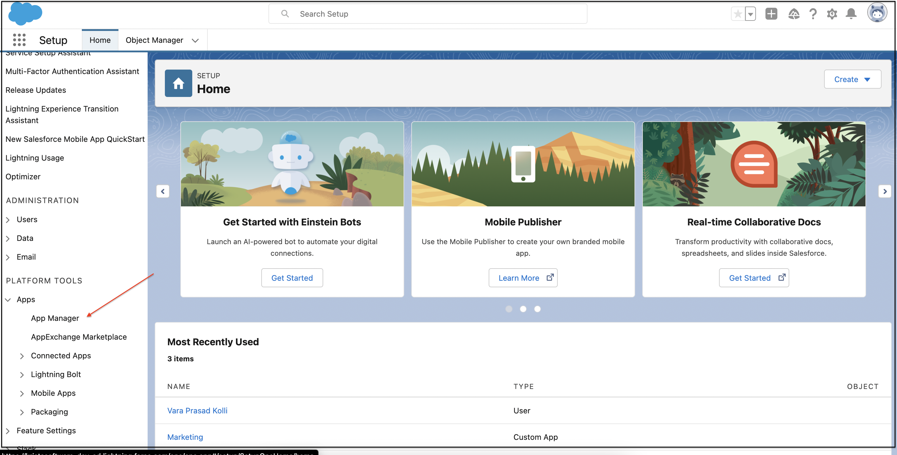

Alternatively:
- Navigate to **Platform Tools** → **Apps** → **App Manager**

### Step 3: Create New Connected App

1. On the App Manager page, click the **New Connected App** button in the top-right corner

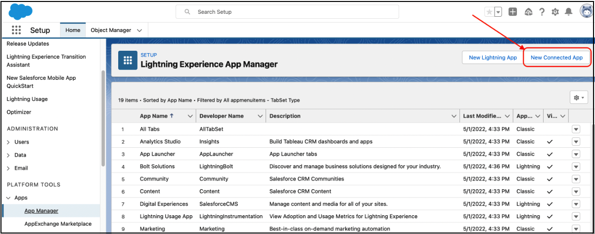

2. You'll be directed to the "New Connected App" configuration page

### Step 4: Configure Basic Information

Fill in the following required fields:

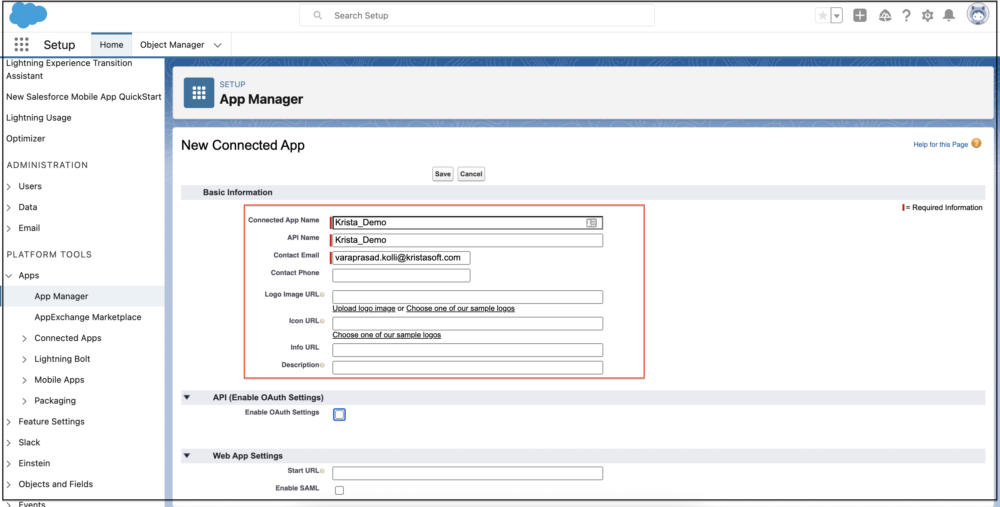

**Connected App Name**:
- Enter a descriptive name: `Krista Salesforce Sales Integration`
- This name will appear in the list of connected apps

**API Name**:
- Auto-populated based on the Connected App Name
- Example: `Krista_Salesforce_Sales_Integration`
- You can modify this if needed (no spaces allowed)

**Contact Email**:
- Enter your email address
- Salesforce will use this for important notifications about the app

**Description** (Optional but recommended):
- Enter: `OAuth integration for Krista Salesforce Sales Extension`

### Step 5: Enable OAuth Settings

1. Check the box **"Enable OAuth Settings"**

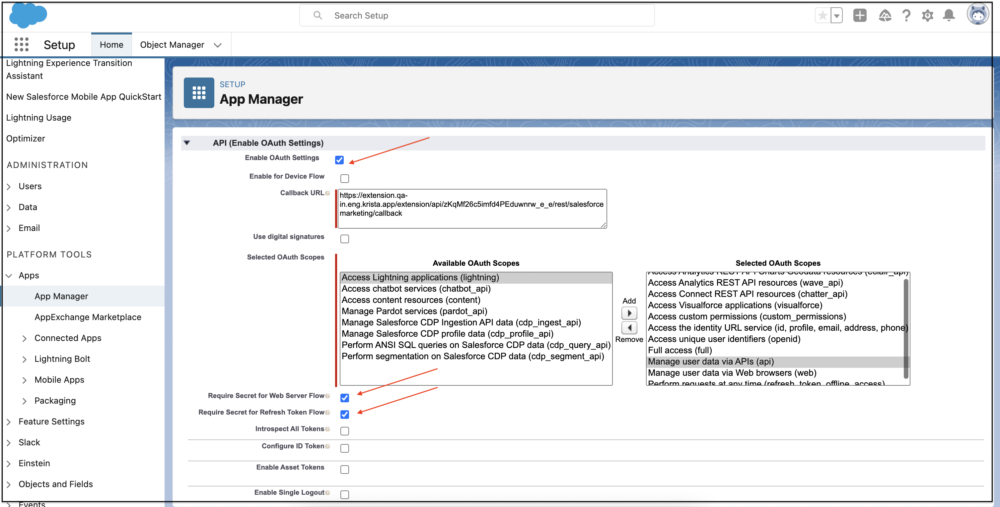

2. Additional OAuth configuration fields will appear

### Step 6: Configure Callback URL

**Callback URL** (also called Redirect URI):

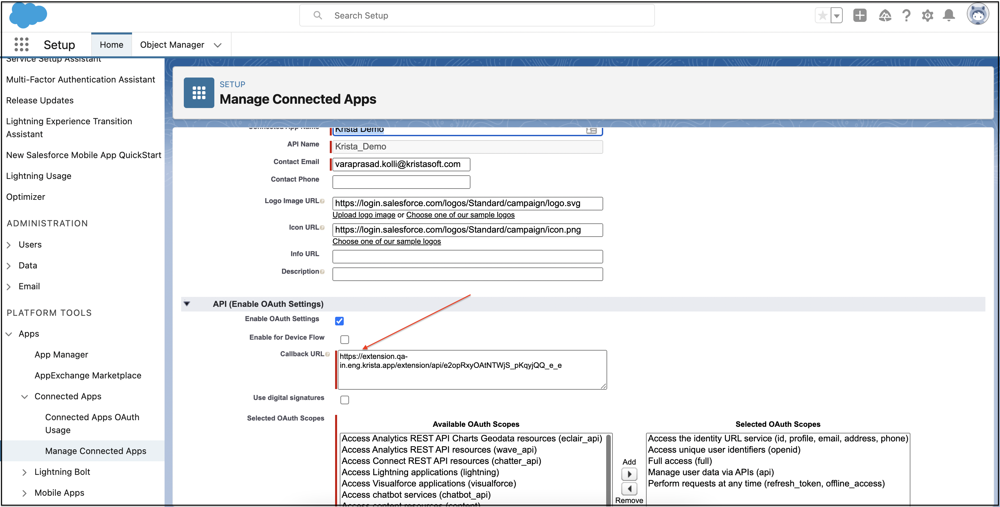

1. In the **Callback URL** field, enter your Krista callback URL
2. Format: `https://[your-krista-appliance]/rest/salesforcesales/callback`
3. Example: `https://krista.mycompany.com/rest/salesforcesales/callback`

> **⚠️ Important**:
> - The callback URL must match exactly (including `https://` and the path)
> - Do not include a trailing slash
> - You can find your exact callback URL in the Krista extension configuration page

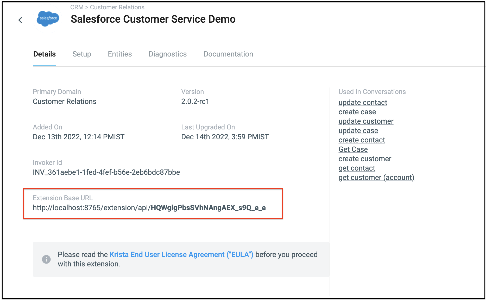

**Multiple Callback URLs** (if needed):
- If you have multiple Krista environments (dev, test, prod), add each callback URL on a separate line:
  ```
  https://krista-dev.mycompany.com/rest/salesforcesales/callback
  https://krista-test.mycompany.com/rest/salesforcesales/callback
  https://krista-prod.mycompany.com/rest/salesforcesales/callback
  ```

### Step 7: Select OAuth Scopes

In the **Selected OAuth Scopes** section, add the following scope entries:

* **Access Analytics REST API Charts Geodata resources (eclair_api)**
* **Access Analytics REST API resources (wave_api)**
* **Access Analytics REST API resources (chatter_api)**
* **Access Visualforce applications (visualforce)**
* **Access custom permissions (custom_permissions)**
* **Access the identity URL service (id, profile, email, address, phone)**
* **Access unique user identifiers (openid)**
* **Full access (full)**
* **Manage user data via APIs (api)**
* **Manage user data via Web browsers (web)**
* **Perform requests at any time (refresh_token, offline_access)**

To add these scopes:
1. In the Available OAuth Scopes list, find each scope listed above
2. Click to select it, then click the **Add** arrow button to move it to Selected OAuth Scopes
3. Repeat for all scopes in the list

> **📝 Note**: These scopes provide comprehensive access to Salesforce APIs and services required for the extension's full functionality.

### Step 8: Additional OAuth Settings

**Enable for Device Flow** (Optional):
- Leave unchecked unless you're using device authentication

**Require Secret for Web Server Flow**:
- ✅ **Select this checkbox** - This is required for the extension to function properly

**Require Secret for Refresh Token Flow**:
- Leave checked (default) for enhanced security

**Enable Authorization Code and Credentials Flow** (if available):
- Check this if you plan to use the Username-Password flow for service accounts

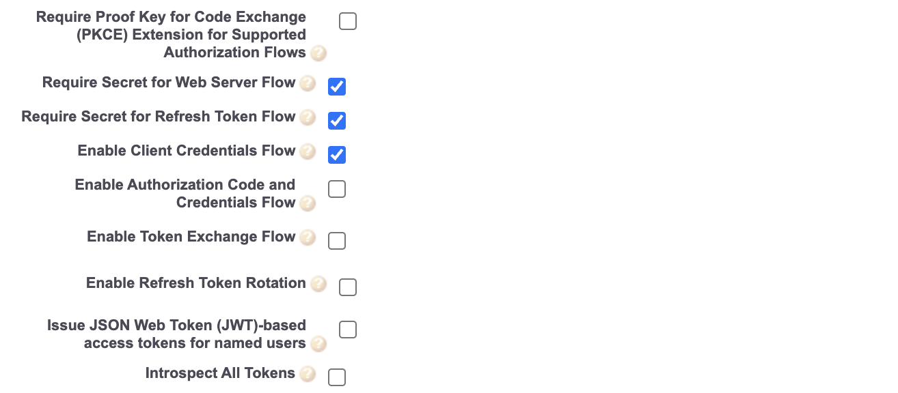

### Step 9: Configure Additional Settings (Optional)

**IP Relaxation**:
- **Relax IP restrictions**: Select if you want to bypass IP restrictions for this app
- **Enforce IP restrictions**: Select if you want to enforce organization-wide IP restrictions
- Recommended: Leave as default unless you have specific security requirements

**Refresh Token Policy**:
- **Refresh token is valid until revoked**: Recommended for production use
- **Refresh token expires after**: Select if you want tokens to expire after a specific period

### Step 10: Save the Connected App

1. Review all settings to ensure they're correct
2. Click **Save** at the bottom of the page
3. You'll see a message: "Please wait 2-10 minutes for your changes to take effect"

> **⚠️ Important**: Wait at least 2-10 minutes before using the Connected App. Salesforce needs time to propagate the changes.

### Step 11: Retrieve OAuth Credentials

After saving, you'll be redirected to the Connected App detail page.

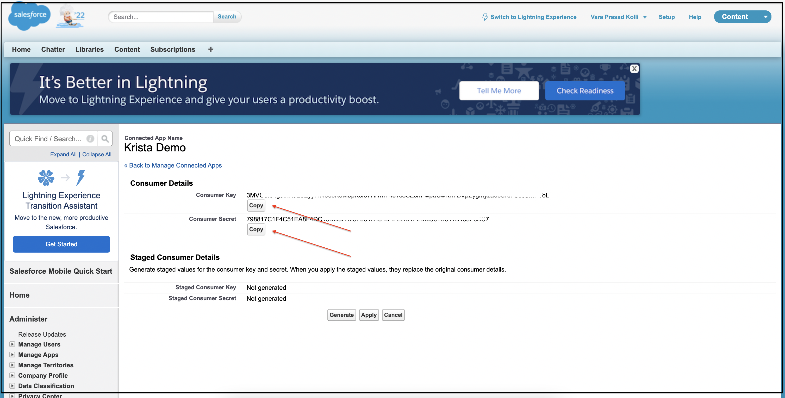

1. In the **API (Enable OAuth Settings)** section, you'll see:
   - **Consumer Key**: This is your **Client ID**
   - **Consumer Secret**: This is your **Client Secret**

2. Click **"Click to reveal"** next to Consumer Secret to view it

3. **Copy and save these credentials securely**:
   - Consumer Key (Client ID)
   - Consumer Secret (Client Secret)

> **🔒 Security Warning**:
> - Keep the Consumer Secret confidential
> - Never commit it to version control
> - Store it in a secure password manager
> - Only share with authorized personnel

### Step 12: Configure Policies (Optional but Recommended)

1. On the Connected App detail page, click **Manage**
2. Click **Edit Policies**

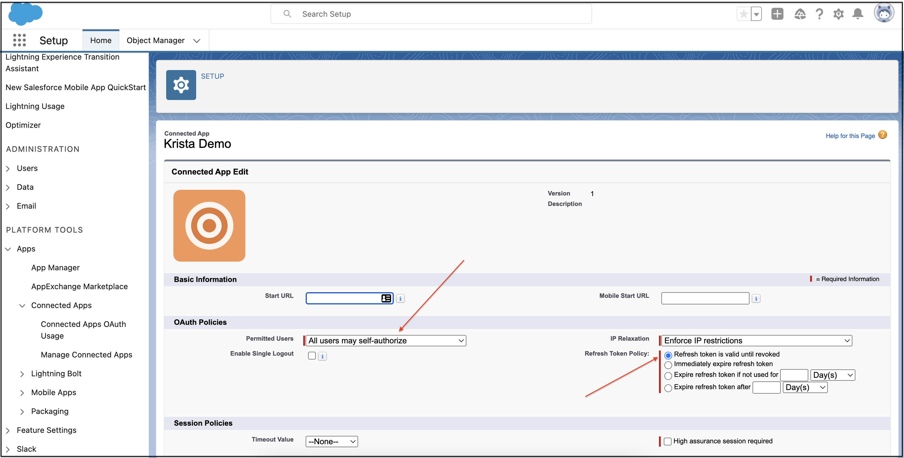

**OAuth Policies**:

**Permitted Users**:
- **All users may self-authorize**: Any user in your org can authenticate (default)
- **Admin approved users are pre-authorized**: Only users with assigned permission sets can authenticate (recommended for production)

**IP Relaxation**:
- Configure based on your security requirements

**Refresh Token Policy**:
- **Refresh token is valid until revoked**: Recommended
- Tokens remain valid indefinitely unless explicitly revoked

**For Service Account (Username-Password Flow)**:

If you're using a service account:
1. Scroll to **OAuth Policies** section
2. Find **"Run As"** or **"Permitted Users"**
3. Select the service account user
4. This ensures the service account can authenticate

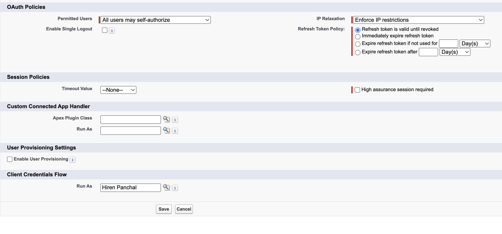

3. Click **Save**

### Step 13: Assign Permission Sets (If Using "Admin Approved Users")

If you selected "Admin approved users are pre-authorized":

1. On the Connected App detail page, click **Manage**
2. Scroll to **Permission Sets** or **Profiles** section
3. Click **Manage Permission Sets** or **Manage Profiles**

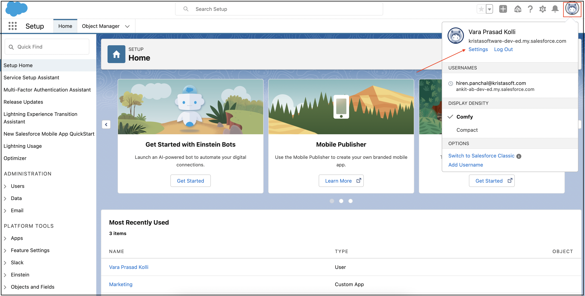

4. Select the permission sets or profiles that should have access
5. Click **Save**

Users must be assigned to these permission sets to authenticate with the Connected App.

## Verification

### Verify Connected App Configuration

1. Go to **Setup** → **App Manager**
2. Find your Connected App in the list
3. Click the dropdown arrow and select **View**
4. Verify:
   - ✅ OAuth is enabled
   - ✅ Callback URL is correct
   - ✅ All required scopes are selected (eclair_api, wave_api, chatter_api, visualforce, custom_permissions, id/profile/email/address/phone, openid, full, api, web, refresh_token/offline_access)
   - ✅ "Require Secret for Web Server Flow" is checked
   - ✅ Consumer Key and Consumer Secret are available

### Test Authentication

1. Configure the Krista extension with your Client ID and Client Secret
2. Follow the [Extension Configuration](pages/ExtensionConfiguration.md) guide
3. Test the connection using Krista's diagnostics or a simple conversation
4. Verify you can authenticate successfully

## Sandbox Configuration

If you're connecting to a Salesforce Sandbox:

1. **Log in to your Sandbox** (not production)
2. Follow all the steps above in the Sandbox environment
3. The Connected App in Sandbox is separate from Production
4. Use the Sandbox-specific Consumer Key and Consumer Secret
5. In Krista extension configuration, set **Sandbox** flag to `true`

> **📝 Note**: Connected Apps do not automatically sync between Production and Sandbox. You must create them separately in each environment.

## Troubleshooting

### Issue: "Callback URL Mismatch" Error

**Cause**: The redirect URI in Krista doesn't match the Callback URL in Salesforce

**Resolution**:
1. Copy the exact callback URL from Krista extension configuration
2. Ensure it's added to the Connected App's Callback URL field
3. Verify there are no typos, extra spaces, or trailing slashes
4. Wait 2-10 minutes after saving changes

### Issue: Cannot See "Consumer Secret"

**Cause**: Insufficient permissions or browser issue

**Resolution**:
1. Ensure you have admin permissions
2. Click "Click to reveal" next to Consumer Secret
3. If still not visible, try a different browser or clear cache
4. Contact your Salesforce administrator

### Issue: "Invalid Client ID" When Testing

**Cause**: Changes haven't propagated or Client ID is incorrect

**Resolution**:
1. Wait 10 minutes after creating the Connected App
2. Verify you copied the entire Consumer Key (Client ID)
3. Ensure no extra spaces or characters were copied
4. Try refreshing the Connected App page and re-copying credentials

### Issue: Users Cannot Authenticate

**Cause**: Permission restrictions or IP restrictions

**Resolution**:
1. Check "Permitted Users" setting in OAuth Policies
2. If using "Admin approved users", ensure users are assigned to permission sets
3. Review IP Relaxation settings
4. Verify users have API Enabled permission in their profile

## Next Steps

After creating your Connected App:

1. **Configure Krista Extension**: Use the Consumer Key and Consumer Secret in [Extension Configuration](pages/ExtensionConfiguration.md)
2. **Understand Authentication**: Review [Authentication](pages/Authentication.md) modes and flows
3. **Test Connection**: Create a test conversation to verify connectivity
4. **Explore Catalog Requests**: Start using [Opportunity Management](pages/GetOpportunities.md) features

## Additional Resources

- [Salesforce Connected Apps Documentation](https://help.salesforce.com/articleView?id=connected_app_overview.htm)
- [OAuth 2.0 Web Server Flow](https://help.salesforce.com/articleView?id=remoteaccess_oauth_web_server_flow.htm)
- [OAuth 2.0 Username-Password Flow](https://help.salesforce.com/articleView?id=remoteaccess_oauth_username_password_flow.htm)

## See Also

- [Extension Configuration](pages/ExtensionConfiguration.md)
- [Authentication](pages/Authentication.md)
- [Troubleshooting Guide](pages/Troubleshooting.md)

