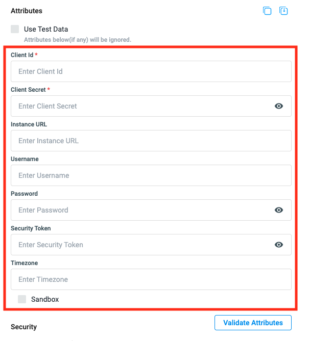
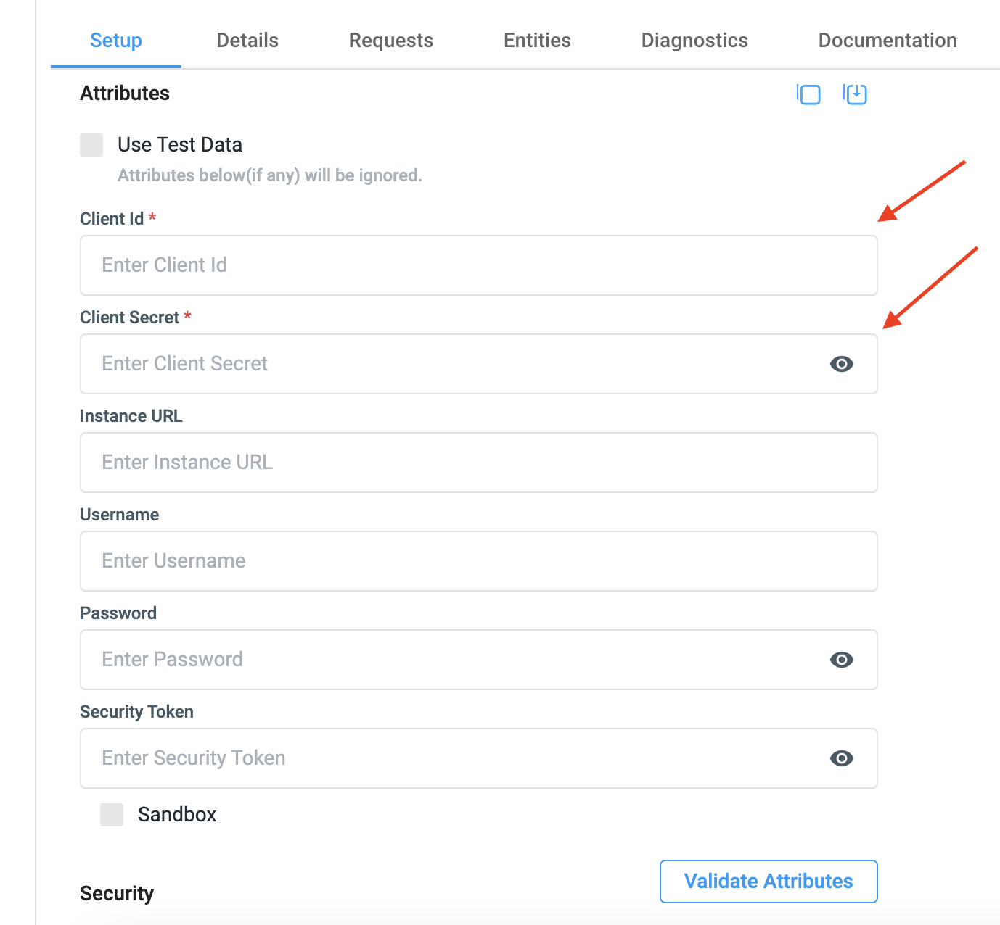
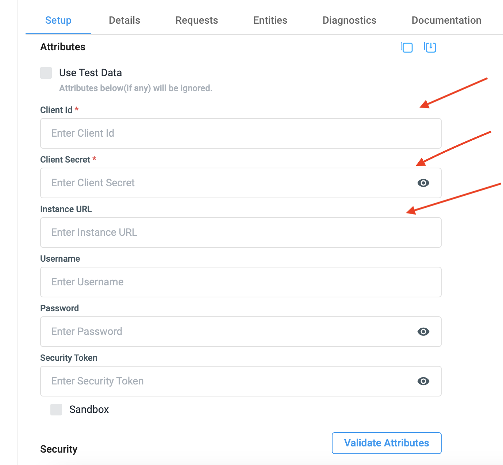
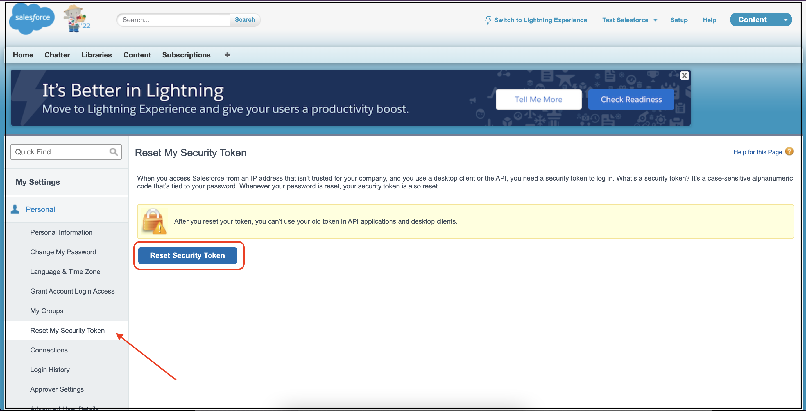
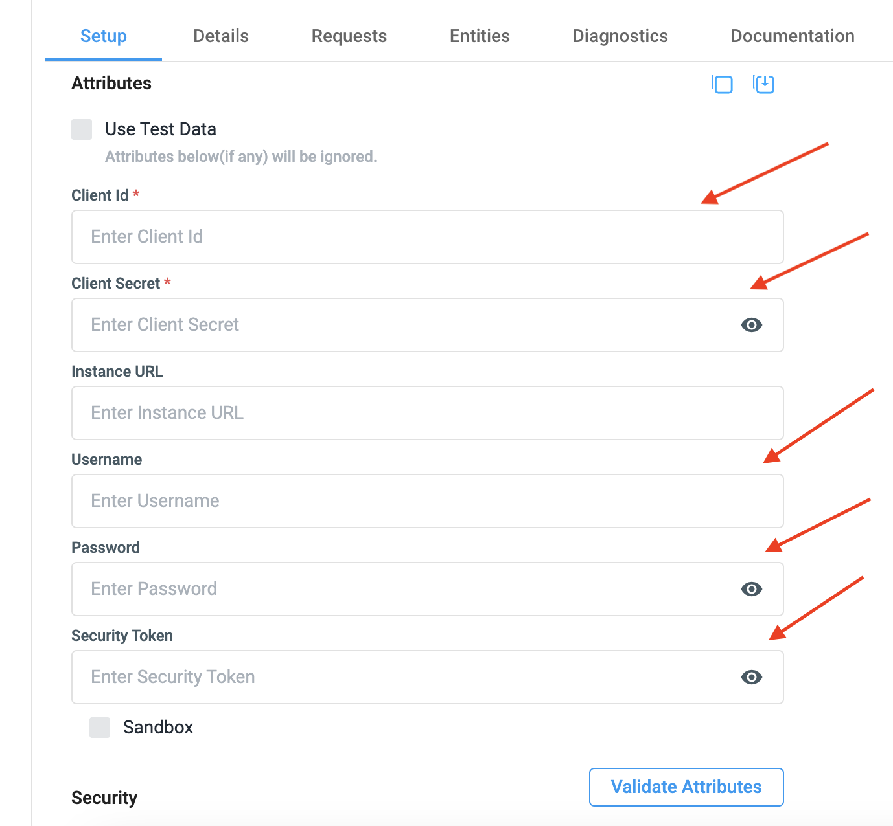

# Extension Configuration

## Overview

This guide explains how to configure the Krista Salesforce Sales Extension to connect to your Salesforce instance. The extension supports multiple authentication methods and can connect to both production and sandbox environments.

## Configuration Parameters

The following table lists all configuration parameters required to set up the extension:

| Parameter      | Type    | Required     | Description                                                            | Example                               |
|----------------|---------|--------------|------------------------------------------------------------------------|---------------------------------------|
| Client ID      | Text    | Yes          | OAuth 2.0 client identifier from your Salesforce Connected App         | "3MVG9fTLmJ60pJ5..."                  |
| Client Secret  | Text    | Yes          | OAuth 2.0 client secret from your Salesforce Connected App             | "1234567890ABCDEF..."                 |
| Instance URL   | Text    | No           | Your Salesforce instance URL (optional, auto-detected if not provided) | "https://mycompany.my.salesforce.com" |
| Username       | Text    | Conditional* | Salesforce username for Username-Password OAuth flow                   | "user@company.com"                    |
| Password       | Text    | Conditional* | Salesforce password for Username-Password OAuth flow                   | "MyP@ssw0rd"                          |
| Security Token | Text    | Conditional* | Salesforce security token for Username-Password OAuth flow             | "AbCdEfGhIjKlMnOp"                    |
| Sandbox        | Boolean | No           | Set to `true` to connect to a Salesforce sandbox environment           | false                                 |
| Time Zone      | Text    | No           | Time zone for date/time operations (optional)                          | "America/New_York"                    |

**Conditional Requirements***: Username, Password, and Security Token are required only when using the Username-Password OAuth flow for service account authentication. They are not needed for the Authorization Code flow (user authentication).



## Step-by-Step Setup

### Step 1: Create a Salesforce Connected App

Before configuring the extension, you must create a Connected App in Salesforce to obtain the Client ID and Client Secret.

👉 Follow the [Creating Salesforce Connected App](pages/CreatingSalesforceApp.md) guide for detailed instructions.

### Step 2: Access Extension Configuration in Krista

1. Log in to your Krista application
2. Navigate to **Extensions** in the main menu
3. Locate **Salesforce Sales** extension
4. Click **Configure** or **Setup**

### Step 3: Enter OAuth Credentials

1. **Client ID**: Copy the Consumer Key from your Salesforce Connected App and paste it here
2. **Client Secret**: Copy the Consumer Secret from your Salesforce Connected App and paste it here

> **⚠️ Security Warning**: Keep your Client Secret secure. Never share it or commit it to version control systems.

### Step 4: Choose Authentication Type

The extension supports two authentication modes:

#### Option A: User Authentication (Authorization Code Flow)
- **When to use**: When you want each user to authenticate with their own Salesforce account
- **Configuration**: Only Client ID and Client Secret are required
- **How it works**: Users will be redirected to Salesforce to log in when they first use the extension
- **Best for**: Interactive conversations where actions should be performed as the authenticated user

**Configuration for User Authentication:**
```
Client ID: [Your Client ID]
Client Secret: [Your Client Secret]
Instance URL: [Optional]
Sandbox: [true/false]

Leave Username, Password, and Security Token empty
```



#### Option B: Service Account Authentication (Username-Password Flow)
- **When to use**: When you want automated workflows using a single service account
- **Configuration**: Requires Client ID, Client Secret, Username, Password, and Security Token
- **How it works**: The extension authenticates automatically using the provided credentials
- **Best for**: Automated background processes, scheduled tasks, system-to-system integration

**Configuration for Service Account Authentication:**
```
Client ID: [Your Client ID]
Client Secret: [Your Client Secret]
Username: [Service Account Username]
Password: [Service Account Password]
Security Token: [Service Account Security Token]
Instance URL: [Optional]
Sandbox: [true/false]
```



> **📝 Note**: To obtain your Security Token, go to Salesforce → Settings → Reset My Security Token. Salesforce will email the token to you.



### Step 5: Configure Instance URL (Optional)

- **Production**: Leave blank or enter your production instance URL (e.g., `https://mycompany.my.salesforce.com`)
- **Sandbox**: Leave blank or enter your sandbox instance URL (e.g., `https://mycompany--sandbox.my.salesforce.com`)

> **💡 Tip**: The extension can auto-detect the instance URL during authentication. Only specify this if you need to connect to a specific instance.

### Step 6: Set Sandbox Flag

- Set **Sandbox** to `true` if connecting to a Salesforce sandbox environment
- Set **Sandbox** to `false` (or leave unchecked) for production environments

> **⚠️ Important**: The Sandbox flag determines which Salesforce OAuth endpoint is used. Make sure this matches your environment.

### Step 7: Save and Test Configuration



1. Click **Save** to store your configuration
2. The extension will validate your credentials
3. If using service account authentication, the extension will attempt to authenticate immediately
4. If using user authentication, authentication will occur when a user first accesses a Salesforce resource

## Redirect URI Configuration

The extension automatically generates a redirect URI (callback URL) based on your Krista appliance routing URL:

**Format**: `https://[your-krista-appliance]/rest/salesforcesales/callback`

**Example**: `https://krista.mycompany.com/rest/salesforcesales/callback`

### How to Configure Redirect URI in Salesforce

1. Go to your Salesforce Connected App settings
2. Find the **Callback URL** or **Redirect URI** field
3. Add the redirect URI shown in your Krista extension configuration
4. Save the Connected App settings

> **📝 Note**: The redirect URI must match exactly (including https://) between Salesforce and Krista, or authentication will fail.

## Authentication Flow Selection

The extension automatically determines which authentication flow to use based on the parameters you provide:

| Parameters Provided | Authentication Flow Used | Use Case |
|---------------------|-------------------------|----------|
| Client ID + Client Secret only | Authorization Code (User Auth) | Interactive user authentication |
| Client ID + Client Secret + Username + Password + Security Token | Username-Password (Service Account) | Automated service account |

### Configuring Authentication in Krista Conversations

When creating conversations that use Salesforce, you'll configure authentication in the **Ask a System** step:

#### For User Authentication (Authorization Code Flow):
Check the **"Have people authenticate with their account"** checkbox:


- Users will be prompted to authenticate with their Salesforce credentials
- Each user authenticates with their own account
- Actions are performed as the authenticated user

#### For Service Account Authentication (Username-Password Flow):
Leave the **"Have people authenticate with their account"** checkbox **unchecked**:


- Extension uses the configured service account credentials
- No user interaction required for authentication
- All actions are performed as the service account

## Security Considerations

### Best Practices

1. **Credential Storage**
   - Store credentials securely in Krista's encrypted configuration
   - Never hardcode credentials in conversations or code
   - Use environment-specific configurations for dev/test/prod

2. **Service Account Security**
   - Create a dedicated Salesforce user for the service account
   - Grant only the minimum required permissions
   - Use a strong password and rotate it regularly
   - Monitor service account activity in Salesforce

3. **OAuth Security**
   - Keep Client Secret confidential
   - Use HTTPS for all communications
   - Regularly review Connected App permissions
   - Revoke unused or compromised tokens

4. **Network Security**
   - Ensure Krista appliance can reach Salesforce (check firewalls)
   - Whitelist Krista appliance IP in Salesforce if using IP restrictions
   - Use VPN or private network for sensitive environments

### Permission Requirements

The service account or authenticated users must have the following Salesforce permissions:

- **API Enabled**: User must have API access enabled
- **Object Permissions**: Read/Write access to Opportunity, Lead, Account, Asset, Quote, Task, Event objects
- **Field Permissions**: Access to all fields used in catalog requests
- **Custom Field Access**: Read access to any custom fields you want to retrieve
- **Email Permissions**: Send Email permission for email-related catalog requests

## Troubleshooting

### Issue: "Invalid Client ID or Client Secret"

**Cause**: The OAuth credentials are incorrect or the Connected App is not properly configured.

**Resolution**:
1. Verify Client ID and Client Secret are copied correctly from Salesforce
2. Ensure there are no extra spaces or characters
3. Confirm the Connected App is approved and active in Salesforce
4. Check that OAuth is enabled in the Connected App settings

### Issue: "Authentication Failed" with Service Account

**Cause**: Username, password, or security token is incorrect.

**Resolution**:
1. Verify username is correct (usually an email address)
2. Confirm password is current and correct
3. Reset security token in Salesforce (Settings → Reset My Security Token)
4. Concatenate password + security token (e.g., if password is "Pass123" and token is "ABC", enter "Pass123ABC" as password, or enter them separately if fields are provided)
5. Ensure the user account has API access enabled

### Issue: "Redirect URI Mismatch"

**Cause**: The callback URL in Salesforce doesn't match the Krista redirect URI.

**Resolution**:
1. Copy the exact redirect URI from Krista extension configuration
2. Add it to the Callback URL field in your Salesforce Connected App
3. Ensure it includes `https://` and the correct path
4. Save the Connected App and wait a few minutes for changes to propagate

### Issue: "Insufficient Privileges"

**Cause**: The authenticated user or service account lacks required Salesforce permissions.

**Resolution**:
1. Verify the user has API Enabled permission
2. Check object-level permissions (Case, Contact, Account, etc.)
3. Verify field-level security settings
4. Ensure the user profile or permission set includes necessary access
5. For custom fields, verify field-level security is set to visible

### Issue: "Unable to Connect to Sandbox"

**Cause**: Sandbox flag is not set correctly or instance URL is wrong.

**Resolution**:
1. Set Sandbox flag to `true` for sandbox environments
2. Verify the instance URL points to your sandbox (e.g., `https://mycompany--sandbox.my.salesforce.com`)
3. Ensure your Connected App exists in the sandbox environment
4. Refresh sandbox if recently created

### Issue: "Token Expired" Errors

**Cause**: Access token or refresh token has expired.

**Resolution**:
1. For user authentication: User will be prompted to re-authenticate automatically
2. For service account: Extension will automatically refresh the token
3. If issues persist, re-save the extension configuration to force re-authentication
4. Check Salesforce session settings and token expiration policies

## Next Steps

After configuring the extension:

1. **Test Authentication**: Create a simple conversation using a catalog request to verify connectivity
2. **Review Authentication Modes**: Read the [Authentication](pages/Authentication.md) guide to understand OAuth flows
3. **Explore Catalog Requests**: Check available [Opportunity Management](pages/GetOpportunities.md) and [Content Operations](pages/RetrieveCustomFieldsForGivenObject.md)
4. **Set Up Alerts**: Configure opportunity change alerts for real-time notifications

## See Also

- [Creating Salesforce Connected App](pages/CreatingSalesforceApp.md)
- [Authentication](pages/Authentication.md)
- [Troubleshooting Guide](pages/Troubleshooting.md)

