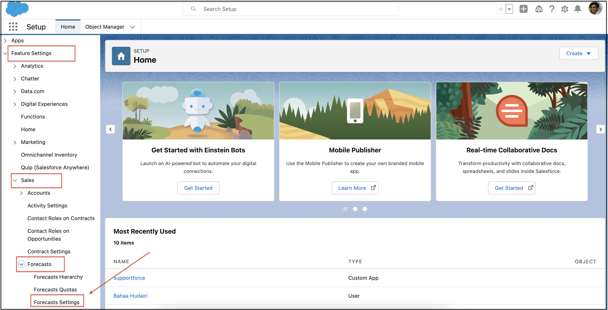
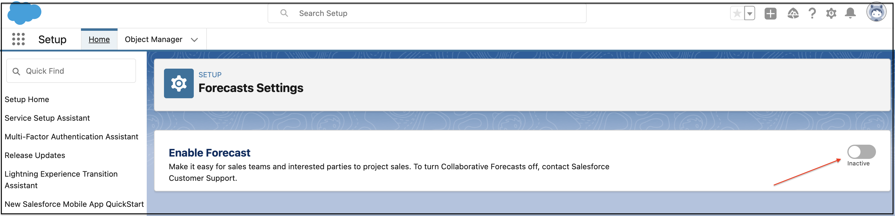
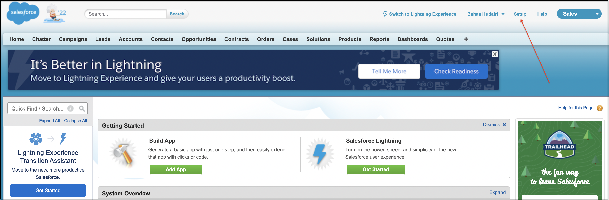
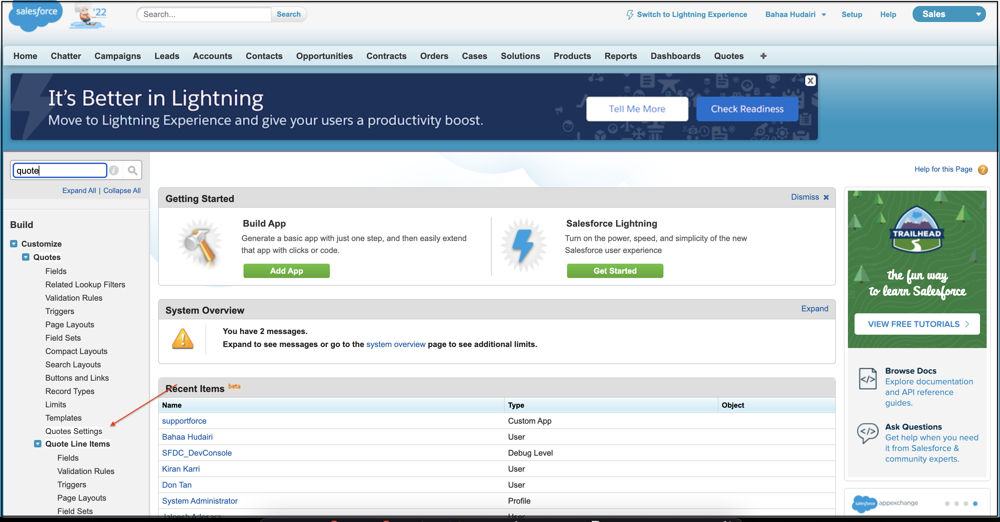
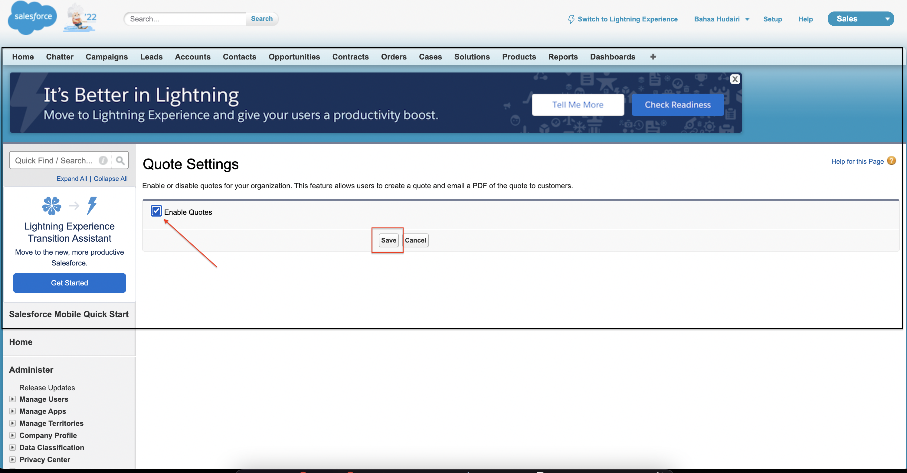
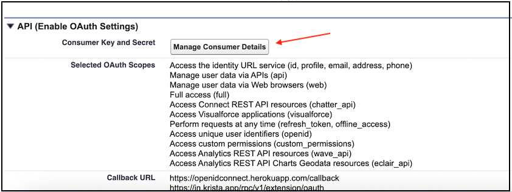
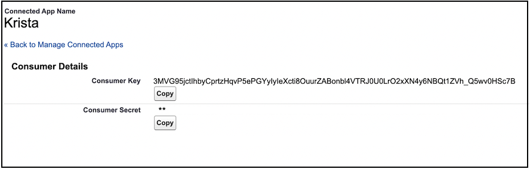

# Get Sales Forecast For A Specific Quarter

* Enable access of forecast entity. To enable access need salesforce lightning.

  * On the SETUP Home page, under the **Feature Settings** menu on the left panel, click **Sales**, followed by **Forecasts**, followed by **Forecasts Settings**.
    
  * Click on switch to active access.
    

* Enable access of quote entity. To enable access need salesforce classic.
  * Navigate to the Setup icon and then click **Setup**.
    
  * Search quote in quick find and select quote settings.
    
  * Select enable quotes and click on save.
    

* Navigate to **App Manager** in setup page and select created app.

* On the App Info page, click **Manage Consumer Details**.

  

* On the next page, Consumer Key and Consumer Secret would be displayed. The Consumer key is the Client ID, and the Consumer secret is the Client Secret. Save these for further usage.

  

* Provide the values of Client ID and Client Secret in your Extension setup page and proceed with the Extension request.