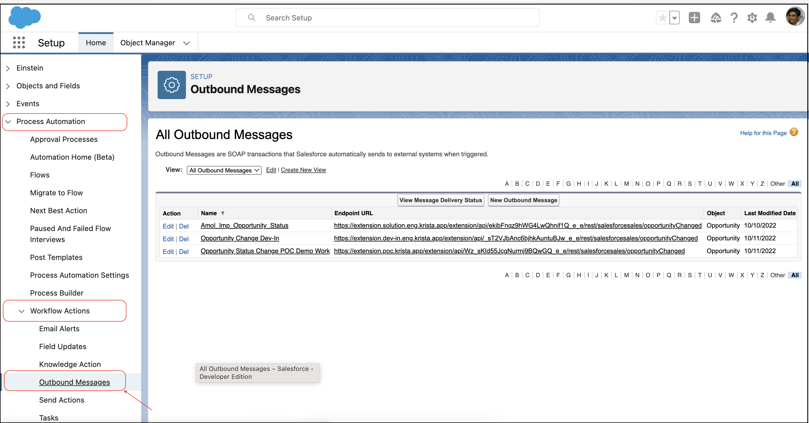
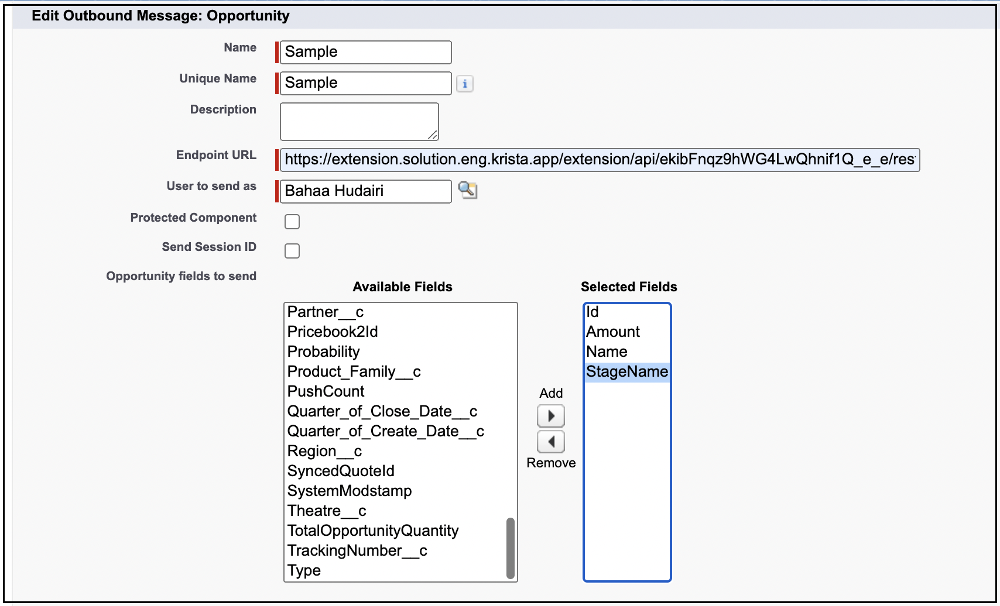
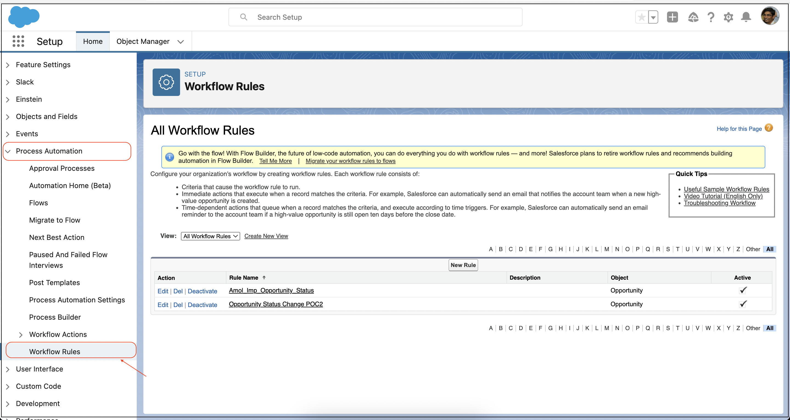

# Opportunity Change Alert

## Overview

The Opportunity Change Alert catalog request enables real-time notifications when opportunities are created or updated in Salesforce. This alert system helps sales teams stay informed about critical changes to their sales pipeline.

## Request Details

- **Catalog Request Name**: Opportunity Change Alert
- **Description**: This request is for the changes in the opportunities
- **Type**: Alert/Notification Request
- **Trigger**: Opportunity creation or modification

## Parameters

### Input Parameters
- **No Parameters Required** - This is an alert-based request that triggers automatically

### Output Parameters

| **Parameter Name** | **Parameter Type** | **Description** |
|--------------------|--------------------|-----------------|
| Response           | MultiField         | Contains opportunity change details |

## Response Format

The alert response includes key opportunity information:
- **Amount**: Opportunity value
- **ID**: Unique opportunity identifier  
- **Name**: Opportunity name
- **StageName**: Current opportunity stage

## Setup Instructions

### Steps To Create Alert In Salesforce Sales

#### Step 1: Create Outbound Message

1. Navigate to the Setup icon and then click **Setup**.
   

2. On the SETUP Home page, under the **Process Automation** menu on the left panel, under the **Workflow Actions**, click **Outbound Messages**.
   

3. On the **Outbound Messages** page, click **New Outbound Message**.

4. From the Object drop-down list, select **Opportunity** as an object then click **Next**.

5. On the next page enter **Name**.

6. Enter **Endpoint URL**
   - Go to the Detail's page of the extension and copy the Routing id from there. After that, append **'/rest/salesforcesales/opportunityChanged'** at the end of the routing id (This is your endpoint url).
   
   

7. Select **Opportunity fields to send** as **Amount**, **ID**, **Name**, and **StageName**, and then click **Save**.

   

#### Step 2: Create Workflow Rule

1. On the SETUP Home page, under the **Process Automation** menu on the left panel, click **Workflow Rules**.
   

2. On the **Workflow Rules**, click **New Rule** and select **Continue with Workflow Rules**.

3. On the Workflow Rules page, select **Opportunity** as object then click **Next**.

4. On the next page add **Rule Name**, **Evaluation Criteria**, and **Rule Criteria** and then click **Save & Next**.

5. On the next page click **Add Workflow Action** and select **Select Existing Action**.

6. On the next page select **Outbound Message** under the **Choose Action Type**.

7. And select your created Outbound Message under **Available Actions** and click Add arrow, and then click **Save**.

8. Now click **Done** button.

## Use Cases

1. **Pipeline Monitoring**: Track changes to opportunity stages and amounts
2. **Sales Team Notifications**: Alert team members when opportunities are updated
3. **Revenue Tracking**: Monitor changes to opportunity values
4. **Stage Progression**: Track opportunities moving through sales stages
5. **Data Synchronization**: Keep external systems updated with opportunity changes

## Best Practices

1. **Field Selection**: Only include necessary fields in the outbound message to reduce payload size
2. **Rule Criteria**: Set specific criteria to avoid unnecessary alerts
3. **Endpoint Security**: Ensure the endpoint URL is secure and accessible
4. **Error Handling**: Implement proper error handling for failed notifications
5. **Testing**: Test the workflow thoroughly before activating in production

## Technical Implementation

### Endpoint Configuration
- **URL Pattern**: `{routing_id}/rest/salesforcesales/opportunityChanged`
- **Method**: POST
- **Content-Type**: application/xml

### Required Fields
- Amount
- ID  
- Name
- StageName

## Troubleshooting

### Common Issues
1. **Alerts Not Triggering**: Check workflow rule criteria and activation status
2. **Endpoint Errors**: Verify routing ID and endpoint URL format
3. **Missing Data**: Ensure all required fields are selected in outbound message
4. **Permission Issues**: Verify user has appropriate Salesforce permissions

## Related Requests

- [Get Opportunities](pages/GetOpportunities.md) - Retrieve opportunity data
- [Update Status Of Opportunities](pages/UpdateStatusOfOpportunities.md) - Modify opportunity stages
- [Account Change Alert](pages/AccountChangeAlert.md) - Similar alert for accounts

## See Also

- [Opportunity Entity](pages/entities/Opportunity.md)
- [User Entity](pages/entities/User.md)
- [Extension Configuration](pages/ExtensionConfiguration.md)
