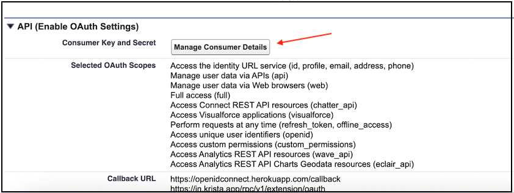
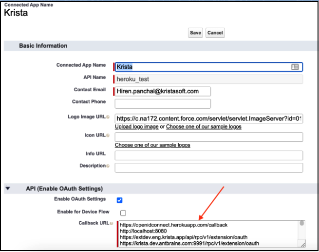

# Configuring the Krista Salesforce Sales Module Extension

### Configuration Steps

* Username, Password, Client ID, Client Secret and Security Token:
  * In order to make connection, you have to provide username, password, client id, client secret and security token in setup parameters.
  * You can use salesforce login credentials as username and password.
  * You can get client id and client secret from your registered web application in salesforce portal. You can get these parameters by clicking on **Manage Consumer Details** from **App Manager** tab on the setup page.
    
  * For **Security Token**, you must use the security token that you received on your registered email after you reset it on Salesforce system.

* Once you have provided the username, password, client id and client secret you must authorize yourself with the same account which is used to register the application in salesforce portal. Click on the view button of your registered app.

* In order to authorize yourself you are required to follow these steps:
   * Go to the Detail's page of the extension and copy the Routing id from there. After that, append **"/rest/salesforcesales/callback"** at the end of the routing id (This is you redirect uri). Now add this uri in Authorized redirect uri in credentials of your registered app in salesforce portal.
     
     
   * Now click on the validate button. Once you click on validate , an authentication page will appear. Click on that tab and authorize yourself using the same account which is used to register your application in salesforce portal.

* Once you are authorized, you can see if the connection is established by clicking test connection on setup page.

* After the connection is established, you are good to go with the requests of the extension.
