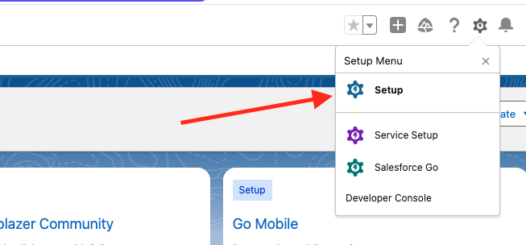
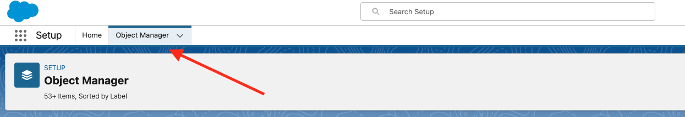
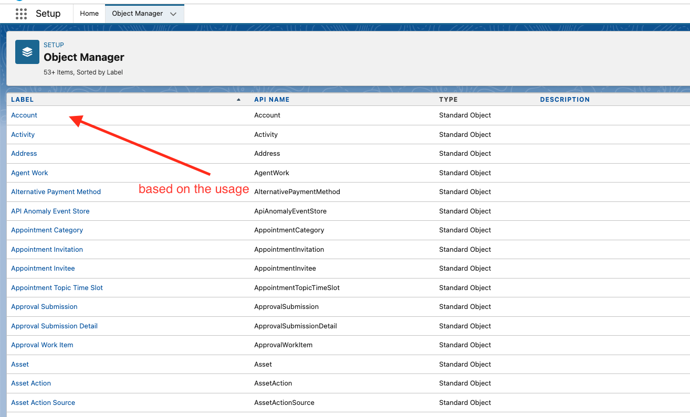
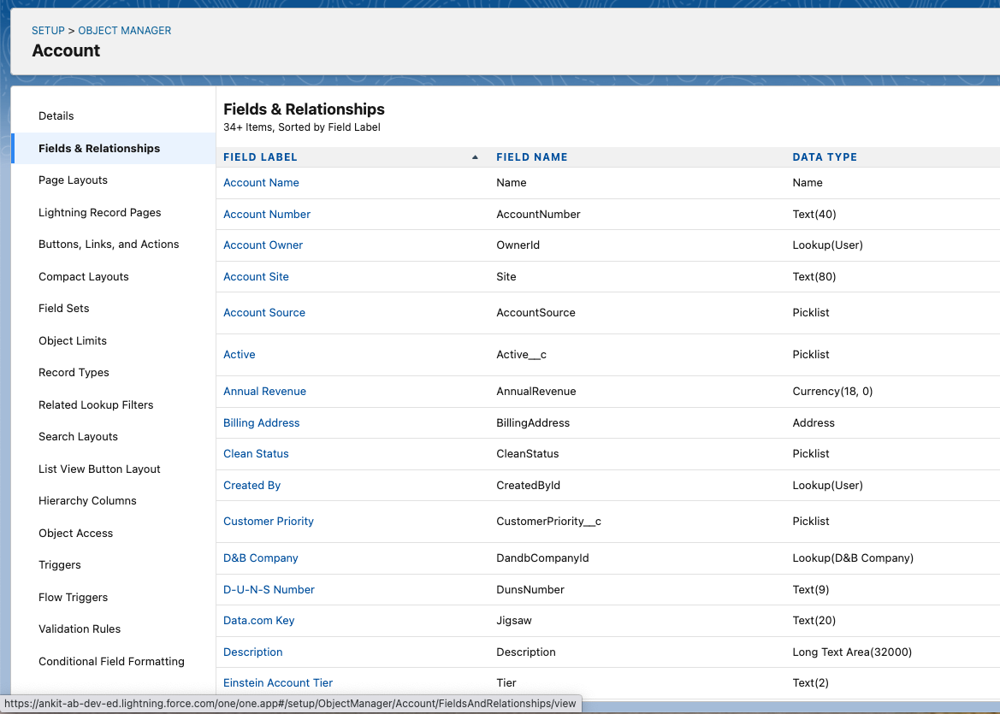
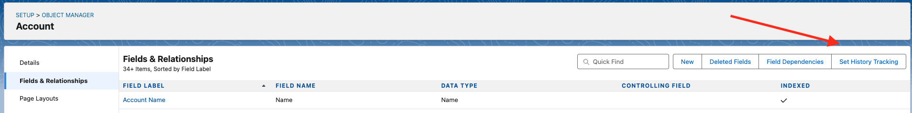
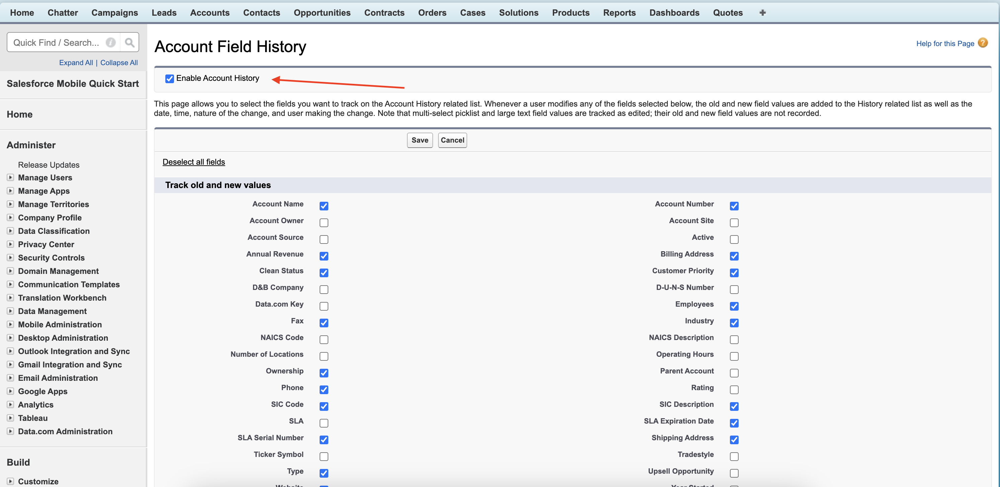
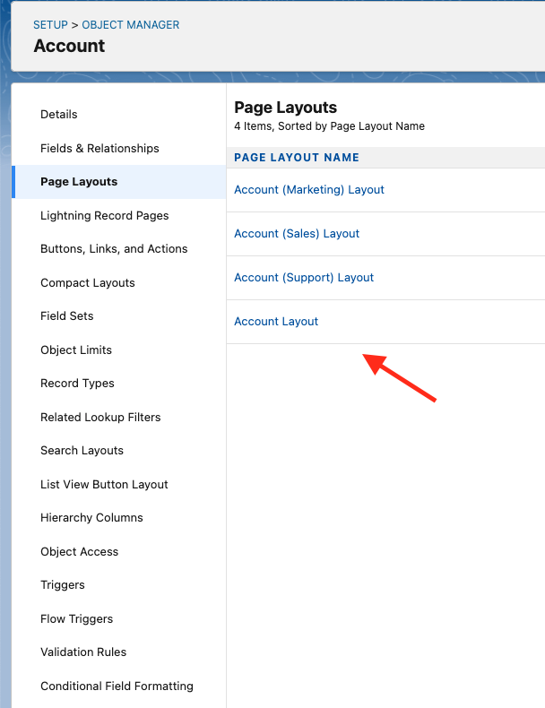

# Salesforce Account/Lead History Setup Guide

1. **Click on Setup icon** on the upper right of the Salesforce page.  
   

2. **Select Object Manager** on the left upper navigation bar.  
   

3. **Select Account** if you are working with account change alert and **Lead** if you are working with lead change alert as the LABEL.  
   

4. **Select Fields and Relationships** from the left menu.  
   

5. **Click on “Set History Tracking”** on the upper right and enable **Account History**.  
   

6. **Select the required fields** and save.  
   

7. **Select Page Layouts** from the left menu.

8. **Click on Account Layout** if you are working with account change alert and **Lead Layout** if you are working with lead change alert from the given options.  
   

9. **Click on Related Lists.**

10. **Drag and drop the Account History icon** for account change alert and **Lead History icon** for lead change alert in the Related Lists section below, then save the changes.  
    
