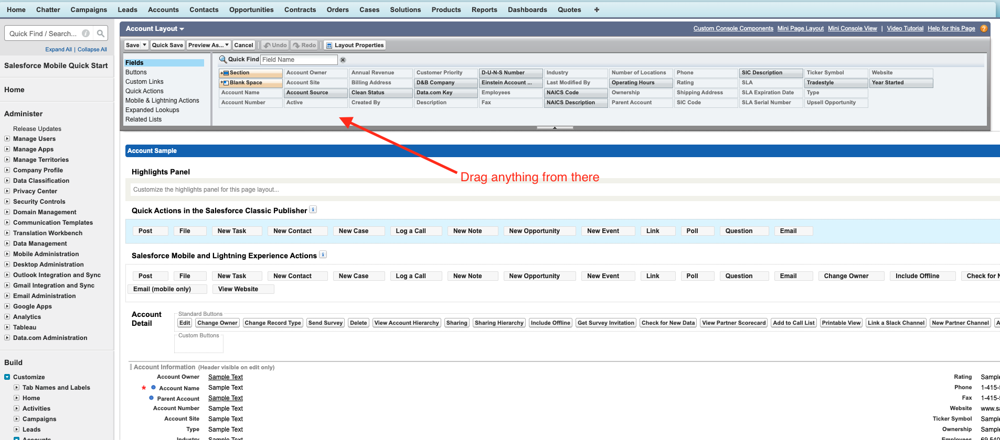

* Click on Setup icon on the upper right of the salesforce page.
* Select object manager on the left upper navigation bar. 
* Select Account if you are working with account change alert and Lead if you are working with lead change alert as the LABEL. 
* Select Fields and Relationships from the left menu. 
* Click on “Set History Tracking” on the upper right and enable Account History. 
* Select the below given fields and save.
  
* Select Page Layouts from the left menu.
* Click on Account Layout if you are working with account change alert and Lead Layout if you are working with lead change alert from the given options.
* Click on Related Lists.
* Drag and drop the Account History icon for account change alert and Lead History icon for lead change alert in the Related Fields below and save the changes.
  
