# Obtaining User and OAuth2.0 Credentials

### Username, Password, and Security Token

* If you already have a Salesforce Developer Account, use the pre-existing user credentials as Username and Password.

* If you don’t have a pre-existing account, sign up for a new Salesforce Developer Account.

* Go to Service account page of salesforce portal from [here](https://developer.salesforce.com/).

* Now click on **Sign Up** button. A page window will appear. Enter all the personal details and click **Sign Me Up**.

* Ensure that you check the verification email in your Inbox. Click **Verify Account**.

  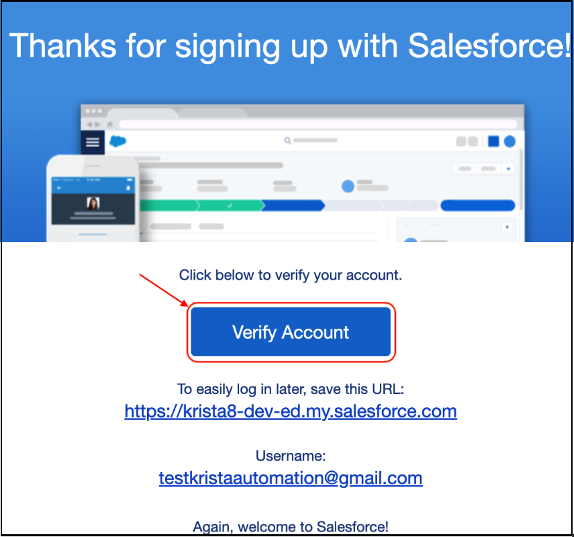

  
* You will be redirected to the **Change Your Password** page on the Salesforce system. Set up the new password following the guidelines. Also, configure the **Security Question** and **Answer**.

  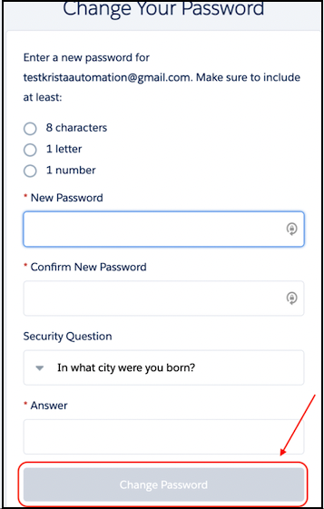

* Click **Change Password**. Save these user credentials to use from now onward as **Username** and **Password** for Krista Salesforce Sales Extension setup.

* Log in to your Salesforce account. Navigate to user profile and click **Settings**.

  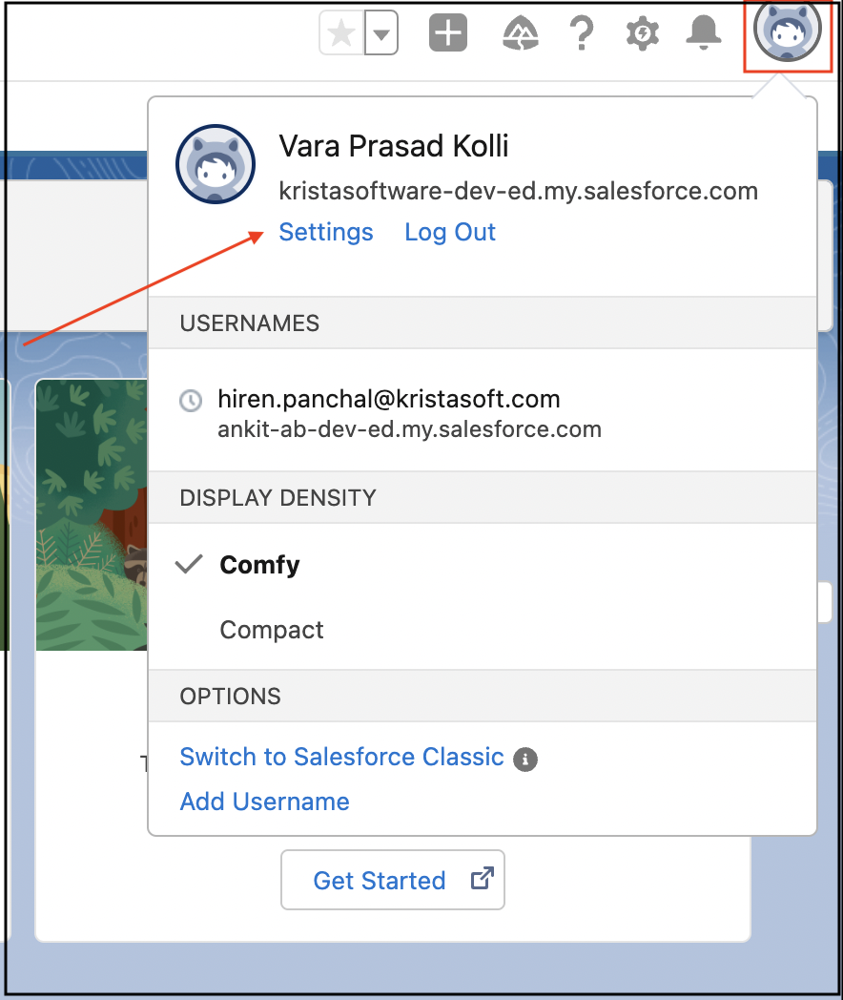

* On the navigation panel, click **Reset My Security Token** and **Reset Security Token**. You will receive unique security token ID on your registered email. Save this security token to use from now onward as **Security Token** on Krista Salesforce Marketing extension setup.

  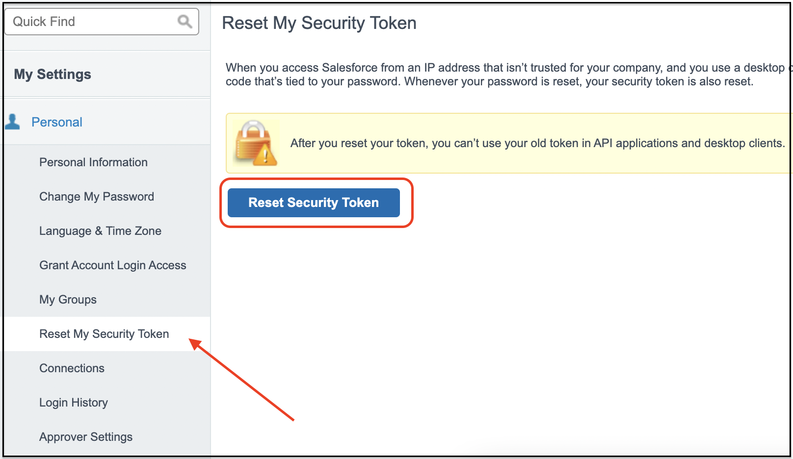

### Obtaining Client ID and Client Secret for OAuth2.0

* Go to the login page of the salesforce portal. [Click Here](https://login.salesforce.com/)

* Navigate to the Setup icon and then click **Setup**.

  

   
* On the SETUP Home page, under the **Apps** menu on the left panel, click **Apps Manager**.

  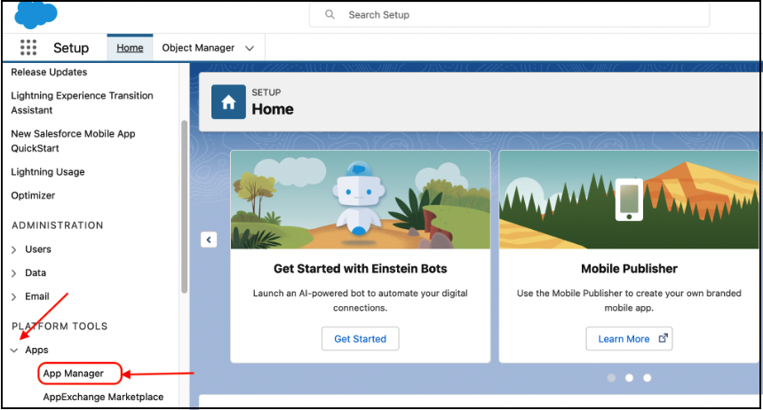

  
* On the SETUP Lightening Experience App Manager, click **New Connected App**.
  
  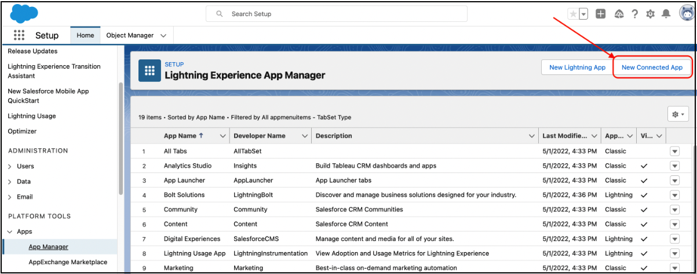

* On the App creation page, in the Basic Information panel, enter the details for the **Connected App Name**, **API Name**, and **Contact Email** fields. These are mandatory fields. If you want, you can set up additional fields such as **Logo Image URL**.

  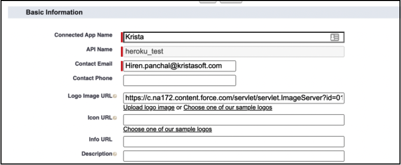

* In the API (Enable OAuth Settings) panel, select the **Enable OAuth Settings** checkbox.

* Enter the **Callback URL** details corresponding to your extension.
  * Go to the Detail's page of the extension and copy the Routing id from there. After that, append **'/rest/salesforcesales/callback'** at the end of the routing id (This is you redirect uri)

  

* In **Selected OAuth Scopes**, add the following scope entries:
  * Access the identity URL service (id, profile, email, address, phone)
  * Access unique user identifiers (openid)
  * Manage user data via APIs (api)
  * Perform requests at any time (refresh_token, offline_access)

* Select the **Require Secret for Web Server Flow** checkbox.

* Select the **Require Secret for Refresh Token Flow** checkbox.

  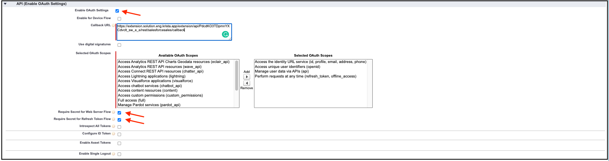
  

* Click **Save**.

* On the App Info page, click **Manage**.

* On the next screen, click **Edit Policies**.

* For the Permitted Users in OAuth policies, select **All users may self-authorize**.

* For the Refresh Token Policy, select **Refresh token is valid until revoked**.

* Click **Save**.

  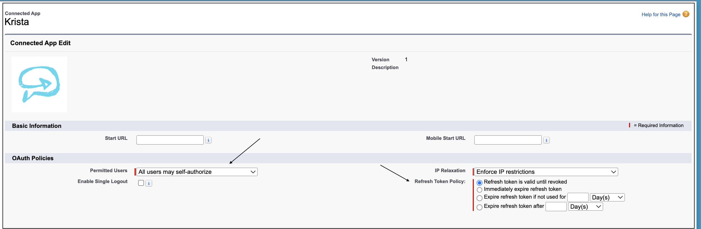

* Enable access of forecast entity. To enable access need salesforce lightning.
  * On the SETUP Home page, under the **Feature Settings** menu on the left panel, click **Sales**, followed by **Forecasts**, followed by **Forecasts Settings**.
    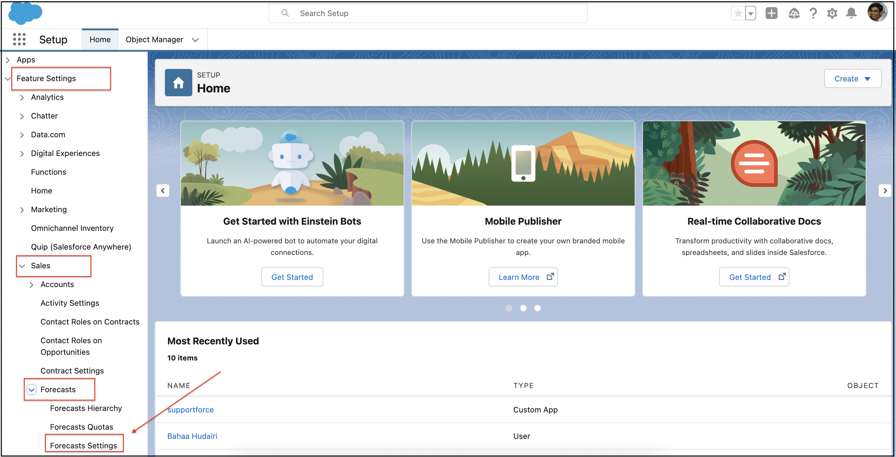
  * Click on switch to active access.
    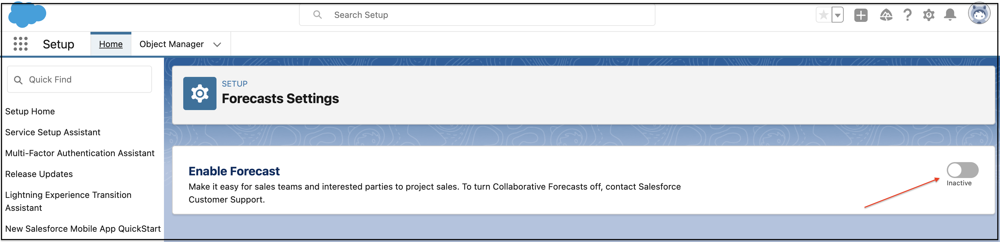

* Enable access of quote entity. To enable access need salesforce classic.
  * Navigate to the Setup icon and then click **Setup**.
    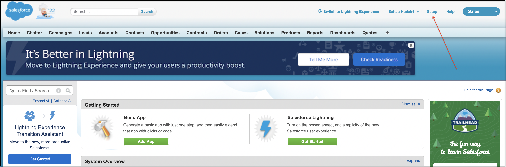
  * Search quote in quick find and select quote settings.
    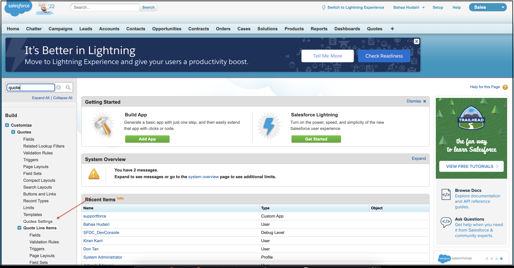
  * Select enable quotes and click on save.
    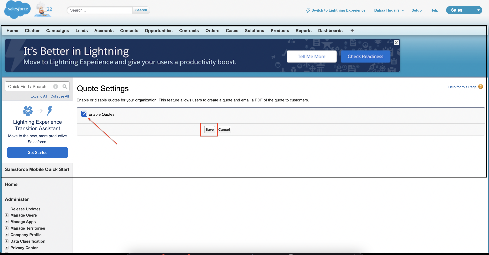

* Navigate to **App Manager** in setup page and select created app.

* On the App Info page, click **Manage Consumer Details**

  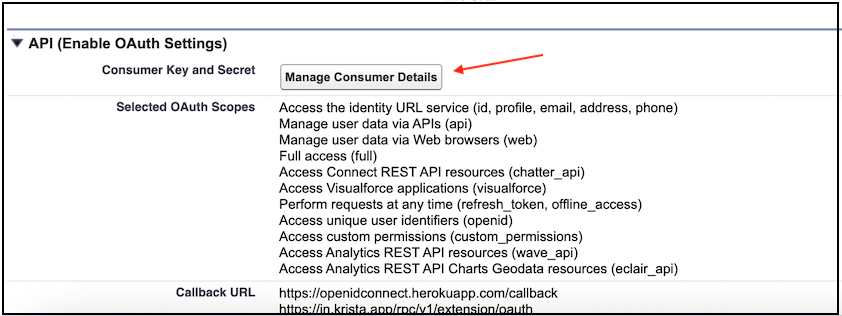

* On the next page, Consumer Key and Consumer Secret would be displayed. The Consumer key is the Client ID, and the Consumer secret is the Client Secret. Save these for further usage.

  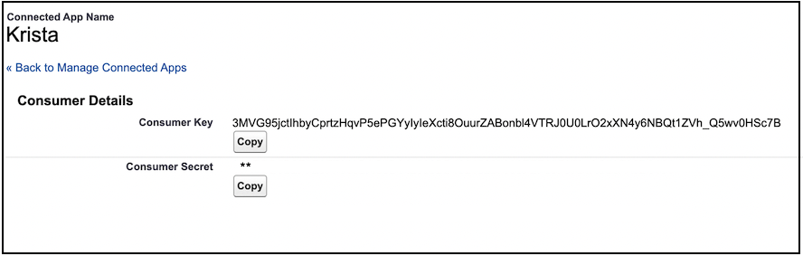

* Provide the values of Client ID and Client Secret in your Extension setup page and proceed with the Extension request.