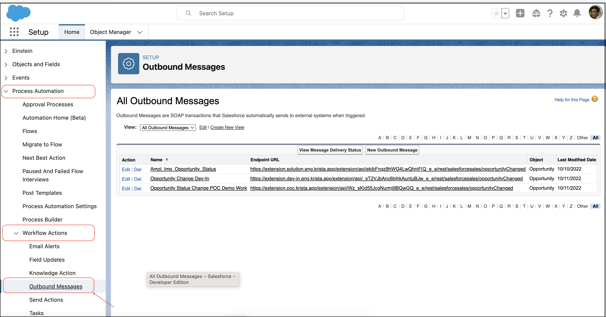
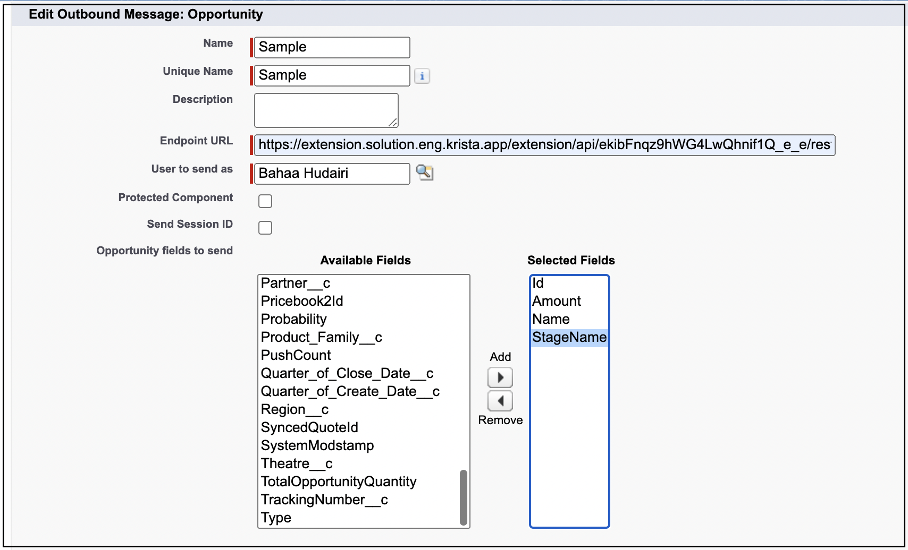
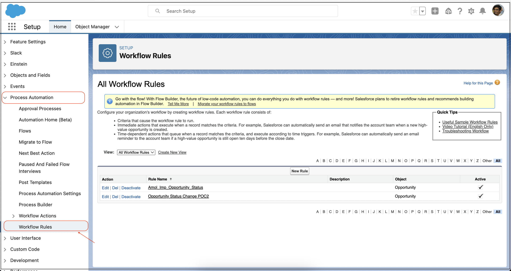
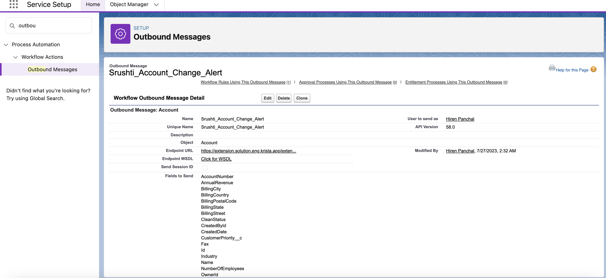
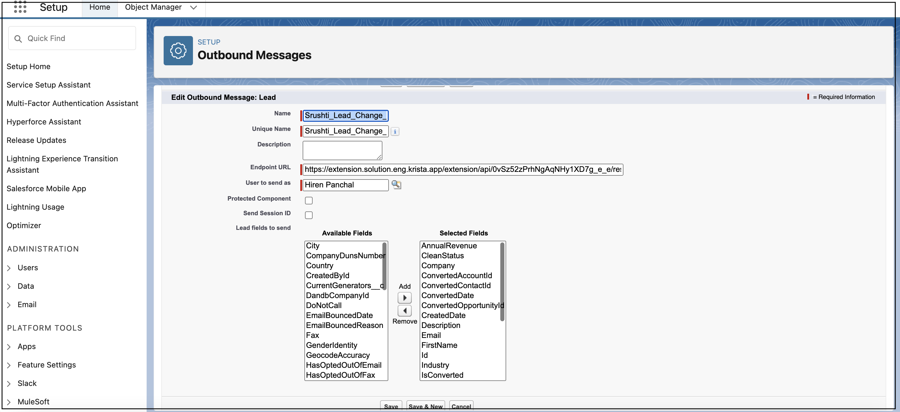
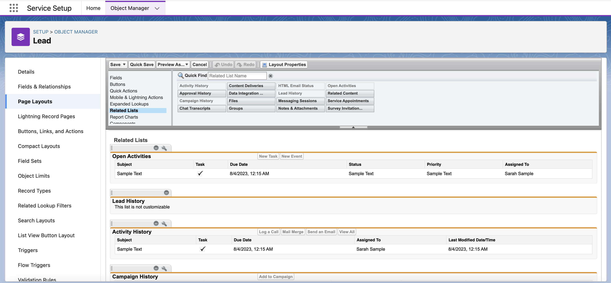
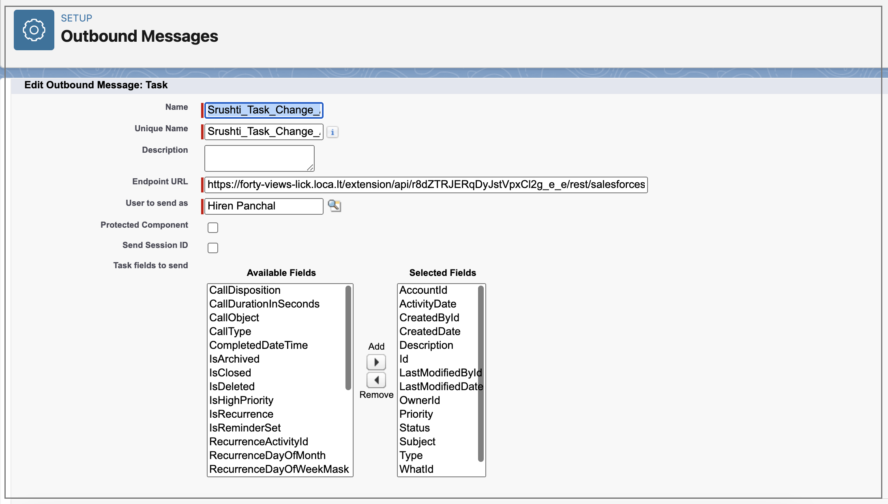
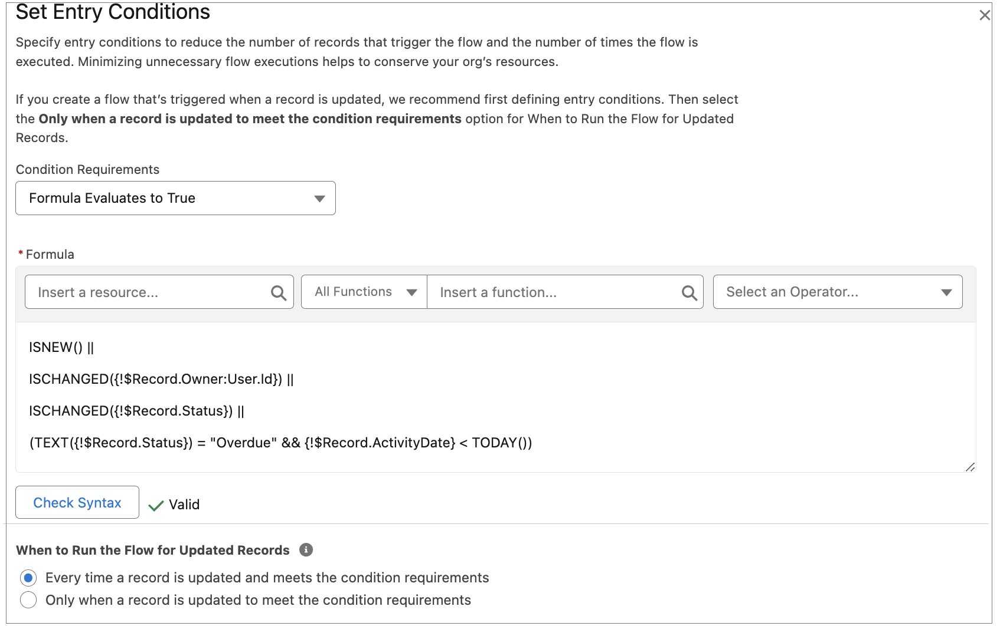
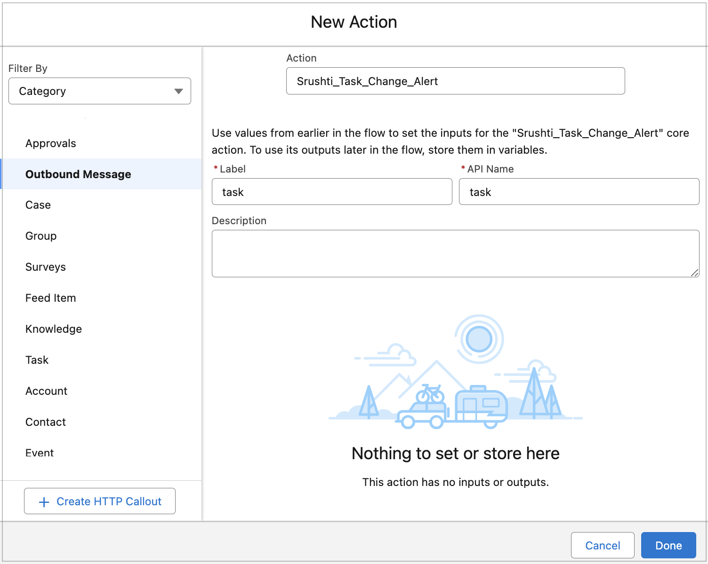

# Supported Requests

## Catalog Requests

Krista Salesforce Sales extension supports the following Catalog Requests:

### Quote Management Area

#### Add Product To A Quote

- **Description**: The request adds to the quote, a new product with a price entry book identifier.
- **Input Parameters**:

| **Parameter Name** | **Parameter Type** | **Mandatory** | **Example**        |
|--------------------|--------------------|---------------|--------------------|
| Quote Id           | Text               | Yes           | 0065w00002AlDtDAAM |
| Pricebook Entry Id | Text               | Yes           | 01u5g00000505tMAAQ |
| Quantity           | Number             | Yes           | 2.0                |
| Discount Percent   | Number             | No            | 29                 |

- Note: Obtain the Quote Id and Pricebook Entry Id from the Quote Entity Search Request.

- **Output Parameters**:

| **Parameter Name**    | **Parameter Type** |
|-----------------------|--------------------|
| All Products In Quote | List&lt;FreeForm>  |

#### Update Quote By Quote Id

- **Description**: This request updates the quote for a specific quote Id with details.
- **Input Parameters**:

| **Parameter Name** | **Parameter Type** | **Mandatory** | **Example**                        |
|--------------------|--------------------|---------------|------------------------------------|
| Quote Id           | Identifier         | Yes           | 0065w00002AlDtDAAM                 |
| Quote Fields       | Expression         | Yes           | [{"Quantity":12},{"Discount": 23}] |

- Note: Obtain the Quote ID and supported Quote Fields from Quote Entity Search Request.

- **Output Parameters**:

| **Parameter Name** | **Parameter Type** |
|--------------------|--------------------|
| Updated Quote      | Quote              |

#### Get Quote Details

- **Description**: This request fetches all the details of a quote.
- **Input Parameters**:

| **Parameter Name** | **Parameter Type** | **Mandatory** | **Example**        |
|--------------------|--------------------|---------------|--------------------|
| Quote Id           | Identifier         | Yes           | 0065w00002AlDtDAAM |

- Note: Obtain the Quote Identifier from the Quote Entity Search Request.

- **Output Parameters**:

| **Parameter Name** | **Parameter Type** |
|--------------------|--------------------|
| Quote Details      | Quote              |

#### Get All Quote Status

- **Description**: This request fetches all the statuses of a quote.
- **Input Parameters**: No Input Parameters Required

- **Output Parameters**:

| **Parameter Name** | **Parameter Type** |
|--------------------|--------------------|
| Statuses           | List&lt;Text&gt;   |

#### Update Quote Status By Id

- **Description**: This request updates quote status for a Quote Id.
- **Input Parameters**:

| **Parameter Name** | **Parameter Type** | **Mandatory** | **Example**        |
|--------------------|--------------------|---------------|--------------------|
| Quote Id           | Identifier         | Yes           | 0065w00002AlDtDAAM |
| Status             | Text               | Yes           | Approved           |

- Note: Obtain the Quote Id from the Quote Entity Search Request.

- **Output Parameters**:

| **Parameter Name** | **Parameter Type** |
|--------------------|--------------------|
| New Status         | Text               |

#### Get The Latest Quote From Opportunity

- **Description**: This request returns the quote for an Opportunity Id.
- **Input Parameters**:

| **Parameter Name** | **Parameter Type** | **Mandatory** | **Example**        |
|--------------------|--------------------|---------------|--------------------|
| Opportunity Id     | Identifier         | Yes           | 0065w00002AlDtDAAM |

- Note: Obtain the Opportunity Id from the Opportunity Entity Search Request.

- **Output Parameters**:

| **Parameter Name** | **Parameter Type** |
|--------------------|--------------------|
| Quote              | Quote              |

#### Get Quote Line Item By Quote Id

- **Description**: This request returns the Quote Line items with important fields such as quantity, sales price and
  discount.
- **Input Parameters**:

| **Parameter Name** | **Parameter Type** | **Mandatory** | **Example**                                             |
|--------------------|--------------------|---------------|---------------------------------------------------------|
| Quote Id           | Identifier         | Yes           | 0065w00002AlDtDAAM                                      |
| Filters            | Expression         | No            | [{"Quantity":"12"},{"Product2Id":"01t5g000007LIXzAAO"}] |

- Note: Obtain the Quote Id from the Quote Entity. Ensure that the keys and values of the Filter Expression are strings.

- **Output Parameters**:

| **Parameter Name** | **Parameter Type** |
|--------------------|--------------------|
| Quote Line Item    | List&lt;FreeForm>  |

### Weekly Summary Area

#### Get Revenue Closed In Current Quarter

- **Description**: This request returns a value for the Revenue Closed amount for the time span of the current quarter.
- **Input Parameters**: No Input Parameters Required

- **Output Parameters**:

| **Parameter Name** | **Parameter Type** |
|--------------------|--------------------|
| Closed Revenue     | Text               |

#### Get Revenue Expected To Close In Current Quarter

- **Description**: This request will return the 'Revenue Expected To Close' amount in the current quarter.
- **Input Parameters**: No Input Parameters Required

- **Output Parameters**:

| **Parameter Name** | **Parameter Type** |
|--------------------|--------------------|
| Expected Revenue   | Text               |

### Assets Management Area

#### Update An Asset

- **Description**: This request modifies the asset data with the input parameters for an Asset Id.
- **Input Parameters**:

| **Parameter Name**    | **Parameter Type** | **Mandatory** | **Example**        |
|-----------------------|--------------------|---------------|--------------------|
| Id                    | Text               | Yes           | 0065w00002AlDtDAAM |
| Contact Id            | Text               | Yes           | 0035g00000hUxJPAA0 |
| Account Id            | Text               | Yes           | 0015g00000u7ZScAAM |
| Is Competitor Product | Yes/No             | Yes           | No                 |

- Note: Obtain the Asset Id, Account Id, and Contact Id from the Asset Entity Search Request.

- **Output Parameters**:

| **Parameter Name** | **Parameter Type** |
|--------------------|--------------------|
| Asset              | Asset              |

#### Delete An Asset

- **Description**: This request deletes the asset for an Asset Id.
- **Input Parameters**:

| **Parameter Name** | **Parameter Type** | **Mandatory** | **Example**        |
|--------------------|--------------------|---------------|--------------------|
| Id                 | Text               | Yes           | 0065w00002AlDtDAAM |

- Note: Obtain the Asset Id from the Asset Entity Search Request.

- **Output Parameters**:

| **Parameter Name** | **Parameter Type** |
|--------------------|--------------------|
| Status             | Yes/No             |

### Opportunity Management Area

#### Get Opportunities

- **Description**: This request returns the list of opportunities filtered by a SQL query or the list of last day's
  opportunities.
- **Input Parameters**:

| **Parameter Name** | **Parameter Type** | **Mandatory** | **Example**                                                                                 |
|--------------------|--------------------|---------------|---------------------------------------------------------------------------------------------|
| SOQL Query         | Text               | No            | "SELECT NAME FROM OPPORTUNITY WHERE ID = '0065w00002AlDtDAAM'", "ID = '0065w00002AlDtDAAM'" |
| Last Days          | Number             | No            | 7                                                                                           |

- **Output Parameters**:

| **Parameter Name** | **Parameter Type**   |
|--------------------|----------------------|
| Opportunities      | List&lt;Opportunity> |

#### Update Opportunity Status By Name

- **Description**: This request updates the status of all the opportunities filtered by a name.
- **Input Parameters**:

| **Parameter Name** | **Parameter Type** | **Mandatory** | **Example**      |
|--------------------|--------------------|---------------|------------------|
| Opportunity Name   | Text               | Yes           | Test Opportunity |
| Status             | Text               | Yes           | In Review        |

- **Output Parameters**:

| **Parameter Name** | **Parameter Type** |
|--------------------|--------------------|
| Status             | Yes/No             |

#### Update Status Of Opportunities

- **Description**: This request changes the status of opportunities.
- **Input Parameters**:

| **Parameter Name**   | **Parameter Type**   | **Mandatory** | **Example**             |
|----------------------|----------------------|---------------|-------------------------|
| Opportunities        | List&lt;Opportunity> | Yes           | Test Opportunity Entity |
| Status or Stage Name | Text                 | Yes           | In Review               |

- **Output Parameters**:

| **Parameter Name**    | **Parameter Type**   |
|-----------------------|----------------------|
| Updated Opportunities | List&lt;Opportunity> |

#### Update An Opportunity

- **Description**: This request modifies an opportunity with the given input parameters.
- **Input Parameters**:

| **Parameter Name** | **Parameter Type** | **Mandatory** | **Example**                   |
|--------------------|--------------------|---------------|-------------------------------|
| Opportunity Id     | Text               | Yes           | 0035g00000hUxJPAA0            |
| Opportunity Name   | Text               | No            | Test Opportunity              |
| Close Date         | Date               | No            | 12 Dec 2022                   |
| Stage Name         | Text               | No            | In Review                     |
| Amount             | Number             | No            | 200000.00                     |
| Description        | Paragraph          | No            | Description about opportunity |

- Note: Opportunity Id can be found in Opportunity Entity Search Request.

- **Output Parameters**:

| **Parameter Name**  | **Parameter Type** |
|---------------------|--------------------|
| Updated Opportunity | Opportunity        |

#### Get My Details

- **Description**: This request will return the currently logged-in user's profile details.
- **Input Parameters**: No Parameters Required

- **Output Parameters**:

| **Parameter Name** | **Parameter Type** |
|--------------------|--------------------|
| User               | User               |

#### Get The Latest Posts For Opportunity

- **Description**: This request will retrieve the latest N number of posts from Salesforce Sales Opportunity feed.
- **Input Parameters**:

| **Parameter Name** | **Parameter Type** | **Mandatory** | **Example**        |
|--------------------|--------------------|---------------|--------------------|
| Opportunity Id     | Text               | Yes           | 0035g00000hUxJPAA0 |
| Number Of Posts    | Number             | No            | 5                  |

- **Output Parameters**: Latest Posts is an Entity.

| **Parameter Name** | **Parameter Type**    |
|--------------------|-----------------------|
| Posts              | List&lt;Latest Posts> |

* Please note that, Maximum 100 latest posts will be provided, even if the input for "Number Of Posts" is higher.

#### Opportunity Change Alert

- **Description**: This request is for the changes in the opportunities.
- **Input Parameters**: No Parameters Required

- **Output Parameters**:

| **Parameter Name** | **Parameter Type** |
|--------------------|--------------------|
| Response           | MultiField         |

- **Steps To Create Alert In Salesforce Sale**

  - Navigate to the Setup icon and then click **Setup**.
    

  - On the SETUP Home page, under the **Process Automation** menu on the left panel, under the **Workflow Actions**,
    click **Outbound Messages**.
    

  - On the **Outbound Messages** page, click **New Outbound Message**.

    - From the Object drop-down list, select **Opportunity** as an object then click **Next**.

    - On the next page enter **Name**.

    - Enter **Endpoint URL**
        - Go to the Detail's page of the extension and copy the Routing id from there. After that, append **'
          /rest/salesforcesales/opportunityChanged'** at the end of the routing id (This is your endpoint url).
      
          

    - Select **Opportunity fields to send** as **Amount**, **ID**, **Name**, and **StageName**, and then click **Save**.

      

    - Now create **Workflow Rule**.

    - On the SETUP Home page, under the **Process Automation** menu on the left panel, click **Workflow Rules**.
      

    - On the **Workflow Rules**, click **New Rule** and select **Continue with Workflow Rules**.

    - On the Workflow Rules page, select **Opportunity** as object then click **Next**.

    - On the next page add **Rule Name**, **Evaluation Criteria**, and **Rule Criteria** and then click **Save & Next**.

    - On the next page click **Add Workflow Action** and select **Select Existing Action**.

    - On the next page select **Outbound Message** under the **Choose Action Type**.

    - And select your created Outbound Message under **Available Actions** and click Add arrow, and then click **Save**.

    - Now click **Done** button.

### Accounts Management Area

#### Find Or Create Account

- **Description**: Searches for an account by name. If found, returns it. If not found, creates a new account with the given name and returns it.
- **Input Parameters**:

| **Parameter Name** | **Parameter Type** | **Mandatory** | **Example**        |
|--------------------|--------------------|---------------|--------------------|
| Account Name       | Text               | Yes           | Acme Corporation   |

- **Output Parameters**:

| **Parameter Name** | **Parameter Type** |
|--------------------|--------------------|
| Account            | Entity(Account)    |

#### Account Change Alert

- **Description**: This request is for the changes(creation and update) in the accounts.
- **Input Parameters**: No Parameters Required

- **Output Parameters**:

| **Parameter Name** | **Parameter Type** |
|--------------------|--------------------|
| Response           | MultiField         |

**Steps To Create Alert In Salesforce Sale**

- Navigate to the Setup icon and then click **Setup**.
  

- On the SETUP Home page, under the **Process Automation** menu on the left panel, under the **Workflow Actions**,
  click **Outbound Messages**.
  

- On the **Outbound Messages** page, click **New Outbound Message**.

  - From the Object drop-down list, select **Account** as an object then click **Next**.

  - On the next page enter **Name**.

  - Enter **Endpoint URL**
    - Go to the Detail's page of the extension and copy the Routing id from there. After that, append **'
      /rest/salesforcesales/accountchanged'** at the end of the routing id (This is your endpoint url).

      

  - Select Account fields from account entity list to send and then click **Save**.

    

  - Now create **Workflow Rule**.

  - On the SETUP Home page, under the **Process Automation** menu on the left panel, click **Workflow Rules**.
    

  - On the **Workflow Rules**, click **New Rule** and select **Continue with Workflow Rules**.

  - On the Workflow Rules page, select **Account** as object then click **Next**.

  - On the next page add **Rule Name**, **Evaluation Criteria**, and **Rule Criteria** and then click **Save & Next**.

  - On the next page click **Add Workflow Action** and select **Select Existing Action**.

  - On the next page select **Outbound Message** under the **Choose Action Type**.

  - And select your created Outbound Message under **Available Actions** and click Add arrow, and then click **Save**.

  - Now click **Done** button.

* For the purpose of tracking history of attribute values, perform the following steps:
  - Click Setup icon on the upper right of the salesforce page. 
  - Select object manager on the left upper navigation bar. 
  - Select Account if you are working with account change alert  as the LABEL.
  - Select Fields and Relationships from the left menu.
  - Click **Set History Tracking** on the upper right and enable Account History.
  - Select the below given fields and save.
    

  - Select Page Layouts from the left menu.
  - Click on Account Layout if you are working with account change alert  from the given options.
  - Click on Related Lists.
  - Drag and drop the Account History icon for account change alert in the Related Fields below and save the changes.
    

### Leads Management Area

#### Get Leads

- **Description**: This request returns a list of leads based on a field in filter.
- **Input Parameters**:

| **Parameter Name** | **Parameter Type** | **Mandatory**             | **Example**        |
|--------------------|--------------------|---------------------------|--------------------|
| Field              | Pick One           | Yes                       | By User            |
| Owner Id           | Text               | Yes if Field is By User   | 0035g00000hUxJPAA0 |
| Start Date Time    | Date               | Yes if Field is New Leads | 5 Jun 2022 17:00   |

- Note: Obtain the Owner Id from the Lead Entity Search Request. The supported options for a field are: **By User** and
  **New Leads**

- **Output Parameters**:

| **Parameter Name** | **Parameter Type** |
|--------------------|--------------------|
| Leads              | List&lt;Lead>      |

#### Lead Change Alert

- **Description**: This request is for the changes(creation and update) in the leads.
- **Input Parameters**: No Parameters Required

- **Output Parameters**:

| **Parameter Name** | **Parameter Type** |
|--------------------|--------------------|
| Response           | MultiField         |

**Steps To Create Alert In Salesforce Sale**

- Navigate to the Setup icon and then click **Setup**.
  

- On the SETUP Home page, under the **Process Automation** menu on the left panel, under the **Workflow Actions**,
  click **Outbound Messages**.
  

- On the **Outbound Messages** page, click **New Outbound Message**.

  - From the Object drop-down list, select **Lead** as an object then click **Next**.

  - On the next page enter **Name**.

  - Enter **Endpoint URL**
    - Go to the Detail's page of the extension and copy the Routing id from there. After that, append **'
      /rest/salesforcesales/leadchanged'** at the end of the routing id (This is your endpoint uri).

      

  - Select Lead fields from lead  entity list to send and then click, and then click **Save**.

    

  - Now create **Workflow Rule**.

  - On the SETUP Home page, under the **Process Automation** menu on the left panel, click **Workflow Rules**.
    

  - On the **Workflow Rules**, click **New Rule** and select **Continue with Workflow Rules**.

  - On the Workflow Rules page, select **Lead** as object then click **Next**.

  - On the next page add **Rule Name**, **Evaluation Criteria**, and **Rule Criteria** and then click **Save & Next**.

  - On the next page click **Add Workflow Action** and select **Select Existing Action**.

  - On the next page select **Outbound Message** under the **Choose Action Type**.

  - And select your created Outbound Message under **Available Actions** and click Add arrow, and then click **Save**.

  - Now click **Done** button.

* For the purpose of tracking history of attribute values, perform the following steps:
  - Click Setup icon on the upper right of the salesforce page.
  - Select object manager on the left upper navigation bar.
  - Select Lead if you are working with lead change alert  as the LABEL.
  - Select Fields and Relationships from the left menu.
  - Click **Set History Tracking** on the upper right and enable Lead History.
  - Select the below given fields and save.
    
  
  - Select Page Layouts from the left menu.
  - Click on Lead Layout if you are working with account change alert  from the given options.
  - Click on Related Lists.
  - Drag and drop the Lead History icon for account change alert in the Related Fields below and save the changes.
    

### Task Management Area

#### Task Change Alert

- **Description**: This request is for the changes(creation and update) in the tasks.
- **Input Parameters**: No Parameters Required.

- **Output Parameters**:

| **Parameter Name** | **Parameter Type** |
|--------------------|--------------------|
| Response           | MultiField         |

**Steps To Create Alert In Salesforce Sale**

- Navigate to the Setup icon and then click **Setup**.
  

- On the SETUP Home page, under the **Process Automation** menu on the left panel, under the **Workflow Actions**,
  click **Outbound Messages**.
  

- On the **Outbound Messages** page, click **New Outbound Message**.

  - From the Object drop-down list, select **Task** as an object then click **Next**.

  - On the next page enter **Name**.

  - Enter **Endpoint URL**
    - Go to the Detail's page of the extension and copy the Routing id from there. After that, append **'
      /rest/salesforcesales/taskchanged'** at the end of the routing id (This is your endpoint uri).

      

  - Select Task fields from task  entity list to send and then click, and then click **Save**.

    

  - Now create **Flow**.

  - On the SETUP Home page, under the **Process Automation** menu on the left panel, click **Flows**.

  - On the **Flows**, click **New Flow** on upper right corner.

  - Select **Record-Triggered Flow** then click **Create**.

  - On the Flow Builder page of the Salesforce Portal, navigate to Select Elements > Select Objects.

  - Select **Task** as **Object**.
  
  - Select  **When a record is created or updated** as **Configure Trigger**.
  
  - Select  **Flow API Name** as **Condition Requirements**.

  - Insert **Formula** as attached in the screenshot below.
  
  

  - Select **Every time a record is updated and meets the condition requirements** as **When to Run the Flow for Updated Records**.
  
  - Select **Actions and Related Records** as **Optimize the Flow for**.
  
  - On the left-hand side navigation panel under Record-Triggered Flow, hover over, a flow of visual steps would be displayed starting with a plus sign (+).
  
  - Click the + sign and under Add Element UI panel, search for Action.
  
  - Select **Action** under **Interaction**.
  
  - Scroll down and select **Outbound Message** on the right-hand side panel.
  
  - Search and select the desired **Outbound Message** under **Action**.
  
  - Provide **Label** and **API Name** and select **Done**.
  
  

  - Click **Save** on the top right corner.
  
  - Provide **Flow Label** and **Flow API Name** and select **Save**.
  
  - Click **Activate** on the top right corner.

  - **Note:** Alert will be created only when a new task is created or when the **Task Status** or **Task Assigned To Id** of the existing task is changed and when an existing task becomes overdue.

#### Get Task Statuses

- **Description**: This request returns the available pickone values for the Status field of a task.
- **Input Parameters**: No Input Parameters Required.

- **Output Parameters**:

| **Parameter Name** | **Parameter Type** |
|--------------------|--------------------|
| Task Status        | List&lt;String>    |

### Actions Area

#### Send A Mail

- **Description**: This request sends an email to the comma-separated email addresses. These emails have a subject and
  content body.
- **Input Parameters**:

| **Parameter Name** | **Parameter Type** | **Mandatory** | **Example**                  |
|--------------------|--------------------|---------------|------------------------------|
| Email Addresses    | Text               | Yes           | example@abc.com, abc@xyz.com |
| Subject            | Text               | Yes           | Subject for the Mail         |
| Body               | Paragraph          | Yes           | Body of the Mail             |

- **Output Parameters**:

| **Parameter Name** | **Parameter Type** |
|--------------------|--------------------|
| Status             | Yes/No             |

#### Send Verification Mail

- **Description**: This request sends a verification email to the comma-separated email addresses. These emails have a
  subject and content body.
- **Input Parameters**

| **Parameter Name** | **Parameter Type** | **Mandatory** | **Example**                  |
|--------------------|--------------------|---------------|------------------------------|
| Email Addresses    | Text               | Yes           | example@abc.com, abc@xyz.com |
| Subject            | Text               | Yes           | Subject for the Mail         |
| Body               | Paragraph          | Yes           | Body of the Mail             |

- **Output Parameters**:

| **Parameter Name** | **Parameter Type** |
|--------------------|--------------------|
| Verification Code  | Text               |

### Reporting Area

#### Sales Quota For The Quarter

- **Description**: This request will return sales quota details with the owner's name, and amount for the current
  quarter.
- **Input Parameters**: No Input Parameters Required

- **Output Parameters**:

| **Parameter Name** | **Parameter Type**  |
|--------------------|---------------------|
| Sales Quota        | List&lt;MultiField> |

#### Total Potential Opportunity Value For Quarter

- **Description**: This request returns the amount of potential opportunity for the current quarter.
- **Input Parameters**: No Input Parameters Required

- **Output Parameters**:

| **Parameter Name** | **Parameter Type** |
|--------------------|--------------------|
| Projected Sum      | Number             |

#### Process Query Request

- **Description**: This request takes the SOQL query as input and returns the response with details.
- **Input Parameters**:

| **Parameter Name** | **Parameter Type** | **Mandatory** | **Example**            |
|--------------------|--------------------|---------------|------------------------|
| Query              | Paragraph          | Yes           | SELECT NAME FROM QUOTE |

- **Output Parameters**:

| **Parameter Name** | **Parameter Type** |
|--------------------|--------------------|
| Response           | FreeForm           |

#### Value Of Opportunities Closed For Current Quarter

- **Description**: This request returns the values of opportunities closed for the current quarter. If the owner Ids are
  provided, you can filter the corresponding values.
- **Input Parameters**:

| **Parameter Name** | **Parameter Type** | **Mandatory** | **Example**        |
|--------------------|--------------------|---------------|--------------------|
| Owner Id           | Text               | No            | 0035g00000hUxJPAA0 |

- **Output Parameters**:

| **Parameter Name** | **Parameter Type** |
|--------------------|--------------------|
| Quarter Revenue    | List<MultiField>   |

#### YTD Sales Revenue Closed

- **Description**: This request returns the total amount of the values of opportunities closed for the current calendar
  year. If the owner Ids are provided, you can filter the corresponding values.
- **Input Parameters**:

| **Parameter Name** | **Parameter Type** | **Mandatory** | **Example**        |
|--------------------|--------------------|---------------|--------------------|
| Owner Id           | Text               | No            | 0035g00000hUxJPAA0 |

- **Output Parameters**:

| **Parameter Name** | **Parameter Type** |
|--------------------|--------------------|
| Quarter Revenue    | List&lt;FreeForm>  |

#### Get Opportunities Summary

- **Description**: This request returns a list of regions with the total associated amounts.
- **Input Parameters**: No Input Parameters Required

- **Output Parameters**:

| **Parameter Name** | **Parameter Type**  |
|--------------------|---------------------|
| Opportunities      | List&lt;MultiField> |

#### Sales Pipeline Summary

- **Description**: This request returns a list of upcoming sales opportunities in a pipeline. It has details such as
  stage name, average, and total.
- **Input Parameters**: No Input Parameters Required

- **Output Parameters**:

| **Parameter Name**     | **Parameter Type**              |
|------------------------|---------------------------------|
| Sales Pipeline Summary | List&lt;Sales Pipeline Summary> |

#### Process Query Request Async

- **Description**: This request takes the SOQL query as input and returns Job Id.
- **Input Parameters**: 

| **Parameter Name** | **Parameter Type** |
|--------------------|--------------------|
| SOQL Query         | Paragraph          |

- **Output Parameters**:

| **Parameter Name** | **Parameter Type** |
|--------------------|--------------------|
| Job Id             | String             |

#### Get Results for Process Query Request Async

- **Description**: This request takes the Job Id as input and returns the generic output.
- **Input Parameters**:

| **Parameter Name** | **Parameter Type** |
|--------------------|--------------------|
| Job Id             | String             |

- **Output Parameters**:

| **Parameter Name** | **Parameter Type** |
|--------------------|--------------------|
| Response           | FreeForm           |

### Forecasting Area

#### Get Sales Forecast For A Specific Quarter

- **Description**: This request returns the amount of sales forecast for a particular quarter. You can filter the
  results with a query.
- **Input Parameters**:

| **Parameter Name** | **Parameter Type** | **Mandatory** | **Example**                                                           |
|--------------------|--------------------|---------------|-----------------------------------------------------------------------|
| Quarters           | Pick List          | Yes           | Q1, Q2                                                                |
| Query              | Text               | No            | Select ExpectedRevenue from Opportunity Where Id='0065g00000NwcZJAAZ' |

- Note: Supported values for Quarters: 'Q1', 'Q2', 'Q3', 'Q4'

- **Output Parameters**:

| **Parameter Name** | **Parameter Type** |
|--------------------|--------------------|
| Forecast           | List&lt;FreeForm>  |

### Content Area

#### Retrieve Custom Fields For Given Object

- **Description**: Retrieve Custom Fields For Given Object
- **Input Parameters**:

| **Parameter Name** | **Parameter Type** | **Mandatory** | **Example**    |
|--------------------|--------------------|---------------|----------------|
| Object Id          | Text               | Yes           | 123456         |
| Object Type        | Pick List          | Yes           | Account        |
| Custom Fields      | List<String>       | Yes           | Competition__c |

- **Output Parameters**:

| **Parameter Name** | **Parameter Type** |
|--------------------|--------------------|
| Field Details      | FreeForm           |

### Order Management Area

#### Upload PO File

- **Description**: Upload a Purchase Order file (PDF, Word, Excel, etc.) to Salesforce. Returns the Content Document ID for linking.
- **Input Parameters**:

| **Parameter Name** | **Parameter Type** | **Mandatory** | **Example**             |
|--------------------|--------------------|---------------|-------------------------|
| Upload File        | File               | Yes           | PurchaseOrder.pdf       |
| Description        | Text               | No            | PO for Order #12345     |

- **Output Parameters**:

| **Parameter Name** | **Parameter Type** |
|--------------------|--------------------|
| Content Document Id| Text               |

#### Link File to Order

- **Description**: Link an uploaded file (ContentDocument) to an Order. Creates a ContentDocumentLink relationship.
- **Input Parameters**:

| **Parameter Name** | **Parameter Type** | **Mandatory** | **Example**             |
|--------------------|--------------------|---------------|-------------------------|
| Content Document Id| Text               | Yes           | 0695w00000AbcDeAAZ      |
| Order Id           | Text               | Yes           | 8015w00000XyzAbAAZ      |
| Share Type         | Text               | No            | V                       |
| Visibility         | Text               | No            | AllUsers                |

- **Output Parameters**:

| **Parameter Name** | **Parameter Type** |
|--------------------|--------------------|
| Link Id            | Text               |

#### Find Or Create Product

- **Description**: Searches for a product by product code. If found, returns it. If not found, creates a new product with the given name and code and returns it.
- **Input Parameters**:

| **Parameter Name** | **Parameter Type** | **Mandatory** | **Example**             |
|--------------------|--------------------|---------------|-------------------------|
| Product Name       | Text               | Yes           | Widget Pro              |
| Product Code       | Text               | Yes           | WDGT-001                |

- **Output Parameters**:

| **Parameter Name** | **Parameter Type** |
|--------------------|--------------------|
| Product            | Entity(Product)    |

#### Find Or Create Pricebook Entry

- **Description**: Searches for a pricebook entry by product and pricebook. If found, returns it. If not found, creates a new pricebook entry and returns it.
- **Input Parameters**:

| **Parameter Name** | **Parameter Type** | **Mandatory** | **Example**             |
|--------------------|--------------------|---------------|-------------------------|
| Pricebook2 Id      | Text               | Yes           | 01s5w00000AbCdEAAX      |
| Product2 Id        | Text               | Yes           | 01t5w00000XyZaAAAX      |
| Unit Price         | Number             | Yes           | 99.99                   |

- **Output Parameters**:

| **Parameter Name** | **Parameter Type**       |
|--------------------|--------------------------|
| Pricebook Entry    | Entity(Pricebook Entry)  |

## Entity Requests
Krista Salesforce Sales Module Extension supports the following entity requests:

#### Opportunity

* Search Opportunity
    * Description: Returns list of opportunities.
    * Input Parameters:

| **Parameter Name** | **Parameter Type** | **Mandatory** | **Example**             |
|--------------------|--------------------|---------------|-------------------------|
| Name               | Text               | No            | Demo Opportunity        |
| ID                 | Text               | No            | 0065w00002AlDtDAAM      |
| Owner ID           | Text               | No            | 0055w00000D9a8iAAC      |
| Account ID         | Text               | No            | 0015w00002inu5PAAP      |
| Stage Name         | Pick one           | No            | Closed                  |
| Amount             | Currency           | No            | 20000                   |
| Probability        | Percentage         | No            | 20                      |
| Last Modified Date | Date               | No            | 2022-07-12T14&#58;52:18 |
| Created Date       | Date               | No            | 2022-07-11T05&#58;27:43 |
| Close Date         | Date               | No            | 2022-10-30              |

* Output Parameters:

| **Parameter Name** | **Parameter Type**   |
|--------------------|----------------------|
| Opportunity        | List&lt;Opportunity> |

**Note:**

* For Due Date if no time zone is specified, then default time zone is considered.

* Get Opportunity
    * Description: Returns selected opportunity.
    * Input Parameters: NA
    * Output Parameters:

| **Parameter Name** | **Parameter Type** |
|--------------------|--------------------|
| Opportunity        | Opportunity        |

* Create Opportunity
    * Description: Returns created opportunity.
    * Input Parameters:

| **Parameter Name** | **Parameter Type** | **Mandatory** | **Example**             |
|--------------------|--------------------|---------------|-------------------------|
| Name               | Text               | Yes           | Create Opportunity      |
| ID                 | Text               | No            | 0065w00002AlDtDAAM      |
| Contact ID         | Text               | No            | 0055w00000D9a8iAAC      |
| Owner ID           | Text               | No            | 0055w00000D9a8iAAC      |
| Account ID         | Text               | No            | 0015w00002inu5PAAP      |
| Pricebook ID       | Text               | No            | 0015w00002inu5PAAP      |
| Stage Name         | Pick one           | Yes           | Closed                  |
| Amount             | Currency           | No            | 20000                   |
| Probability        | Percentage         | No            | 20                      |
| Description        | Percentage         | No            | Entity Description      |
| Expected Revenue   | Percentage         | No            | 3000000                 |
| Last Modified Date | Date               | No            | 2022-07-12T14&#58;52:18 |
| Created Date       | Date               | No            | 2022-07-11T05&#58;27:43 |
| Close Date         | Date               | Yes           | 2022-10-30              |

* Output Parameters:

| **Parameter Name** | **Parameter Type** |
|--------------------|--------------------|
| Opportunity        | Opportunity        |

* Update Opportunity
    * Description: Returns updated opportunity.
    * Input Parameters:

| **Parameter Name** | **Parameter Type** | **Mandatory** | **Example**             |
|--------------------|--------------------|---------------|-------------------------|
| Name               | Text               | Yes           | Update Opportunity      |
| ID                 | Text               | No            | 0065w00002AlDtDAAM      |
| Contact ID         | Text               | No            | 0055w00000D9a8iAAC      |
| Owner ID           | Text               | No            | 0055w00000D9a8iAAC      |
| Account ID         | Text               | No            | 0015w00002inu5PAAP      |
| Pricebook ID       | Text               | No            | 0015w00002inu5PAAP      |
| Stage Name         | Pick one           | Yes           | Closed                  |
| Amount             | Currency           | No            | 20000                   |
| Probability        | Percentage         | No            | 20                      |
| Description        | Percentage         | No            | Entity Description      |
| Expected Revenue   | Percentage         | No            | 3000000                 |
| Last Modified Date | Date               | No            | 2022-07-12T14&#58;52:18 |
| Created Date       | Date               | No            | 2022-07-11T05&#58;27:43 |
| Close Date         | Date               | Yes           | 2022-10-30              |

* Output Parameters:

| **Parameter Name** | **Parameter Type** |
|--------------------|--------------------|
| Opportunity        | Opportunity        |

* Delete Opportunity Entry
  * Description: Deletes the Opportunity entry for given Id.
  * Input Parameters: key

#### Asset

* Search Asset
    * Description: Returns list of asset.
    * Input Parameters:

| **Parameter Name** | **Parameter Type** | **Mandatory** | **Example**        |
|--------------------|--------------------|---------------|--------------------|
| Name               | Text               | No            | Demo Asset         |
| ID                 | Text               | No            | 0065w00002AlDtDAAM |

* Output Parameters:

| **Parameter Name** | **Parameter Type** |
|--------------------|--------------------|
| Asset              | List&lt;Asset>     |

* Get Asset
    * Description: Returns selected asset.
    * Input Parameters: NA
    * Output Parameters:

| **Parameter Name** | **Parameter Type** |
|--------------------|--------------------|
| Asset              | Asset              |

* Create Asset
    * Description: Returns created asset.
    * Input Parameters:

| **Parameter Name**    | **Parameter Type** | **Mandatory** | **Example**             |
|-----------------------|--------------------|---------------|-------------------------|
| ID                    | Text               | No            | 0065w00002AlDtDAAM      |
| Contact ID            | Text               | No            | 0055w00000D9a8iAAC      |
| Account ID            | Text               | No            | 0015w00002inu5PAAP      |
| Root Asset ID         | Text               | No            | 0015w00002inu5PAAP      |
| Is Competitor Product | Switch             | No            | False                   |
| Created Date          | Date               | No            | 2022-07-11T05&#58;27:43 |
| Contact By ID         | Text               | No            | 0055w00000D9a8iAAC      |
| Last Modified Date    | Date               | No            | 2022-07-12T14&#58;52:18 |
| Is Deleted            | Switch             | No            | False                   |
| Name                  | Text               | Yes           | Create Asset            |
| Owner ID              | Text               | No            | 0055w00000D9a8iAAC      |

* Output Parameters:

| **Parameter Name** | **Parameter Type** |
|--------------------|--------------------|
| Asset              | Asset              |

* Delete Asset Entry
  * Description: Deletes the Asset entry for given Id.
  * Input Parameters: key

#### Lead

* Search Lead
    * Description: Returns list of lead.
    * Input Parameters:

| **Parameter Name** | **Parameter Type** | **Mandatory** | **Example**        |
|--------------------|--------------------|---------------|--------------------|
| Name               | Text               | No            | Demo Lead          |
| Owner ID           | Text               | No            | 0055w00000D9a8iAAC |
| Status             | Pick one           | No            | Closed             |

* Output Parameters:

| **Parameter Name** | **Parameter Type** |
|--------------------|--------------------|
| Lead               | List&lt;Lead>      |

* Get Lead
    * Description: Returns selected lead.
    * Input Parameters: NA
    * Output Parameters:

| **Parameter Name** | **Parameter Type** |
|--------------------|--------------------|
| Lead               | Lead               |

* Create Lead
    * Description: Returns created lead.
    * Input Parameters:

| **Parameter Name**       | **Parameter Type** | **Mandatory** | **Example**             |
|--------------------------|--------------------|---------------|-------------------------|
| Name                     | Text               | Yes           | Create Lead             |
| ID                       | Text               | No            | 00Q5w00001sSs0YEAF      |
| Title                    | Text               | No            | Developer               |
| Company                  | Text               | Yes           | Kristasoft              |
| Website                  | Text               | No            | www.kristasoft.com      |
| Owner ID                 | Text               | No            | 0055w00000D9a8iAAC      |
| Is Converted             | Switch             | No            | False                   |
| Converted Account ID     | Text               | No            | 0015w00002inu5PAAP      |
| Converted Contact Id     | Text               | No            | 0015w00002inu5PAAW      |
| Converted Opportunity Id | Text               | No            | 0015w00002inu5PAAQ      |
| Clean Status             | Text               | No            | Pending                 |
| Phone                    | Phone              | No            | 0123456789              |
| MobilePhone              | Phone              | No            | 9876543210              |
| Email                    | Email              | No            | abc@email.com           |
| Description              | Paragraph          | No            | This is Description     |
| Status                   | Pick one           | No            | Closed - Converted      |
| LeadSource               | Pick one           | No            | AppDefense              |
| Industry                 | Pick one           | No            | Communications          |
| Rating                   | Pick one           | No            | Hot                     |
| Annual Revenue           | Currency           | No            | 110000                  |
| Converted Date           | Date               | No            | 2022-07-11T05&#58;27:43 |
| Created Date             | Date               | No            | 2022-07-11T05&#58;27:43 |
| Last Modified Date       | Date               | No            | 2022-07-12T14&#58;52:18 |

* Output Parameters:

| **Parameter Name** | **Parameter Type** |
|--------------------|--------------------|
| Lead               | Lead               |

* Update Lead
    * Description: Returns updated lead.
    * Input Parameters:

| **Parameter Name**       | **Parameter Type** | **Mandatory** | **Example**             |
|--------------------------|--------------------|---------------|-------------------------|
| Name                     | Text               | Yes           | Update Lead             |
| ID                       | Text               | No            | 00Q5w00001sSs0YEAF      |
| Title                    | Text               | No            | Developer               |
| Company                  | Text               | Yes           | Kristasoft              |
| Website                  | Text               | No            | www.kristasoft.com      |
| Owner ID                 | Text               | No            | 0055w00000D9a8iAAC      |
| Is Converted             | Switch             | No            | False                   |
| Converted Account ID     | Text               | No            | 0015w00002inu5PAAP      |
| Converted Contact Id     | Text               | No            | 0015w00002inu5PAAW      |
| Converted Opportunity Id | Text               | No            | 0015w00002inu5PAAQ      |
| Clean Status             | Text               | No            | Pending                 |
| Phone                    | Phone              | No            | 0123456789              |
| MobilePhone              | Phone              | No            | 9876543210              |
| Email                    | Email              | No            | abc@email.com           |
| Description              | Paragraph          | No            | This is Description     |
| Status                   | Pick one           | No            | Closed - Converted      |
| LeadSource               | Pick one           | No            | AppDefense              |
| Industry                 | Pick one           | No            | Communications          |
| Rating                   | Pick one           | No            | Hot                     |
| Annual Revenue           | Currency           | No            | 110000                  |
| Converted Date           | Date               | No            | 2022-07-11T05&#58;27:43 |
| Created Date             | Date               | No            | 2022-07-11T05&#58;27:43 |
| Last Modified Date       | Date               | No            | 2022-07-12T14&#58;52:18 |

* Output Parameters:

| **Parameter Name** | **Parameter Type** |
|--------------------|--------------------|
| Lead               | Lead               |

* Delete Lead Entry
  * Description: Deletes the Lead entry for given Id.
  * Input Parameters: key

#### Account

* Search Account
    * Description: Returns list of account.
    * Input Parameters:

| **Parameter Name** | **Parameter Type** | **Mandatory** | **Example**  |
|--------------------|--------------------|---------------|--------------|
| Name               | Text               | No            | Demo Account |

* Output Parameters:

| **Parameter Name** | **Parameter Type** |
|--------------------|--------------------|
| Account            | List&lt;Account>   |

* Get Account
    * Description: Returns selected account.
    * Input Parameters: NA
    * Output Parameters:

| **Parameter Name** | **Parameter Type** |
|--------------------|--------------------|
| Account            | Account            |

* Create Account
    * Description: Returns created account.
    * Input Parameters:

| **Parameter Name**   | **Parameter Type** | **Mandatory** | **Example**             |
|----------------------|--------------------|---------------|-------------------------|
| ID                   | Text               | No            | 0015w00002P6bymAAD      |
| Name                 | Text               | Yes           | Create Account          |
| Fax                  | Text               | No            | (650) 222-1111          |
| Account Number       | Text               | No            | CD399210-B              |
| Website              | Text               | No            | www.kristasoft.com      |
| SIC                  | Text               | No            | 4437                    |
| Owner ID             | Text               | No            | 0055w00000D9a8iAAC      |
| Created By ID        | Text               | No            | 0055w00000D9a8iAAC      |
| Clean Status         | Text               | No            | Pending                 |
| SLA Serial Number    | Text               | No            | 5572                    |
| Created Date         | Date               | No            | 2022-07-11T05&#58;27:43 |
| Type                 | Pick one           | No            | Prospect                |
| Billing Street       | Street             | No            | SB Road                 |
| Billing City         | City               | No            | Pune                    |
| Billing State        | State              | No            | Maharashtra             |
| Billing Postal Code  | Postal Code        | No            | 411016                  |
| Billing Country      | Country            | No            | India                   |
| Shipping Street      | Street             | No            | SB Road                 |
| Shipping City        | City               | No            | Pune                    |
| Shipping State       | State              | No            | Maharashtra             |
| Shipping Postal Code | Postal Code        | No            | 411016                  |
| Shipping Country     | Country            | No            | India                   |
| Phone                | Phone              | No            | 0123456789              |
| Industry             | Pick one           | No            | Construction            |
| Number Of Employees  | Number             | No            | 16                      |
| Ownership            | Pick One           | No            | Public                  |
| Customer Priority    | Pick One           | No            | High                    |
| SLA Expiration Date  | Date               | No            | 2022-07-12T14&#58;52:18 |
| Annual Revenue       | Number             | No            | 110000                  |

* Output Parameters:

| **Parameter Name** | **Parameter Type** |
|--------------------|--------------------|
| Account            | Account            |

* Update Account
    * Description: Returns updated account.
    * Input Parameters:

| **Parameter Name**   | **Parameter Type** | **Mandatory** | **Example**             |
|----------------------|--------------------|---------------|-------------------------|
| ID                   | Text               | No            | 0015w00002P6bymAAD      |
| Name                 | Text               | Yes           | Update Account          |
| Fax                  | Text               | No            | (650) 222-1111          |
| Account Number       | Text               | No            | CD399210-B              |
| Website              | Text               | No            | www.kristasoft.com      |
| SIC                  | Text               | No            | 4437                    |
| Owner ID             | Text               | No            | 0055w00000D9a8iAAC      |
| Created By ID        | Text               | No            | 0055w00000D9a8iAAC      |
| Clean Status         | Text               | No            | Pending                 |
| SLA Serial Number    | Text               | No            | 5572                    |
| Created Date         | Date               | No            | 2022-07-11T05&#58;27:43 |
| Type                 | Pick one           | No            | Prospect                |
| Billing Street       | Street             | No            | SB Road                 |
| Billing City         | City               | No            | Pune                    |
| Billing State        | State              | No            | Maharashtra             |
| Billing Postal Code  | Postal Code        | No            | 411016                  |
| Billing Country      | Country            | No            | India                   |
| Shipping Street      | Street             | No            | SB Road                 |
| Shipping City        | City               | No            | Pune                    |
| Shipping State       | State              | No            | Maharashtra             |
| Shipping Postal Code | Postal Code        | No            | 411016                  |
| Shipping Country     | Country            | No            | India                   |
| Phone                | Phone              | No            | 0123456789              |
| Industry             | Pick one           | No            | Construction            |
| Number Of Employees  | Number             | No            | 16                      |
| Ownership            | Pick One           | No            | Public                  |
| Customer Priority    | Pick One           | No            | High                    |
| SLA Expiration Date  | Date               | No            | 2022-07-12T14&#58;52:18 |
| Annual Revenue       | Number             | No            | 110000                  |

* Output Parameters:

| **Parameter Name** | **Parameter Type** |
|--------------------|--------------------|
| Account            | Account            |

* Delete Account Entry
  * Description: Deletes the Account entry for given Id.
  * Input Parameters: key

#### Event

* Search Event
    * Description: Returns list of event.
    * Input Parameters:

| **Parameter Name** | **Parameter Type** | **Mandatory** | **Example**        |
|--------------------|--------------------|---------------|--------------------|
| Lead ID            | Text               | No            | 0065w00002AlDtDAAM |
| Subject            | Text               | No            | Demo Subject       |

* Output Parameters:

| **Parameter Name** | **Parameter Type** |
|--------------------|--------------------|
| Event              | List&lt;Event>     |

* Get Event
    * Description: Returns selected event.
    * Input Parameters: NA
    * Output Parameters:

| **Parameter Name** | **Parameter Type** |
|--------------------|--------------------|
| Event              | Event              |

* Create Event
    * Description: Returns created event.
    * Input Parameters:

| **Parameter Name** | **Parameter Type** | **Mandatory** | **Example**             |
|--------------------|--------------------|---------------|-------------------------|
| ID                 | Text               | No            | 0015w00002P6bymAAD      |
| Lead ID            | Text               | Yes           | 0015w00002P6bymAAD      |
| Subject            | Text               | Yes           | Create Event Subject    |
| Owner ID           | Text               | No            | 0055w00000D9a8iAAC      |
| Account ID         | Text               | No            | 0055w00000D9a8iAAC      |
| Created Date       | Date               | No            | 2022-07-11T05&#58;27:43 |
| Is Private         | Switch             | No            | False                   |
| Is Group Event     | Switch             | No            | False                   |
| Last Modified Date | Date               | No            | 2022-07-12T14&#58;52:18 |
| Location           | Text               | No            | India                   |
| Start Date Time    | Date               | No            | 2022-07-12T14&#58;52:18 |
| End Date Time      | Date               | No            | 2022-07-12T14&#58;52:18 |

* Output Parameters:

| **Parameter Name** | **Parameter Type** |
|--------------------|--------------------|
| Event              | Event              |

* Update Event
    * Description: Returns updated event.
    * Input Parameters:

| **Parameter Name** | **Parameter Type** | **Mandatory** | **Example**             |
|--------------------|--------------------|---------------|-------------------------|
| ID                 | Text               | No            | 0015w00002P6bymAAD      |
| Lead ID            | Text               | Yes           | 0015w00002P6bymAAD      |
| Subject            | Text               | Yes           | Update Event Subject    |
| Owner ID           | Text               | No            | 0055w00000D9a8iAAC      |
| Account ID         | Text               | No            | 0055w00000D9a8iAAC      |
| Created Date       | Date               | No            | 2022-07-11T05&#58;27:43 |
| Is Private         | Switch             | No            | False                   |
| Is Group Event     | Switch             | No            | False                   |
| Last Modified Date | Date               | No            | 2022-07-12T14&#58;52:18 |
| Location           | Text               | No            | India                   |
| Start Date Time    | Date               | No            | 2022-07-12T14&#58;52:18 |
| End Date Time      | Date               | No            | 2022-07-12T14&#58;52:18 |

* Output Parameters:

| **Parameter Name** | **Parameter Type** |
|--------------------|--------------------|
| Event              | Event              |

* Delete Event Entry
  * Description: Deletes the Event entry for given Id.
  * Input Parameters: key

#### User

* Search User
    * Description: Returns list of user.
    * Input Parameters:

| **Parameter Name** | **Parameter Type** | **Mandatory** | **Example**    |
|--------------------|--------------------|---------------|----------------|
| Name               | Text               | No            | Demo User      |
| User Name          | Text               | No            | Demo User Name |
| Email              | Email              | No            | test@xyz.com   |

* Output Parameters:

| **Parameter Name** | **Parameter Type** |
|--------------------|--------------------|
| User               | List&lt;User>      |

* Get User
    * Description: Returns selected user.
    * Input Parameters: NA
    * Output Parameters:

| **Parameter Name** | **Parameter Type** |
|--------------------|--------------------|
| User               | User               |

* Create User
    * Description: Returns created user.
    * Input Parameters:

| **Parameter Name** | **Parameter Type** | **Mandatory** | **Example**        |
|--------------------|--------------------|---------------|--------------------|
| ID                 | Text               | No            | 0015w00002P6bymAAD |
| User Name          | Text               | Yes           | user@email.com     |
| Last Name          | Text               | Yes           | User               |
| First Name         | Text               | No            | Test               |
| Name               | Text               | No            | Test User          |
| Company Name       | Text               | No            | Kristasoft         |
| Alias              | Text               | Yes           | TestU              |
| Community Nichname | Text               | No            | Nickname           |
| Email              | Email              | Yes           | user@email.com     |
| Mobile Number      | Phone              | No            | 0123456789         |

* Output Parameters:

| **Parameter Name** | **Parameter Type** |
|--------------------|--------------------|
| User               | User               |

* Delete User Entry
  * Description: Deletes the User entry for given Id.
  * Input Parameters: key

#### Quote

* Search Quote
    * Description: Returns list of quote.
    * Input Parameters:

| **Parameter Name** | **Parameter Type** | **Mandatory** | **Example**        |
|--------------------|--------------------|---------------|--------------------|
| Name               | Text               | No            | Demo Quote         |
| Opportunity ID     | Text               | No            | 0055w00000D9a8iAAC |
| Account ID         | Text               | No            | 0055w00000D9a8iAAC |
| Status             | Pick one           | Yes           | Closed             |

* Output Parameters:

| **Parameter Name** | **Parameter Type** |
|--------------------|--------------------|
| Quote              | List&lt;Quote>     |

* Get Quote
    * Description: Returns selected quote.
    * Input Parameters: NA
    * Output Parameters:

| **Parameter Name** | **Parameter Type** |
|--------------------|--------------------|
| Quote              | Quote              |

* Create Quote
    * Description: Returns created quote.
    * Input Parameters:

| **Parameter Name** | **Parameter Type** | **Mandatory** | **Example**             |
|--------------------|--------------------|---------------|-------------------------|
| ID                 | Text               | No            | 0065w00002AlDtDAAM      |
| Name               | Text               | Yes           | Create Quote            |
| Created Date       | Date               | No            | 2022-07-11T05&#58;27:43 |
| Opportunity ID     | Text               | Yes           | 0015w00002inu5PAAP      |
| Pricebook ID       | Text               | No            | 0015w00002inu5PAAP      |
| Contact ID         | Text               | No            | 0055w00000D9a8iAAC      |
| Shipping Handling  | Number             | No            | 20                      |
| Tax                | Number             | No            | 2                       |
| Expiration Date    | Date               | No            | 2022-07-11T05&#58;27:43 |
| Subtotal           | Number             | No            | 433                     |
| Line Item Count    | Number             | No            | 34                      |
| Billing Name       | Text               | No            | John                    |
| Account ID         | Text               | No            | 0015w00002inu5PAAP      |
| Quote Number       | Number             | No            | 4                       |
| Status             | Pick one           | No            | Needs Review            |
| Description        | Paragraph          | No            | Entity Description      |
| Total Price        | Currency           | No            | 5767                    |
| Discount           | Percentage         | No            | 7                       |
| Grand Total        | Currency           | No            | 5555                    |

* Output Parameters:

| **Parameter Name** | **Parameter Type** |
|--------------------|--------------------|
| Quote              | Quote              |

* Update Quote
    * Description: Returns updated quote.
    * Input Parameters:

| **Parameter Name** | **Parameter Type** | **Mandatory** | **Example**             |
|--------------------|--------------------|---------------|-------------------------|
| ID                 | Text               | No            | 0065w00002AlDtDAAM      |
| Name               | Text               | Yes           | Update Quote            |
| Created Date       | Date               | No            | 2022-07-11T05&#58;27:43 |
| Opportunity ID     | Text               | Yes           | 0015w00002inu5PAAP      |
| Pricebook ID       | Text               | No            | 0015w00002inu5PAAP      |
| Contact ID         | Text               | No            | 0055w00000D9a8iAAC      |
| Shipping Handling  | Number             | No            | 20                      |
| Tax                | Number             | No            | 2                       |
| Expiration Date    | Date               | No            | 2022-07-11T05&#58;27:43 |
| Subtotal           | Number             | No            | 433                     |
| Line Item Count    | Number             | No            | 34                      |
| Billing Name       | Text               | No            | John                    |
| Account ID         | Text               | No            | 0015w00002inu5PAAP      |
| Quote Number       | Number             | No            | 4                       |
| Status             | Pick one           | No            | Needs Review            |
| Description        | Paragraph          | No            | Entity Description      |
| Total Price        | Currency           | No            | 5767                    |
| Discount           | Percentage         | No            | 7                       |
| Grand Total        | Currency           | No            | 5555                    |

* Output Parameters:

| **Parameter Name** | **Parameter Type** |
|--------------------|--------------------|
| Quote              | Quote              |

* Delete Quote Entry
  * Description: Deletes the Quote entry for given Id.
  * Input Parameters: key

#### Pricebook Entry

* Search Pricebook Entry
    * Description: Returns list of pricebook entry.
    * Input Parameters:

| **Parameter Name** | **Parameter Type** | **Mandatory** | **Example**          |
|--------------------|--------------------|---------------|----------------------|
| Name               | Text               | No            | Demo Pricebook Entry |

* Output Parameters:

| **Parameter Name** | **Parameter Type**       |
|--------------------|--------------------------|
| Pricebook Entry    | List&lt;Pricebook Entry> |

* Get PricebookEntry
    * Description: Returns selected pricebook entry.
    * Input Parameters: NA
    * Output Parameters:

| **Parameter Name** | **Parameter Type** |
|--------------------|--------------------|
| Pricebook Entry    | Pricebook Entry    |

* Create Pricebook Entry
    * Description: Returns created pricebook entry.
    * Input Parameters:

| **Parameter Name** | **Parameter Type** | **Mandatory** | **Example**             |
|--------------------|--------------------|---------------|-------------------------|
| ID                 | Text               | No            | 0065w00002AlDtDAAM      |
| Name               | Text               | No            | Create Pricebook Entry  |
| Pricebook ID       | Text               | Yes           | 0015w00002inu5PAAP      |
| Product ID         | Text               | Yes           | 0055w00000D9a8iAAC      |
| Product Code       | Text               | No            | ADB988                  |
| Created Date       | Date               | No            | 2022-07-11T05&#58;27:43 |
| Last Modified Date | Date               | No            | 2022-07-11T05&#58;27:43 |
| Unit Price         | Currency           | Yes           | 5555                    |

* Output Parameters:

| **Parameter Name** | **Parameter Type** |
|--------------------|--------------------|
| Pricebook Entry    | Pricebook Entry    |

* Update Pricebook Entry
    * Description: Returns updated pricebook entry.
    * Input Parameters:

| **Parameter Name** | **Parameter Type** | **Mandatory** | **Example**             |
|--------------------|--------------------|---------------|-------------------------|
| ID                 | Text               | No            | 0065w00002AlDtDAAM      |
| Name               | Text               | No            | Update Pricebook Entry  |
| Pricebook ID       | Text               | Yes           | 0015w00002inu5PAAP      |
| Product ID         | Text               | Yes           | 0055w00000D9a8iAAC      |
| Product Code       | Text               | No            | ADB988                  |
| Created Date       | Date               | No            | 2022-07-11T05&#58;27:43 |
| Last Modified Date | Date               | No            | 2022-07-11T05&#58;27:43 |
| Unit Price         | Currency           | Yes           | 5555                    |

**Note:**

* Only Unit Price can be updated.

* Output Parameters:

| **Parameter Name** | **Parameter Type** |
|--------------------|--------------------|
| Pricebook Entry    | Pricebook Entry    |

* Delete Pricebook Entry
    * Description: Deletes the given Id pricebook entry.
    * Input Parameters: key

#### Order

* Search Order
    * Description: Returns list of orders.
    * Input Parameters:

| **Parameter Name** | **Parameter Type** | **Mandatory** | **Example**        |
|--------------------|--------------------|---------------|--------------------|
| Order Number       | Text               | No            | ORD-0001           |
| Account Id         | Text               | No            | 0015w00002inu5PAAP |
| Status             | Pick one           | No            | Draft              |

* Output Parameters:

| **Parameter Name** | **Parameter Type** |
|--------------------|--------------------|
| Order              | List&lt;Order&gt;    |

* Get Order
    * Description: Returns selected order.
    * Input Parameters: NA
    * Output Parameters:

| **Parameter Name** | **Parameter Type** |
|--------------------|--------------------|
| Order              | Order              |

* Create Order
    * Description: Returns created order.
    * Input Parameters:

| **Parameter Name**         | **Parameter Type** | **Mandatory** | **Example**             |
|----------------------------|--------------------|---------------|-------------------------|
| ID                         | Text               | No            | 8015w00000XyzAbAAZ      |
| Account Id                 | Text               | Yes           | 0015w00002inu5PAAP      |
| Effective Date             | Date               | Yes           | 2024-01-15              |
| Status                     | Pick one           | Yes           | Draft                   |
| Description                | Text               | No            | Order description       |
| Customer Authorized By Id  | Text               | No            | 0055w00000D9a8iAAC      |
| Company Authorized By Id   | Text               | No            | 0055w00000D9a8iAAC      |
| Type                       | Text               | No            | Standard                |
| Billing Street             | Street             | No            | 123 Main St             |
| Billing City               | City               | No            | San Francisco           |
| Billing State              | State              | No            | CA                      |
| Billing Postal Code        | Postal Code        | No            | 94105                   |
| Billing Country            | Country            | No            | USA                     |
| Shipping Street            | Street             | No            | 456 Oak Ave             |
| Shipping City              | City               | No            | Los Angeles             |
| Shipping State             | State              | No            | CA                      |
| Shipping Postal Code       | Postal Code        | No            | 90001                   |
| Shipping Country           | Country            | No            | USA                     |
| Custom Fields              | FreeForm           | No            | {"PO_Number__c":"123"}  |

* Output Parameters:

| **Parameter Name** | **Parameter Type** |
|--------------------|--------------------|
| Order              | Order              |

* Update Order
    * Description: Returns updated order.
    * Input Parameters:

| **Parameter Name**         | **Parameter Type** | **Mandatory** | **Example**             |
|----------------------------|--------------------|---------------|-------------------------|
| ID                         | Text               | Yes           | 8015w00000XyzAbAAZ      |
| Account Id                 | Text               | No            | 0015w00002inu5PAAP      |
| Effective Date             | Date               | No            | 2024-01-15              |
| Status                     | Pick one           | No            | Activated               |
| Description                | Text               | No            | Updated description     |
| Billing Street             | Street             | No            | 789 Pine St             |
| Billing City               | City               | No            | Seattle                 |
| Billing State              | State              | No            | WA                      |
| Billing Postal Code        | Postal Code        | No            | 98101                   |
| Billing Country            | Country            | No            | USA                     |
| Shipping Street            | Street             | No            | 321 Elm St              |
| Shipping City              | City               | No            | Portland                |
| Shipping State             | State              | No            | OR                      |
| Shipping Postal Code       | Postal Code        | No            | 97201                   |
| Shipping Country           | Country            | No            | USA                     |
| Custom Fields              | FreeForm           | No            | {"Status__c":"Processed"}|

* Output Parameters:

| **Parameter Name** | **Parameter Type** |
|--------------------|--------------------|
| Order              | Order              |

* Delete Order Entry
  * Description: Deletes the Order entry for given Id.
  * Input Parameters: key

#### Order Item

* Search Order Item
    * Description: Returns list of order items.
    * Input Parameters:

| **Parameter Name** | **Parameter Type** | **Mandatory** | **Example**        |
|--------------------|--------------------|---------------|--------------------|
| Order Id           | Text               | No            | 8015w00000XyzAbAAZ |
| Product Id         | Text               | No            | 01t5w00000XyZaAAAX |

* Output Parameters:

| **Parameter Name** | **Parameter Type**   |
|--------------------|----------------------|
| Order Item         | List&lt;Order Item&gt; |

* Get Order Item
    * Description: Returns selected order item.
    * Input Parameters: NA
    * Output Parameters:

| **Parameter Name** | **Parameter Type** |
|--------------------|--------------------|
| Order Item         | Order Item         |

* Create Order Item
    * Description: Returns created order item.
    * Input Parameters:

| **Parameter Name**     | **Parameter Type** | **Mandatory** | **Example**             |
|------------------------|--------------------|---------------|-------------------------|
| ID                     | Text               | No            | 8025w00000AbcDeAAZ      |
| Order Id               | Text               | Yes           | 8015w00000XyzAbAAZ      |
| Pricebook Entry Id     | Text               | Yes           | 01u5w00000AbCdEAAX      |
| Product Id             | Text               | No            | 01t5w00000XyZaAAAX      |
| Quantity               | Number             | Yes           | 5.0                     |
| Unit Price             | Number             | Yes           | 99.99                   |
| Description            | Text               | No            | Order item description  |
| Service Date           | Date               | No            | 2024-02-01              |
| End Date               | Date               | No            | 2024-03-01              |
| Custom Fields          | FreeForm           | No            | {"Discount__c":"10"}    |

* Output Parameters:

| **Parameter Name** | **Parameter Type** |
|--------------------|--------------------|
| Order Item         | Order Item         |

* Update Order Item
    * Description: Returns updated order item.
    * Input Parameters:

| **Parameter Name**     | **Parameter Type** | **Mandatory** | **Example**             |
|------------------------|--------------------|---------------|-------------------------|
| ID                     | Text               | Yes           | 8025w00000AbcDeAAZ      |
| Quantity               | Number             | No            | 10.0                    |
| Unit Price             | Number             | No            | 89.99                   |
| Description            | Text               | No            | Updated description     |
| Service Date           | Date               | No            | 2024-02-15              |
| End Date               | Date               | No            | 2024-03-15              |
| Custom Fields          | FreeForm           | No            | {"Status__c":"Shipped"} |

* Output Parameters:

| **Parameter Name** | **Parameter Type** |
|--------------------|--------------------|
| Order Item         | Order Item         |

* Delete Order Item Entry
  * Description: Deletes the Order Item entry for given Id.
  * Input Parameters: key

#### Product

* Search Product
    * Description: Returns list of products.
    * Input Parameters:

| **Parameter Name** | **Parameter Type** | **Mandatory** | **Example**        |
|--------------------|--------------------|---------------|--------------------|
| Name               | Text               | No            | Widget Pro         |
| Product Code       | Text               | No            | WDGT-001           |
| Family             | Text               | No            | Hardware           |

* Output Parameters:

| **Parameter Name** | **Parameter Type** |
|--------------------|--------------------|
| Product            | List&lt;Product&gt;  |

* Get Product
    * Description: Returns selected product.
    * Input Parameters: NA
    * Output Parameters:

| **Parameter Name** | **Parameter Type** |
|--------------------|--------------------|
| Product            | Product            |

* Create Product
    * Description: Returns created product.
    * Input Parameters:

| **Parameter Name** | **Parameter Type** | **Mandatory** | **Example**             |
|--------------------|--------------------|---------------|-------------------------|
| ID                 | Text               | No            | 01t5w00000XyZaAAAX      |
| Name               | Text               | Yes           | Widget Pro              |
| Product Code       | Text               | Yes           | WDGT-001                |
| Description        | Text               | No            | High-quality widget     |
| Is Active          | Switch             | No            | true                    |
| Family             | Text               | No            | Hardware                |

* Output Parameters:

| **Parameter Name** | **Parameter Type** |
|--------------------|--------------------|
| Product            | Product            |

* Update Product
    * Description: Returns updated product.
    * Input Parameters:

| **Parameter Name** | **Parameter Type** | **Mandatory** | **Example**             |
|--------------------|--------------------|---------------|-------------------------|
| ID                 | Text               | Yes           | 01t5w00000XyZaAAAX      |
| Name               | Text               | No            | Widget Pro Plus         |
| Product Code       | Text               | No            | WDGT-001-P              |
| Description        | Text               | No            | Enhanced widget         |
| Is Active          | Switch             | No            | true                    |
| Family             | Text               | No            | Hardware                |

* Output Parameters:

| **Parameter Name** | **Parameter Type** |
|--------------------|--------------------|
| Product            | Product            |

* Delete Product Entry
  * Description: Deletes the Product entry for given Id.
  * Input Parameters: key

#### Task

* Search Task
  * Description: Returns list of tasks.
  * Input Parameters:

| **Parameter Name** | **Parameter Type** | **Mandatory** | **Example** |
|--------------------|--------------------|---------------|-------------|
| Title              | Text               | No            | Demo        |
| Priority           | Text               | No            | High        |
| Due Date           | Date               | No            | 2022-10-30  |
| Status             | Text               | No            | Completed   |
| Assigned To Name   | Text               | No            | Name        |

**Note:**
 
* Assigned To Name supports equals ,contains operator.
* Priority supports equals operator only.
* Status supports equals operator only.
* Title supports equals,contains,startswith,endswith operator.
* Due Date supports equals,greater than,less than operator only.
* For Due Date if no time zone is specified, then default time zone is considered.

* Output Parameters:

| **Parameter Name** | **Parameter Type** |
|--------------------|--------------------|
| Task               | List&lt;Task>      |

* Get Task
  * Description: Returns selected task.
  * Input Parameters: NA
  * Output Parameters:

| **Parameter Name** | **Parameter Type** |
|--------------------|--------------------|
| Task               | Task               |

* Create Task
  * Description: Returns created task.
  * Limitation: 
  * Salesforce UI Behavior:
   * When creating a task through the Salesforce UI and assigning it to more than two individuals, it correctly generates a separate task for each assignee. Each task is associated with a specific assignee, allowing for tasks with multiple assignees.
  * Salesforce API Behavior:
   * On the other hand, when attempting to create a task using the Salesforce API with multiple assignees specified in the API request, only one task is created, and it is associated with the latest assignee mentioned in the request.
  * Input Parameters:

| **Parameter Name**     | **Parameter Type** | **Mandatory** | **Example**             |
|------------------------|--------------------|---------------|-------------------------|
| Id                     | Text               | No            | 0065w00002AlDtDAAM      |
| Title                  | Text               | Yes           | Task                    |
| Priority               | Pick one           | Yes           | High                    |
| Due Date               | Date               | No            | 2022-10-30              |
| Description            | Text               | No            | desc                    |
| Status                 | Text               | Yes           | Completed               |
| Task Type              | Text               | No            | Closed                  |
| Assigned To Name       | Text               | No            | 20000                   |
| Assigned To Id         | Text               | Yes           | 0055w00000D9a8iAAC      |
| Associated Entity Id   | Text               | No            | 0055w00000D9a8iAAC      |
| Associated Entity Type | Text               | No            | 3000000                 |
| Associated Entity Name | Text               | No            | 2022-07-12T14&#58;52:18 |

**Note:**

* To add Assigned To Name, Assigned To Id is required.
* To add Associated Entity Type,Associated Entity Name, Associated Entity Id is required.
* Task Type is not supported.

* Output Parameters:

| **Parameter Name** | **Parameter Type** |
|--------------------|--------------------|
| Task               | Task               |

* Update Task
  * Description: Returns updated task.
  * Input Parameters:

| **Parameter Name**     | **Parameter Type** | **Mandatory** | **Example**             |
|------------------------|--------------------|---------------|-------------------------|
| Id                     | Text               | No            | 0065w00002AlDtDAAM      |
| Title                  | Text               | Yes           | Task                    |
| Priority               | Pick one           | Yes           | High                    |
| Due Date               | Date               | No            | 2022-10-30              |
| Description            | Text               | No            | desc                    |
| Status                 | Text               | Yes           | Completed               |
| Task Type              | Text               | No            | Closed                  |
| Assigned To Name       | Text               | No            | 20000                   |
| Assigned To Id         | Text               | Yes           | 0055w00000D9a8iAAC      |
| Associated Entity Id   | Text               | No            | 0055w00000D9a8iAAC      |
| Associated Entity Type | Text               | No            | 3000000                 |
| Associated Entity Name | Text               | No            | 2022-07-12T14&#58;52:18 |

**Note:**

* To add Assigned To Name, Assigned To Id is required.
* To add Associated Entity Type,Associated Entity Name, Associated Entity Id is required.
* Task Type is not supported.

* Output Parameters:

| **Parameter Name** | **Parameter Type** |
|--------------------|--------------------|
| Task               | Task               |

* Delete Task Entry
  * Description: Deletes the Task entry for given Id.
  * Input Parameters: key